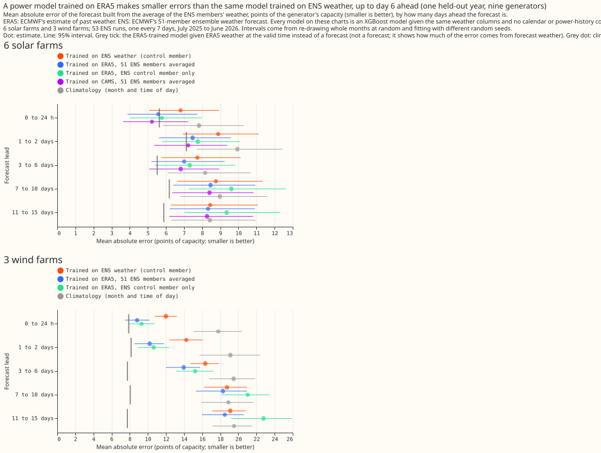
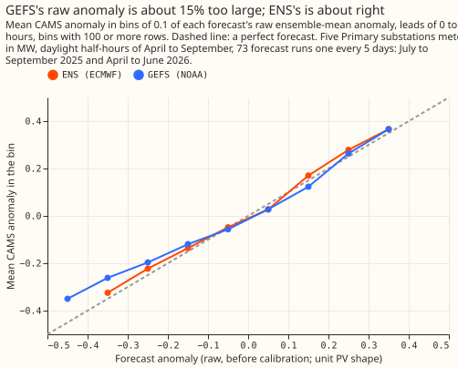
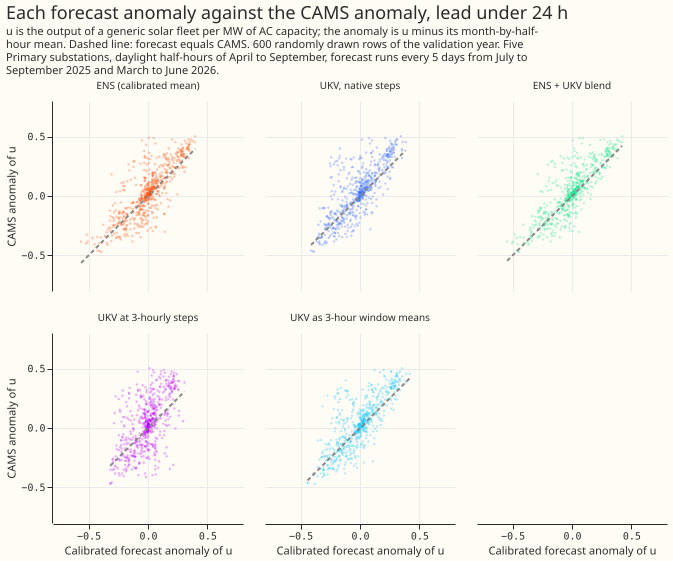
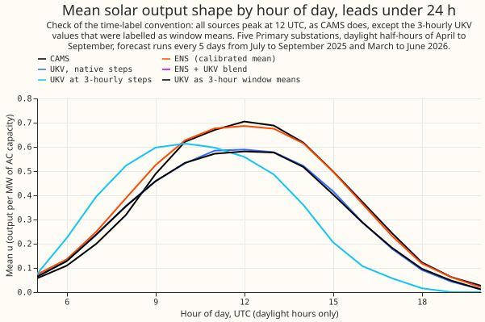

# Weather products and blending: which weather data improves the forecast

**The series found that training the weather-to-power model on estimates of past weather (ERA5)
helps solar and wind farms for the first 6 days ahead, and that most of the extra weather forecasts
tested added little or nothing on top of the ECMWF ensemble (ENS).** The series has nine
experiments.
The clearest gain from an extra forecast came from the Met Office's UKV for three wind farms, and
the
UKV data used came from a research archive that is not the live feed. The experiments scored solar
farms, wind farms, and Primary substations (substations that step power down to the local
distribution network).

- **What worked:** ERA5-trained XGBoost models beat ENS-trained XGBoost models for solar and wind
  farms up to day 6 (over all leads, wind farms 1.70 points of capacity better, solar farms 0.57
  points). UKV's wind lowered the
  wind-farm score by 0.198 points (95% interval -0.316 to -0.069) at 24 to 54 hours ahead.
- **What the series rules out:** GEFS as a replacement for ENS or as a blend partner for the
  sunshine forecast, a gain above about 0.16 points for Primary demand from ERA5 weather, and a gain
  above about 0.07 points from CAMS-trained irradiance. The test of ICON-EU and IFS 0.25 degree for
  wind was inconclusive on three farms.
- **What to try next:** a matched, live UKV history for the wind farms before any port, a source of
  a different kind (such as a satellite-based nowcast) for solar, and a rerun of the ICON-EU and IFS
  wind test with runs from the ENS run's own date and bias-corrected winds.

**Scores are in points, where 1 point is 1% of a series' capacity, and smaller is better.**
Experiments 1 and 3 use the mean absolute error of the ensemble-mean forecast. Experiments 9, 22,
52,
54, and 57 use the quantile score, which measures how well a forecast's range of likely power fits
what happened. Experiments 50 and 53 score a forecast of the sunshine anomaly (how much sunnier or
cloudier than normal a half-hour is) by its squared error and correlation with the satellite-based
CAMS estimate. Every figure is reused from a finished experiment write-up.

## What the data looks like

**Forecast error grows with lead time, and an XGBoost model given the weather that actually happened
scores
far better than any forecast.** The chart plots mean absolute error by lead band for ENS-trained
and ERA5-trained models, a climatology, and a model given ERA5 weather (not a forecast), for solar
and wind farms. Beyond day 6 the ERA5-trained model is within about 1 point of the climatology.
[Experiment
1](../../00001-era5-trained-stage1a-vs-ens-trained/result.md) drew the chart.

**The satellite-measured sunshine anomaly rises with the forecast anomaly, with a slope below 1 for
GEFS's raw anomaly.** Each panel bins the raw forecast anomaly and plots the mean CAMS anomaly in
each bin. The slope of the CAMS anomaly on the raw GEFS anomaly is 0.87 at 0 to 48 hours, so GEFS's
raw anomaly is about 15% too large, while the slope for ENS is 0.98 to 1.07. [Experiment
50](../../00050-second-weather-forecast-for-solar-anomaly/result.md) drew the chart.

**At leads under 24 hours, the UKV and ENS sunshine anomalies each follow the CAMS anomaly, and the
UKV scatter is wider than ENS's.** The scatter shows each calibrated forecast anomaly against the
CAMS
anomaly at five Primary substations. [Experiment
53](../../00053-ukv-vs-ens-solar-anomaly/result.md) drew the chart.

**CAMS, ENS, and UKV share the daily shape of solar output.** The chart plots the mean converted
solar output (`u`) by hour of day for each source at leads under 24 hours. [Experiment
53](../../00053-ukv-vs-ens-solar-anomaly/result.md) drew the chart.

## What the experiments found

**What worked: training on estimates of past weather gives a better solar and wind forecast than
training on archived forecasts, for the first 6 days ahead.** [Experiment
1](../../00001-era5-trained-stage1a-vs-ens-trained/result.md) trained one XGBoost model per series on
ERA5 and one on ENS weather, and gave both the same 51 ENS members. Over all leads the ERA5-trained
XGBoost model scored 15.39 against 17.09 for wind (difference -1.70, 95% interval -2.33 to -1.08)
and 7.67
against 8.25 for solar (-0.57, -0.83 to -0.32). The gain was material up to day 6 and not beyond.
The result stands on 6 solar farms, 3 wind farms, and one validation year.

**The same ERA5 training does not carry over to demand, and the long history is associated with most
of the loss.**
[Experiment 3](../../00003-era5-trained-stage1a-vs-ens-trained-demand/result.md) repeated the test on
22 series that are not wind or solar farms (16 of them Primary demand). The ERA5-trained XGBoost
model scored worse than the ENS-trained XGBoost model: +1.37 (+0.68 to
+2.17) with weather only. Starting the ERA5 history in 2023-09 instead of 2019 lowered the error by
1.32 points (-1.81 to -0.90), so the old years are associated with most of the loss, though the
experiment does not isolate the cause.

**A weather product as accurate as ERA5 would lower the Primary demand score by only 0.10 points, so
better
weather products have little to offer Primary demand.** [Experiment
22](../../00022-era5-weather-ceiling-primary-demand/result.md) swapped ENS weather for ERA5 weather in
the best demand forecast. The ENS arm scored 5.32 and the ERA5 arm 5.22: -0.10 (99.38% interval
-0.16 to -0.04). ERA5 shortwave radiation alone gave -0.08 (-0.13 to -0.04), so shortwave is the
column to test first for any second product. [Experiment
9](../../00009-cams-trained-stage1a-vs-era5-trained-demand/result.md) agreed: training on satellite
irradiance (CAMS) in place of ERA5 shortwave gave -0.035 (97.5% interval -0.070 to +0.001).

**A second global ensemble (GEFS) adds almost nothing to the sunshine forecast, so a source of a
different kind is the next candidate.** [Experiment
50](../../00050-second-weather-forecast-for-solar-anomaly/result.md) found that GEFS's cross-validated
squared error against the CAMS anomaly is 1.109 times ENS's, and a fitted blend's is 1.002 times,
against the 0.99 needed. On the validation year GEFS correlates 0.072 less than ENS at 0 to 24
hours (-0.100 to -0.039), and the blend 0.002 more (-0.001 to +0.006).

**UKV's wind lowers the wind-farm score by about 0.2 points at 1 to 2 days ahead, and the gain is a
ceiling because the UKV data are not the live product.** [Experiment
54](../../00054-product-trained-xgboost-wind-farms/result.md) gave an ENS-trained XGBoost model UKV's
wind as extra columns, trained on UKV's own history. The ENS-plus-UKV arm scored 5.921 against 6.119
for the ENS-only arm at 24 to 54 hours (-0.198, -0.316 to -0.069). A shuffled-UKV placebo showed no
gain (+0.013, -0.012 to +0.040). One farm gained clearly, one probably gained, and one did not.

**The same UKV test for solar farms could neither show a gain nor rule out a gain of 0.10 points.**
[Experiment
57](../../00057-product-trained-xgboost-solar-farms/result.md) scored -0.035 (-0.119 to +0.037) at 24
to 54 hours, a sixth of the wind gain. [Experiment
53](../../00053-ukv-vs-ens-solar-anomaly/result.md) found that a blend of UKV and ENS lowers the
cross-validated squared error of the sunshine anomaly by 7.6% over 0 to 54 hours, but the validation
year cannot confirm it (correlation gain +0.011, -0.006 to +0.027).

**Averaging the wind best guess with ICON-EU and IFS 0.25 degree forecasts did not resolve a gain.**
[Experiment 52](../../00052-more-nwp-products-for-wind-farms/result.md) scored the average at -0.055
(-0.200 to +0.072) at lead days 1 and 2, against a 0.15 threshold. The products' runs were about
half a day older than the ENS run, and their winds were not bias-corrected.

## What was tried

| Experiment | Question | Verdict | Headline number |
|---|---|---|---|
| [1](../../00001-era5-trained-stage1a-vs-ens-trained/result.md) | Does a model trained on ERA5 beat one trained on ENS, for solar and wind farms? | Supported up to day 6 | Wind -1.70 (-2.33 to -1.08), solar -0.57 (-0.83 to -0.32), mean absolute error over all leads |
| [3](../../00003-era5-trained-stage1a-vs-ens-trained-demand/result.md) | Does the ERA5-trained model beat the ENS-trained model on demand series? | Not supported | +1.37 (+0.68 to +2.17) with weather only; a 2023-09 start lowers the error by 1.32 (-1.81 to -0.90) |
| [9](../../00009-cams-trained-stage1a-vs-era5-trained-demand/result.md) | Does a stage 1a trained on CAMS irradiance beat one trained on ERA5 shortwave, for Primary demand? | Refuted | -0.035 (-0.070 to +0.001) against a planned 0.2 |
| [22](../../00022-era5-weather-ceiling-primary-demand/result.md) | How much would Primary demand gain from ERA5 weather in place of ENS weather? | Refuted | -0.10 (-0.16 to -0.04) against a planned 0.3; shortwave alone -0.08 (-0.13 to -0.04) |
| [50](../../00050-second-weather-forecast-for-solar-anomaly/result.md) | Does GEFS, alone or blended with ENS, forecast the sunshine anomaly better than ENS? | Refuted | GEFS squared error 1.109 times ENS's; the blend 1.002 times, against 0.99 needed |
| [52](../../00052-more-nwp-products-for-wind-farms/result.md) | Does averaging the wind best guess with ICON-EU and IFS 0.25 degree lower the wind score at 1 to 2 days? | Inconclusive | -0.055 (-0.200 to +0.072) against a 0.15 threshold |
| [53](../../00053-ukv-vs-ens-solar-anomaly/result.md) | Does the Met Office UKV, alone or blended with ENS, track the CAMS sunshine anomaly better than ENS? | Small gain (blend only) | Squared error 7.6% lower over 0 to 54 hours; validation correlation +0.011 (-0.006 to +0.027); UKV alone worse |
| [54](../../00054-product-trained-xgboost-wind-farms/result.md) | Does UKV, learned from its own history, help the wind-farm forecast at 1 to 2 days? | Small gain (ceiling) | -0.198 (-0.316 to -0.069) against a 0.15 target |
| [57](../../00057-product-trained-xgboost-solar-farms/result.md) | Does UKV, learned from its own history, help the solar-farm forecast at 1 to 2 days? | Inconclusive | -0.035 (-0.119 to +0.037) against a 0.10 target; a gain above 0.12 is ruled out |

## Related studies

**Studies under `docs/studies/` test the same products on other targets.** They are not part of the
table above, because a study is not an ml-experiment.

- [Extra IFS variables and a second forecast for solar
  power](../../../studies/forecasts/ifs-solar-variables.md)
- [Archived UKV forecasts added to ENS at wind and solar
  farms](../../../studies/forecasts/ukv-ceda-blends.md)
- [Which single weather forecast to add to ENS first](../../../studies/forecasts/blends-with-ens.md)
- [ERA5's other variables for same-hour solar
  output](../../../studies/past-weather/era5-solar-variables.md)
- [Whether blending past-weather products beats the best single
  product](../../../studies/past-weather/blending.md)

## What would change in production

**These experiments are flagged `candidate`, and none is adopted yet.** The flags are proposals for the maintainer to confirm.

- **[00001 - ERA5-trained stage 1, solar and wind, part 1](../../00001-era5-trained-stage1a-vs-ens-trained/result.md):** Train the weather-to-power model on ERA5 and apply it to ENS members. Needs the staged design, and helps only up to day 6.
- **[00014 - CAMS irradiance for demand, part 3](../../00014-cams-trained-stage1-with-stage0-ens-correction-demand/result.md):** Map the ENS shortwave onto CAMS (a stage 0 quantile mapping) before a CAMS-trained stage 1a reads it. The year's mean is corrected but individual months are up to 18.6% off, and the member spread widens by 27%.
