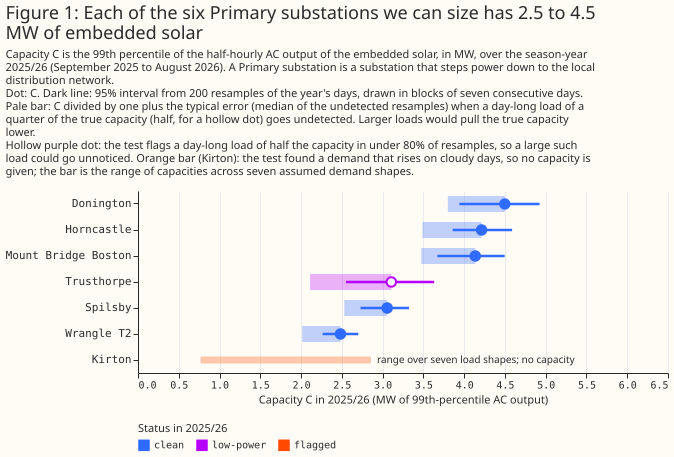
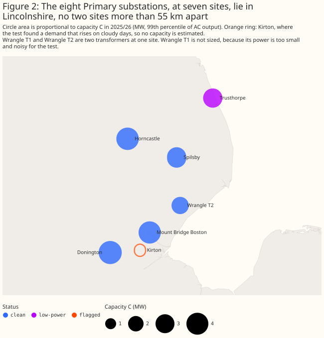
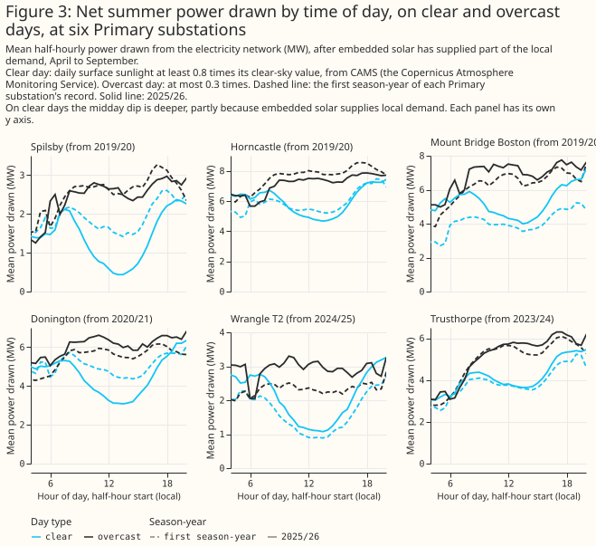
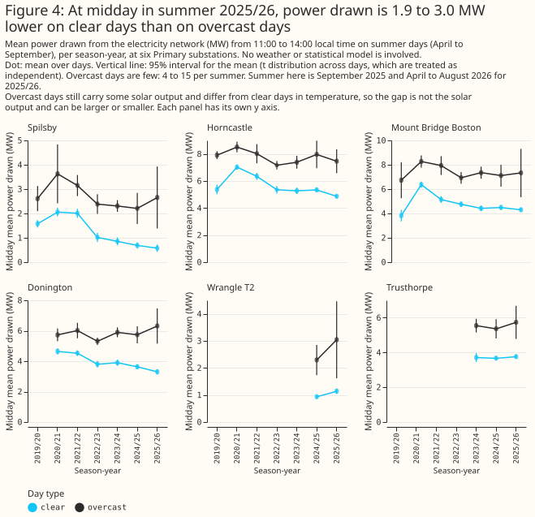
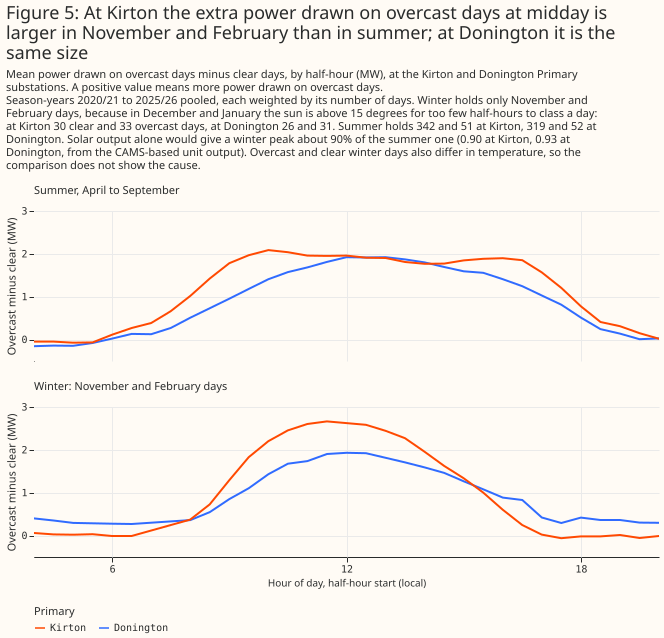
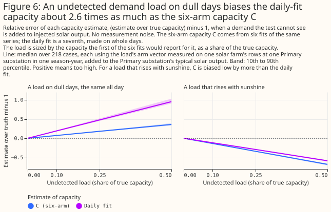
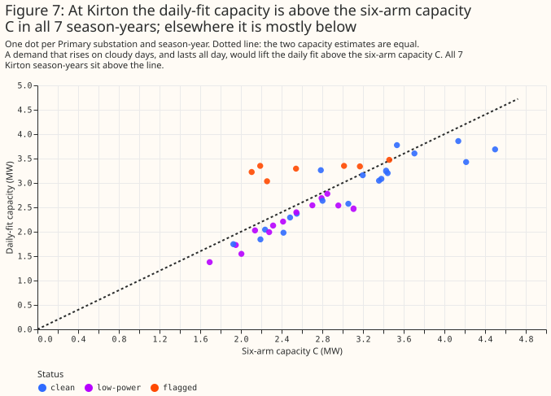
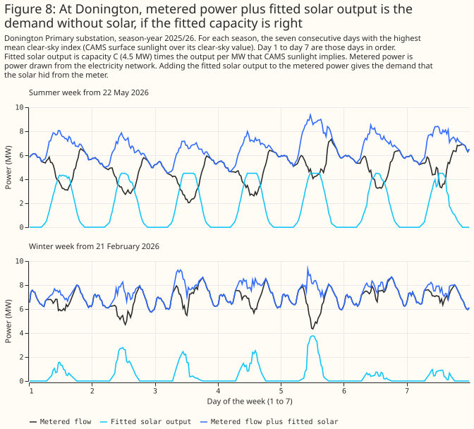
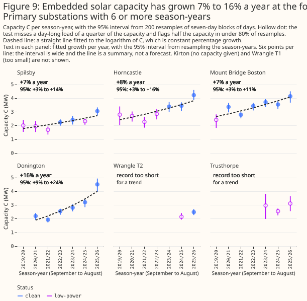

# Embedded solar behind six Lincolnshire Primary substations is 2.5 to 4.5 MW, and grew 7% to 16% a year

**Bottom line: in the season-year 2025/26, the embedded solar behind six of the eight Primary
substations metered in signed megawatts in our trial area has a capacity of 2.5 to 4.5 MW each.**
The 95% sampling interval of each capacity is about plus or minus 9% to 17%. At the four Primary
substations with 6 or more season-years of data, the capacity grew by 7% to 16% a year. Two further
errors can be larger than the sampling interval at some Primary substations: the step from six solar
farms to rooftop panels, and a cloud-driven demand that our test fails to detect. The page reports
the three errors separately.

**The page uses these terms.**

- **Primary substation.** A substation that steps power down to the local distribution network.
- **Season-year.** September to August, named by its September: 2025/26 is September 2025 to August
  2026.
- **Embedded solar.** Solar panels connected to the local distribution network, which National Grid
  Electricity Distribution (NGED) does not meter. They lower the power a Primary substation draws
  from the network on sunny days.
- **Capacity C.** The 99th percentile of the half-hourly AC output of the embedded solar, in MW. It
  is smaller than the installed DC capacity.
- **Cloud-driven demand.** Demand that is higher on overcast days, such as heating and lighting. It
  looks like lost solar output, so it makes the fitted capacity too high.
- **The test, flagged.** The test compares the capacities that six fits of the same demand series
  return. The six fits allow different amounts of cloud-driven demand, so they disagree when it is
  present. A season-year is flagged when they disagree by more than they do on solar-farm output
  added to the same Primary substation's demand.
- **Status.** `clean`: the test flags a day-long cloud-driven demand of half the capacity in at
  least 80% of simulated trials. `low-power`: it does not. `flagged`: the test found cloud-driven
  demand, so no capacity is given.



**The table gives each Primary substation's capacity C in 2025/26, its sampling interval, the bound
B on an undetected cloud-driven demand, and the daily fit as a cross-check.** The bound B is the
median error of C when a day-long cloud-driven demand goes undetected, read at the strength in
brackets (a multiple of the true capacity). The daily fit is a seventh capacity estimate, made on
whole days. The full table, one row per Primary substation and season-year, is in [a CSV
file](assets/embedded_pv_capacity_table.csv). Wrangle T1 is left out, because its power is too small
and noisy for the test.

<!-- capacity-table-start -->

| Primary substation | Status | Capacity C (MW) | 95% interval (MW) | Bound B (strength) | Daily fit over C |
|---|---|---|---|---|---|
| Donington | clean | 4.50 | 3.94 to 4.92 | 0.18 (0.25) | 0.82 |
| Horncastle | clean | 4.21 | 3.86 to 4.59 | 0.21 (0.25) | 0.81 |
| Mount Bridge Boston | clean | 4.14 | 3.67 to 4.50 | 0.19 (0.25) | 0.93 |
| Trusthorpe | low-power | 3.11 | 2.55 to 3.63 | 0.47 (0.5) | 0.80 |
| Spilsby | clean | 3.06 | 2.73 to 3.32 | 0.21 (0.25) | 0.84 |
| Wrangle T2 | clean | 2.48 | 2.26 to 2.70 | 0.23 (0.25) | 0.92 |
| Kirton | flagged | none | range 0.8 to 2.9 | not given | 1.53 |

<!-- capacity-table-end -->

**Can we say how much solar sits behind each Primary substation?** Yes for six, no for two.

- Six Primary substations have a capacity, with a 95% sampling interval of about plus or minus 9% to
  17% in 2025/26. Trusthorpe's interval is the widest.
- Kirton has none: the test flagged cloud-driven demand in 6 of its 7 season-years, so we give only
  the range of capacities that seven assumed demand shapes allow (0.8 to 2.9 MW in 2025/26).
- Wrangle T1 is left out, as above. The six, Kirton, and Wrangle T1 make the eight Primary
  substations metered in signed megawatts.

**Is the growth real?** Probably, at the four Primary substations with 6 or more season-years.

- The fitted growth is 7.3% a year at Spilsby, 7.8% at Horncastle, 7.4% at Mount Bridge Boston, and
  16.1% at Donington (Figure 9).
- The growth rate holds only if any hidden demand stays the same size in megawatts from year to
  year. Nothing here tests that.

**Can the estimates be used for forecasting?** We do not recommend it.

- In [experiment 00031](../ml-experiments/00031-embedded-pv-features-primary-demand/result.md),
  adding embedded-solar capacity estimates as a forecast input did not lower the forecast error
  averaged over all lead times. The irradiance the fits rest on also arrives too late for a live
  forecast.
- The capacity estimates are useful for explaining past demand and for ranking Primary substations
  by embedded solar.

**What do these data and methods support?** They support a table with three stated errors, built
from one trial area, six solar farms, and one irradiance product. The table does not support a
figure for any Primary substation outside the trial area. It does not support an estimate that is
independent of the ratios measured on the six solar farms (see Limitations).

> **How this page was made.** The research question came from a human. Everything else — the code
> behind every result, the analysis, the figures, and the text — was written by Claude,
> Anthropic's AI model (for this page, Claude Sonnet 5.5). Independent Claude reviewers have
> checked the method, the evidence, and the prose adversarially.

## Key findings

- **Two ways of estimating capacity disagree at Kirton and agree elsewhere.** At Kirton the daily
  fit is above C in all 7 season-years. At the 32 clean and low-power season-years of the other
  Primary substations it is below C in 30 ([Figure
  7](#the-two-capacity-estimates-agree-except-at-kirton)).
- **An undetected load on dull days would bias the daily fit about 2.6 times as much as C.** For
  that reason the page uses C as the capacity ([Figure
  6](#an-undetected-load-biases-the-estimates)).
- **In summer 2025/26 the raw data show midday power drawn 1.9 to 3.0 MW lower on clear days than on
  overcast days, but the gap is more than the solar output** ([Figure
  4](#the-clear-day-dip-is-visible-without-a-model)).
- **At Kirton the midday power drawn on overcast days exceeds clear days by more in November and
  February than in summer, which solar alone would not produce** ([Figure
  5](#kirtons-overcast-day-excess-is-larger-in-winter)).

## Introduction

**NGED meters its Primary substations but not the solar panels behind them.** The question is how
many megawatts of solar sit behind each Primary substation, how that number changed from 2019/20 to
2025/26, and how far each number can be trusted. The answer is useful for explaining past demand and
for ranking Primary substations. It is not a forecast input (see Discussion).

This page builds a table from two earlier experiments, with no new fitting. [Experiment
00039](../ml-experiments/00039-pv-disaggregation-cams-injection/result.md) fitted embedded-solar
capacity to the demand of the Primary substations, using CAMS irradiance (the Copernicus Atmosphere
Monitoring Service's satellite estimate of sunlight), and checked the fit on solar-farm output added
to demand. [Experiment 00040](../ml-experiments/00040-pv-capacity-error-bars/result.md) built the
test that compares six fits, and attached an error bar to the capacity where the test finds no
cloud-driven demand.

## Data and methods

**Primary substations.** The eight Primary substations metered in signed megawatts are in the table,
because solar output above local demand shows as negative flow there. Eight further Primary
substations are metered in megavolt-amperes, which folds that negative flow into positive demand, so
they are left out ([experiment
00039](../ml-experiments/00039-pv-disaggregation-cams-injection/result.md)).

**Six fits and a daily fit.** Each fit regresses a Primary substation's half-hourly power on
temperature, calendar terms, and CAMS-based solar output. The six fits differ in how much
cloud-driven demand each allows. For solar output of capacity C, fit *a* returns about R*a* times C.
The recovery ratio R*a* is that fit's measured ratio on the output of six solar farms added to the
demand. A cloud-driven demand breaks that proportionality. The misfit T measures how far the six
capacities depart from proportionality. The capacity C is the capacity that best matches the six
fits to their ratios. The daily fit is a seventh fit, made on whole days. The solar farms are
labelled A to F in the experiments, and none is drawn here.

**The test and its flag.** A season-year is flagged when T exceeds the 95th percentile of T on
solar-farm output added to the same Primary substation's demand. A Primary substation is flagged
when more than half its season-years are flagged. Every season-year of a flagged Primary substation
is flagged, because an unflagged year there is more likely a missed detection than a clean year.

**Intervals and the bound.** The 95% sampling interval of C is the 2.5th and 97.5th percentiles of C
over 200 resamples of the year's days in blocks of seven consecutive days. The interval holds the
recovery ratios fixed and ignores undetected loads, so it covers sampling noise in the days only.
The bound B is the median error of C when a day-long cloud-driven demand goes undetected. Its
strength is the largest on a grid of 0.1, 0.25, 0.5, and 1 times the true capacity at which the test
flags the demand in fewer than 80% of simulated trials (`bound_amplitude` in the table). The power
of the test at a strength is the share of trials it flags. For a `clean` season-year the test flags
a strength of 0.5 in at least 80% of trials and misses a strength of 0.25 (power 0.25 to 0.62 at
0.25). The median error of C at 0.25 is then 0.17 to 0.23. A `low-power` season-year also misses a
strength of 0.5, so the bound is read at 0.5 or 1. Both rules were fixed after the table of
experiment 00040 was seen, so they are post hoc choices.

**Planned and exploratory numbers.** Four checks were written in the plan before any output existed.
First, this page's C, flags, and bound reproduce experiment 00040's stored scores, and they do
exactly. Second, C is the headline capacity and the daily fit is a cross-check. Third, growth rates
are fitted per Primary substation with at least 6 season-years. Fourth, Kirton gets no capacity.
Every other number is exploratory. The page does no significance test and does not correct for
multiple comparisons.

## Results

### The Primary substations lie within 55 km of each other

**The eight Primary substations lie in one trial area, 54.7 km across at the widest.** Kirton and
Donington are neighbours.



### The clear-day dip is visible without a model

**At Spilsby the clear-day midday power drawn fell from 1.58 MW in 2019/20 to 0.58 MW in 2025/26. At
Donington it fell from 4.65 MW in 2020/21 to 3.29 MW in 2025/26.** A clear day has CAMS irradiance
of at least 0.8 times its clear-sky value, and an overcast day at most 0.3 times. The other four
Primary substations have shorter records or a smaller change, so the dip is not deeper at every one.



**In summer 2025/26 the midday power drawn is 1.9 to 3.0 MW lower on clear days than on overcast
days.** The gap includes the solar output and the extra heating and lighting on overcast days, so it
overstates the solar. At Donington the gap rose from 1.09 MW in 2020/21 to 3.02 MW in 2025/26, and
at Spilsby from 1.03 MW in 2019/20 to 2.08 MW in 2025/26. At Horncastle and Mount Bridge Boston it
was 2.5 and 2.9 MW in 2019/20 and 2.6 and 3.0 MW in 2025/26.



### Kirton's overcast-day excess is larger in winter

**At Kirton the midday power drawn is higher on overcast days than on clear days by 2.67 MW at most
in winter and 2.09 MW at most in summer. At Donington the figures are 1.93 MW and 1.92 MW.** Solar
output is far lower in winter, so a larger winter gap points to a cloud-driven demand. The test
flags Kirton for the same reason, so Kirton gets no capacity. The winter sample is thin. At 53
degrees north the sun stays below 15 degrees in December and January, so only November and February
days can be classed. Kirton has 30 clear and 33 overcast days in the pool, and Donington has 26
clear and 31 overcast days. Cold overcast days also raise demand at both Primary substations, so the
comparison does not show that cloud-driven demand is the cause.



### An undetected load biases the estimates

**An undetected load that is the same on every daylight half-hour of a dull day, at 25% of the true
capacity, makes C 18% too high and the daily fit 48% too high.** A load that rises with sunshine
does the opposite, making C 34% too low and the daily fit 29% too low. The test misses both kinds of
load. The error sizes come from 218 simulations in which a known load was added to noise-free data,
so real errors will be larger.



### The two capacity estimates agree except at Kirton

**The daily fit is usually below C at the clean and low-power Primary substations.** Over their 32
season-years the daily fit divided by C has a median of 0.92 (10th to 90th percentile 0.81 to 0.98),
and exceeds 1 in only 2. At Kirton the median is 1.30, and the ratio exceeds 1 in all 7
season-years. A day-long cloud-driven demand would push the ratio above 1. There are two readings of
the 0.92 at the clean Primary substations. In the first, there is no large day-long cloud-driven
demand. In the second, the solar farms' daily-fit ratio overstates a rooftop fleet's by 8% to 20%.
The data cannot tell the two readings apart. This check was made after the table of experiment 00040
was seen, so it is post hoc.



### Adding the fitted solar back gives a plausible demand but cannot test the capacity

**In Donington's clearest summer week, metered power plus the fitted solar output averages 7.8 MW
from 11:00 to 14:00 and 6.5 MW from 19:00 to 22:00.** The week is the seven consecutive days with
the highest mean clear-sky index (CAMS irradiance over its clear-sky value), starting on 22 May
2026. If the fitted capacity of 4.5 MW is right, demand at Donington is higher at midday than in the
evening. If the capacity is too high, the sum shows an artificial midday bump. The figure cannot
decide between the two.



### The capacity grew 7% to 16% a year

**A straight line fitted to the logarithm of C against season-year gives 7.3% a year at Spilsby,
7.8% at Horncastle, 7.4% at Mount Bridge Boston, and 16.1% at Donington.** Spilsby, Horncastle, and
Mount Bridge Boston have 7 season-years of data, and Donington has 6. The 95% interval from
resampling season-years is 3.1% to 14.1% at Spilsby, 3.2% to 16.1% at Horncastle, 2.8% to 10.7% at
Mount Bridge Boston, and 8.5% to 23.7% at Donington. An interval from the bootstrap draws alone
holds the sampling noise only, and is narrower: 4.1% to 11.0% at Spilsby and 13.7% to 19.4% at
Donington. The daily fit gives 8.6%, 6.0%, 8.2%, and 16.5%, so the choice of estimator moves a rate
by at most 2 points.

**Donington's rate rests on one jump, and the fitted line is a summary and not a forecast.** The
capacity rose from 3.2 to 4.5 MW in the last season-year, and without that year the rate is 12.0%.
Low-power season-years are in every fit. The status of a season-year flips between clean and
low-power as the power estimate changes (Spilsby's 2021/22 is low-power and its 2022/23 is clean),
so hollow dots alternate along one trend.



## Discussion: what to use

**Use the table to explain past demand and to rank Primary substations by embedded solar and its
growth.** If a Primary substation's capacity matters to a decision, quote its three errors and not
one combined interval.

**Do not use the table as a forecast input.** Experiment 00031 found no gain from embedded-solar
capacity estimates averaged over all lead times, and CAMS irradiance arrives too late for a live
forecast.

**Three errors apply, and the page does not combine them into one interval.**

1. **Sampling.** The 95% sampling interval of C is about plus or minus 9% to 17% in 2025/26. Across
   all 33 clean and low-power season-years the half-width over C has a median of 10%, with a 10th to
   90th percentile of 8% to 21%.
2. **Transfer from solar farms to rooftop fleets.** The recovery ratios come from six metered solar
   farms. The ratio of C to the known injected farm output has a median of 0.99, with a 10th to 90th
   percentile of 0.84 to 1.10. One farm's median is 0.83 and the others' are 0.96 to 1.05. A daily
   fit over C of 0.92 at the clean Primary substations suggests that a rooftop fleet may differ from
   the farms by about 10%.
3. **Undetected demand.** The bound B on C is 0.18 to 0.23 at the five clean Primary substations in
   2025/26 and 0.47 at Trusthorpe. A load that rises with sunshine would make C too low, by 14% at a
   strength of 0.1 and 34% at 0.25. These data cannot measure the size of either a day-long
   cloud-driven demand or a load that rises with sunshine.

**A comparison with outside statistics would test the table against an independent source.** The
Embedded Capacity Register and the national small-scale solar statistics list capacity by area. The
comparison would need each Primary substation's service area from NGED.

## Proposed follow-up study

**Compare the capacities with the Embedded Capacity Register by service area.** This study produced
a table whose three errors are all stated. An outside source could test the transfer from farms to
rooftops, and could give a starting estimate for Kirton. The comparison would need NGED's service
areas for each Primary substation, and no download. The case against: the register lists installed
capacity (DC), and our capacity is a 99th percentile of AC output, so the comparison needs a
conversion that adds its own error.

## Limitations

- **A fleet of rooftop panels with the same orientation as the solar farms is assumed.** The
  recovery ratios come from six solar farms in Lincolnshire, and the estimate moves with the fleet's
  orientation mix, which none of these data measure.
- **One trial area and one irradiance product.** CAMS irradiance drives every fit.
- **The capacity is the 99th percentile of half-hourly AC output**, not the installed DC capacity,
  which is larger.
- **Detection power is low for a day-long load, even at a clean Primary substation.** In experiment
  00040 the test flagged such a load at 25% of the true capacity in 35% of simulated trials (median
  over the eight Primary substations). In this table the power at that strength is 37% to 49% at the
  five clean Primary substations in 2025/26, and 21% at Trusthorpe.
- **Kirton, Wrangle T1, and the Primary substations metered in megavolt-amperes are left out**, for
  the reasons above.
- **The status rules are post hoc.** Their thresholds were fixed after the table of experiment 00040
  was seen.
- **The table rests on the stored fits of experiment 00040.** This page refits nothing, so every
  flaw of those fits carries over.
- **The overcast-day figures use few days.** Each Primary substation has 4 to 15 overcast summer
  days a season-year.

## Scope

The page covers the eight Primary substations metered in signed megawatts in the trial area, from
2019/20 to 2025/26. It says nothing about other Primary substations, battery storage, or weather
products other than CAMS irradiance.

## Data and code availability

The stored fit results and the CAMS-based table come from experiments 00039 and 00040, whose inputs
are NGED's private telemetry and the public CAMS irradiance. The study code is in
[`studies/embedded_pv_capacity/`](https://github.com/openclimatefix/nged-substation-forecast/tree/main/studies/embedded_pv_capacity),
and the shared test is in `packages/studies/src/studies/pv_capacity_misfit.py`. No solar farm is
named or drawn. The code is at the commit of the pull request that merged this page.

## Reproducing the figures

```bash
export POLARS_MAX_THREADS=2 OMP_NUM_THREADS=2 OPENBLAS_NUM_THREADS=2
uv run python studies/embedded_pv_capacity/build_capacity_table.py
uv run python studies/embedded_pv_capacity/build_raw_gaps.py
uv run python studies/embedded_pv_capacity/capacity_charts.py
```

The scripts print every number on this page into `report.md` and `raw_gaps_report.md` in
`data/studies/per_study/embedded_pv_capacity/`.
