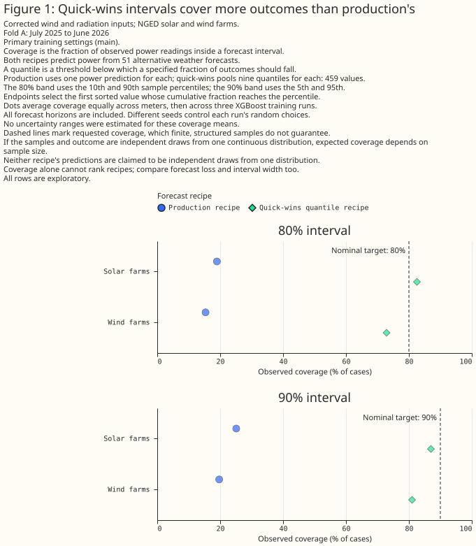

# How well calibrated are the corrected XGBoost forecasts?

## Summary

**The quantile recipe has lower delivered-sample loss in both folds at the primary training
settings.** This separate Part 2 study of issue 1156 also compares forecast coverage and width.
Pooling has an unresolved nine-level loss effect in Fold A and a small supported improvement in
retrospective Fold B. Alternative training settings and final scientific and prose reviews remain
pending. These draft results support no calibration or production recommendation.



> **How this page was made.** The research question came from a human. OpenAI Codex wrote the new
> study code, analysis and text. An independent AI review checked the first results; final
> scientific and prose reviews remain pending. Human review of the page is pending.

## Introduction

**The question is whether the corrected models describe uncertainty as well as they predict
power.** An interval labelled 80% should contain observations at its stated rate under an
appropriate interpretation of the forecast distribution. Coverage alone is insufficient: an
interval can cover more observations simply by becoming wider.

This study uses saved forecasts from the
[wind/radiation and lean-input study](fixed-pipeline-lean-features.md). It compares refits of the
production configuration and the quick-wins quantile winner. The best point refit was not run
because the parent study's preregistered material-effect gate was not reached. The intended reader
is a forecast maintainer deciding which calibration questions deserve a subsequent experiment.

## Data and methods

### Inputs and comparisons

**Only completed fits using both wind and radiation corrections are eligible.** The parent study
documents the exact features, parameters, preprocessing and frozen inputs. Wind components in the
migrated archive are reconstructed from rounded polar values, rather than lossless upstream
components. Forecast hashes, sample counts, targets, capacities and keys must agree with their
recorded provenance before comparisons proceed. Missing recipes or fitting seeds remain pending.

Fold A trains on April 2024–June 2025 and scores July 2025–June 2026. Fold B reverses those windows
and provides retrospective robustness evidence. The intended fitting seeds are 0, 1 and 2;
observed power from July 2026 onward is excluded.

A *planned* contrast was specified in the study plan before results existed; other comparisons
are *exploratory*. The three planned contrasts compare the quantile winner with the production
configuration, with the best point recipe, and with its own control weather member. The last
comparison requires unambiguous recovery of the control member's quantile levels. Subgroup,
source-era and rearrangement diagnostics are exploratory. Intervals describe individual paired
contrasts; they do not adjust for multiple comparisons or establish a family-wide significance
claim. Coverage differences remain descriptive.

### Samples, quantile knots and scores

**Delivered samples and fitted quantile knots have different meanings.** The point recipe delivers
51 predictions, one per weather member. The quantile winner fits nine levels, 0.1 through 0.9,
for each member and pools the resulting 459 values. These are structured predictions, without an
established interpretation as independent scenarios. The control member's nine fitted values
retain their nominal probability labels.

For delivered samples, the common score is twice mean pinball loss at the 19 midpoint probabilities
`(i - 0.5) / 19`, for `i = 1, …, 19`. Pinball loss measures error at a specified quantile, with
different penalties above and below it. After sorting the sample, its empirical inverse CDF uses
zero-based rank `ceil(n * q) - 1`. Each row's loss is divided by its frozen capacity before series
receive equal weight. Frozen effective capacity is the full-history 99th percentile of absolute
observed power; it can use readings after the study cutoff. It enters scoring only, and makes
normalised loss and width retrospective and conditional on that common snapshot. Losses and
widths are percentages of frozen effective capacity; coverage is a percentage of cases. Negative
bias means underprediction. These are study diagnostics, not official leaderboard scores.

The control comparison uses a separate nine-level pinball score at its supported nominal levels.
Native 80% coverage uses the 0.1 and 0.9 knots: both endpoint inequalities must hold, so inverted
endpoints fail coverage and retain signed width. Crossings and their extent are reported before
rearrangement. Sorting the knots and reassigning the same levels is a separately labelled
exploratory variant. Neither variant supplies the 0.05 and 0.95 knots needed for native 90%
coverage or a justified full CDF; those diagnostics remain pending.

### Marginal diagnostics and uncertainty

Delivered 80% and 90% coverage, widths, signed error, ensemble-mean absolute error, spread and
level-specific pinball losses are examined overall, by series type and by lead bands below
72 hours, 72 to below 264 hours, and 264 hours onward. Coverage is interpreted alongside width
and loss.

The empirical-CDF diagnostic at observation `y` is
`(count(values < y) + 0.5 * count(values == y)) / n`, without randomisation. For continuous
independent identically distributed samples and an independent outcome from the same distribution,
its no-tie reference is equal mass at `k/n`, for `k = 0, …, n`, rather than a continuous uniform
histogram. Under those assumptions, an interval with one-based endpoint ranks `L` and `U` has
reference coverage `(U - L) / (n + 1)`. These finite-sample references are no guarantee for either
delivered construction, particularly the fixed quantile pool. No independent-sample reference is
applied to the nine control knots. Histogram shape cannot identify the cause of miscalibration.

The reported difference averages three fitting seeds, with equal weight per series. Each of 2,000
uncertainty draws resamples whole valid-time calendar months and selects one shared fitting seed
for the compared forecasts. Its central 95% range describes month and individual-fit variation;
it is not a confidence interval for the mean of a three-fit ensemble. The separate equal-month
t-interval first averages the seeds within each month and then estimates variation between months.
Reports also show months favouring each loss contrast, seed spread and support counts.
The parent study uses the same bootstrap method with a different deterministic resample sequence;
small differences between its interval endpoints and these reflect Monte Carlo variation.
Fewer than three seeds or six months makes a comparison provisional. If a draw contains no
supported months for a series, that series is omitted from that draw and the remaining series
receive equal weight. Reports expose month support and the frequency and extent of these
omissions; an interval does not remove the limitation of sparse support.

## Results

**Both folds are complete for production and the quantile recipe at the primary training
settings.** Each fold uses fitting seeds 0, 1 and 2 for both corrected-pipeline recipes. Fold B
provides retrospective robustness evidence. Alternative training settings remain pending. The
conditional best point comparison was not run because the preregistered gate was not reached.

**Production delivers 51 weather-member point predictions; the quantile recipe delivers a pool
of 459 fitted values.** The quantile pool combines nine fitted levels from each of 51 weather
members. The control member retains nine labelled quantile knots, which are not nine independent
draws. No independent-sample reference is applied to those control knots.

**The rank table gives conditional analytic references, not measured coverage or calibration
guarantees.** For lower and upper one-based endpoint ranks `L` and `U`, reference coverage is
`(U - L) / (n + 1)` only for continuous independent identically distributed samples and an
independent outcome from the same distribution. Neither delivered recipe is asserted to satisfy
those assumptions; the structured quantile pool in particular has no such guarantee. Observed
coverage must therefore be read with the delivered construction and interval width.

| Sample count | Nominal coverage (% of cases) | Lower endpoint rank (one-based) | Upper endpoint rank (one-based) | Analytic continuous iid coverage (% of cases) |
|---|---|---|---|---|
| 51 | 80.000 | 6 | 46 | 76.923 |
| 51 | 90.000 | 3 | 49 | 88.462 |
| 459 | 80.000 | 46 | 414 | 80.000 |
| 459 | 90.000 | 23 | 437 | 90.000 |

### Fold A: primary settings

**The quantile recipe improves the shared nineteen-level pinball score in Fold A main, while
the effect of pooling on the separate nine-level score remains unresolved.** Completed results
compare `production` with the quantile recipe `r2_e1_c1_a3w_d3`, using fitting seeds 0, 1 and 2.
Each fit contributes 1,070,930 supported forecast rows across 31 series and 12 scored months.
Every series has all 12 months, and no uncertainty draw drops a series. The second hyperparameter
setting remains pending. The conditional comparison with `r2_c4_c2_c1_a3w_d3` was not run because
the preregistered gate was not reached.

**The quantile recipe's lower delivered-sample loss is supported across all 12 months in this
fold (planned).** Its nineteen-level score is 7.756% of frozen effective capacity, against
11.479% for production. The paired difference is -3.723 percentage points of frozen capacity,
with a central 95% month/individual-fit range of [-4.059, -3.382]. The separate equal-month
t-interval also lies below zero. Both recipes use the corrected pipeline; the recipe contrast
does not isolate the effect of the wind or radiation corrections.

**Coverage rises alongside much wider delivered intervals.** In the tables, `coverage80` and
`coverage90` mean the percentage of cases inside intervals labelled 80% and 90%; `width80`,
`width90`, bias and pinball loss are percentages of frozen effective capacity. Negative bias
means underprediction. Production's coverage describes empirical intervals made from weather-member
point predictions. The coverage increase alone does not establish better calibration.

| Recipe | Metric | Value (%) |
|---|---|---|
| production | pinball19 | 11.479 |
| production | bias | -2.041 |
| production | coverage80 | 11.654 |
| production | coverage90 | 15.312 |
| production | width80 | 4.069 |
| production | width90 | 5.341 |
| r2_e1_c1_a3w_d3 | pinball19 | 7.756 |
| r2_e1_c1_a3w_d3 | bias | -0.786 |
| r2_e1_c1_a3w_d3 | coverage80 | 71.617 |
| r2_e1_c1_a3w_d3 | coverage90 | 75.549 |
| r2_e1_c1_a3w_d3 | width80 | 26.698 |
| r2_e1_c1_a3w_d3 | width90 | 29.389 |

**Solar coverage exceeds the 80% label but falls below the 90% label; wind coverage falls below
both labels (exploratory).** For the quantile pool, solar (`PV`) coverage is 82.561% and 86.996%,
with respective widths of 20.550% and 23.044% of frozen capacity. Wind coverage is 72.872% and
81.004%, with widths of 42.060% and 50.097%. The two interval labels therefore need separate
interpretations, and the type-specific widths matter when reading coverage.

| Recipe | Generation type | Metric | Value (%) |
|---|---|---|---|
| production | PV | coverage80 | 18.950 |
| production | PV | coverage90 | 25.101 |
| production | PV | width80 | 4.122 |
| production | PV | width90 | 5.379 |
| production | Wind | coverage80 | 15.355 |
| production | Wind | coverage90 | 19.682 |
| production | Wind | width80 | 9.855 |
| production | Wind | width90 | 12.984 |
| r2_e1_c1_a3w_d3 | PV | coverage80 | 82.561 |
| r2_e1_c1_a3w_d3 | PV | coverage90 | 86.996 |
| r2_e1_c1_a3w_d3 | PV | width80 | 20.550 |
| r2_e1_c1_a3w_d3 | PV | width90 | 23.044 |
| r2_e1_c1_a3w_d3 | Wind | coverage80 | 72.872 |
| r2_e1_c1_a3w_d3 | Wind | coverage90 | 81.004 |
| r2_e1_c1_a3w_d3 | Wind | width80 | 42.060 |
| r2_e1_c1_a3w_d3 | Wind | width90 | 50.097 |

**Pooling has an unresolved nine-level loss effect relative to the native control knots
(planned).** Pooled minus native loss is -0.028 percentage points of frozen capacity, with a
central 95% month/individual-fit range of [-0.072, 0.012]; pooling has lower loss in 6 of 12
months. The separate equal-month t-interval also includes zero. Pooled 80% coverage is lower
than native coverage (71.617% versus 73.922%), and the pooled interval is narrower (26.698%
versus 28.223% of frozen capacity). Neither the loss uncertainty nor the descriptive
coverage/width change establishes that pooling improves calibration. The nine-level scores
must be read separately from the delivered nineteen-level scores.

**Native and rearranged control results agree because no saved control knots cross
(exploratory).** Zero crossings and zero invalid intervals are observed properties of these
saved predictions, without a general guarantee for future forecasts. `crossing_rate` and
`invalid_interval_rate` are percentages of cases. Native and rearranged control 90% coverage
remain pending because the required endpoint knots were not fitted.

| Distribution variant | Metric | Value (%) |
|---|---|---|
| control_native | pinball9 | 8.344 |
| control_native | coverage80 | 73.922 |
| control_native | width80 | 28.223 |
| control_native | crossing_rate | 0.000 |
| control_native | invalid_interval_rate | 0.000 |
| pooled_nine | pinball9 | 8.316 |
| pooled_nine | coverage80 | 71.617 |
| pooled_nine | width80 | 26.698 |
| pooled_nine | crossing_rate | 0.000 |
| pooled_nine | invalid_interval_rate | 0.000 |
| control_rearranged | pinball9 | 8.344 |
| control_rearranged | coverage80 | 73.922 |
| control_rearranged | width80 | 28.223 |
| control_rearranged | crossing_rate | 0.000 |
| control_rearranged | invalid_interval_rate | 0.000 |

**The paired loss table separates the supported recipe improvement from the unresolved pooling
effect.** Treatment is `r2_e1_c1_a3w_d3` throughout; differences are treatment minus reference,
so negative values favour treatment. “Capacity points” means percentage points of frozen
effective capacity. The printed 95% intervals are the month/individual-fit ranges described
above. The delivered and native-control contrasts are planned; the rearranged-control contrast
is exploratory. Sensitivity confirmation remains pending; the retrospective Fold B results follow.

| Treatment variant | Reference recipe | Reference variant | Pinball metric | Difference (capacity points) | 95% interval lower (capacity points) | 95% interval upper (capacity points) | Months with lower loss |
|---|---|---|---|---|---|---|---|
| delivered | production | delivered | pinball19 | -3.723 | -4.059 | -3.382 | 12 |
| pooled_nine | r2_e1_c1_a3w_d3 | control_native | pinball9 | -0.028 | -0.072 | 0.012 | 6 |
| pooled_nine | r2_e1_c1_a3w_d3 | control_rearranged | pinball9 | -0.028 | -0.072 | 0.012 | 6 |

### Retrospective Fold B: primary settings

**The quantile recipe retains its delivered-sample loss advantage in retrospective Fold B
(planned).** Its nineteen-level score is 8.745% of frozen effective capacity, against 12.179%
for production. The paired difference is -3.435 percentage points of frozen capacity, with a
central 95% month/individual-fit range of [-3.959, -2.981]. Loss is lower in all 15 scored
months, and the separate equal-month t-interval also lies below zero. Fold B trains on the later
window and scores the earlier window, so the agreement provides retrospective evidence rather
than a simulated deployment result.

**Fold B's all-series estimate includes incomplete month support for two demand series.** Each
fit contributes 1,326,430 supported forecast rows across 31 series and 15 scored months; series
support ranges from 5 to 15 months. Two of the 2,000 uncertainty draws omit one series because
none of that series' supported months is drawn. The remaining series receive equal weight in
those draws. This diagnostic's resample sequence differs from the parent study's sequence, so
the omission count need not match the parent's report.

| Recipe | Metric | Value (%) |
|---|---|---|
| r2_e1_c1_a3w_d3 | pinball19 | 8.745 |
| r2_e1_c1_a3w_d3 | bias | 1.988 |
| r2_e1_c1_a3w_d3 | coverage80 | 70.424 |
| r2_e1_c1_a3w_d3 | coverage90 | 74.393 |
| r2_e1_c1_a3w_d3 | width80 | 26.338 |
| r2_e1_c1_a3w_d3 | width90 | 29.170 |
| production | pinball19 | 12.179 |
| production | bias | 2.576 |
| production | coverage80 | 10.992 |
| production | coverage90 | 14.415 |
| production | width80 | 4.051 |
| production | width90 | 5.360 |

**Fold B solar coverage is above the 80% label and below the 90% label; wind remains below
both labels (exploratory).** Quantile-pool solar coverage is 80.442% and 84.946%, with respective
widths of 19.432% and 22.249% of frozen capacity. Wind coverage is 72.069% and 80.378%, with
widths of 42.205% and 50.882%. Coverage is a percentage of cases; widths, bias and losses in
these tables are percentages of frozen effective capacity. The observed coverage and width
changes do not establish better overall calibration.

| Recipe | Generation type | Metric | Value (%) |
|---|---|---|---|
| r2_e1_c1_a3w_d3 | PV | coverage80 | 80.442 |
| r2_e1_c1_a3w_d3 | PV | coverage90 | 84.946 |
| r2_e1_c1_a3w_d3 | PV | width80 | 19.432 |
| r2_e1_c1_a3w_d3 | PV | width90 | 22.249 |
| r2_e1_c1_a3w_d3 | Wind | coverage80 | 72.069 |
| r2_e1_c1_a3w_d3 | Wind | coverage90 | 80.378 |
| r2_e1_c1_a3w_d3 | Wind | width80 | 42.205 |
| r2_e1_c1_a3w_d3 | Wind | width90 | 50.882 |
| production | PV | coverage80 | 17.100 |
| production | PV | coverage90 | 22.489 |
| production | PV | width80 | 3.959 |
| production | PV | width90 | 5.211 |
| production | Wind | coverage80 | 14.840 |
| production | Wind | coverage90 | 19.246 |
| production | Wind | width80 | 9.594 |
| production | Wind | width90 | 12.775 |

**Pooling shows a small nine-level loss improvement in Fold B, while Fold A's effect remains
unresolved (planned).** Pooled minus native loss is -0.047 percentage points of frozen capacity,
with a central 95% month/individual-fit range of [-0.083, -0.016] and lower loss in 10 of 15
months. The separate equal-month t-interval also lies below zero. Pooled 80% coverage is lower
than native coverage (70.424% versus 72.746%), alongside a narrower interval (26.338% versus
27.905% of frozen capacity). The small loss gain does not establish improved calibration from
pooling. The nine-level comparison remains separate from the delivered nineteen-level score.

**Native and rearranged control results again agree because the saved control knots do not
cross (exploratory).** Crossing and invalid-interval rates are percentages of cases. Their
observed zeros provide no guarantee for future forecasts. Control 90% coverage remains pending.

| Distribution variant | Metric | Value (%) |
|---|---|---|
| control_native | pinball9 | 9.351 |
| control_native | coverage80 | 72.746 |
| control_native | width80 | 27.905 |
| control_native | crossing_rate | 0.000 |
| control_native | invalid_interval_rate | 0.000 |
| control_rearranged | pinball9 | 9.351 |
| control_rearranged | coverage80 | 72.746 |
| control_rearranged | width80 | 27.905 |
| control_rearranged | crossing_rate | 0.000 |
| control_rearranged | invalid_interval_rate | 0.000 |
| pooled_nine | pinball9 | 9.304 |
| pooled_nine | coverage80 | 70.424 |
| pooled_nine | width80 | 26.338 |
| pooled_nine | crossing_rate | 0.000 |
| pooled_nine | invalid_interval_rate | 0.000 |

**The Fold B paired table preserves the distinct loss comparisons and their uncertainty.**
Treatment is `r2_e1_c1_a3w_d3` throughout; negative differences favour treatment. Capacity
points and the printed 95% intervals retain the definitions used for Fold A. The delivered and
native-control contrasts are planned; the rearranged-control contrast is exploratory.

| Treatment variant | Reference recipe | Reference variant | Pinball metric | Difference (capacity points) | 95% interval lower (capacity points) | 95% interval upper (capacity points) | Months with lower loss |
|---|---|---|---|---|---|---|---|
| delivered | production | delivered | pinball19 | -3.435 | -3.959 | -2.981 | 15 |
| pooled_nine | r2_e1_c1_a3w_d3 | control_native | pinball9 | -0.047 | -0.083 | -0.016 | 10 |
| pooled_nine | r2_e1_c1_a3w_d3 | control_rearranged | pinball9 | -0.047 | -0.083 | -0.016 | 10 |

## Discussion

**No calibration or production recommendation follows from this draft.** The useful question is
whether changes in coverage also improve loss without relying on excessive width. Both primary-setting
folds favour the quantile recipe's delivered loss. Pooling's small nine-level improvement is supported
in retrospective Fold B and unresolved in Fold A. Alternative training settings and final scientific
and prose reviews remain pending before any recommendation. Marginal performance cannot establish
coherent scenarios across sites or forecast times.

## Proposed follow-up study

A separately planned calibration screen could test whether held-out-month calibration improves
on the matched `manual_heuristic` baseline. It would fit on eleven scored months and evaluate the
twelfth without using it to select parameters. Its value depends on the diagnostic findings;
little reproducible improvement or inadequate support would argue against proceeding.

For planning only, assume about one day of agent work, one hour of maintainer review and up to
one CPU-day on the existing workstation, with no new downloads or spend. These are rough
assumptions, not measured costs or an execution commitment. Measured scoring throughput is needed
before proposing execution. This draft passes neither the issue's G5 calibration gate nor its
G9 gate for later ensemble-statistic experiments.

## Limitations

The quick-wins winner was selected using Fold A, so this comparison is not an independent repeat
of that selection. Fold B is retrospective and does not simulate a deployment trained only on
earlier data. Shared weather episodes, frozen capacities, missing targets and sparse month
support limit interpretation beyond the observed period and population.

Source-era summaries use recorded weather initialisation times before or from
13 November 2024 at 00:00 UTC, the archive's precipitation-availability boundary. This is distinct
from the operational cycle change. Different seasons and training exposure prevent a causal
upgrade interpretation. The separate comparison around 12 May 2026 at 06:00 UTC remains pending;
inventorying that boundary does not verify a cycle effect.

## Scope

This stage examines saved-prediction marginal distributions. Training-versus-validation coverage,
cross-fitted training forecasts, spread rescaling, EMOS, residual-quantile and isotonic calibration
remain pending. Validation forecasts cannot substitute for matching training predictions, and
coverage alone neither proves nor rules out overfitting.

Joint energy and variogram scores, scenario reordering, weather-cell or hierarchy sums and the
issue's later model experiments remain outside this stage. There is no coherence claim, forecast
contract change, production code change or evaluation of observed power from July 2026 onward.

## Data and code availability

The study-local scorer is `studies/forecast_calibration/calibration_diagnostics.py`. Forecasts,
power observations, fit manifests and detailed provenance remain private under the study's data
namespace. Public evidence is restricted to aggregate tables and figures without site identifiers,
names or coordinates. Exact input/output hashes, code revision, dependency versions, XGBoost
settings and completed-run inventory must be supplied with the results; none is inferred from
this draft.

<!-- PROVENANCE -->

## Reproducing the figures

**The first coverage figure uses the completed Fold A main report.** The following is a scoring
command template, not the exact completed command. Variables must point to verified, matching completed
fits for one fold and setting, and a new output directory; omit a missing point fit and report it
as pending rather than substituting an older pipeline.

```bash
.venv/bin/python studies/forecast_calibration/calibration_diagnostics.py \
  --frames "$COMBINED_FRAMES" \
  --fit "$PRODUCTION_FIT" "$QUANTILE_FIT" "$POINT_FIT" \
  --output "$NEW_DIAGNOSTIC_OUTPUT"
```

The scorer writes aggregate diagnostic tables, sample semantics and a manifest. Exact completed
commands, figure-generation code and rendering instructions remain pending, along with scientific,
first-reader and prose review of the completed page.
