# Do wind and radiation fixes improve XGBoost forecasts, and which lean inputs help?

> **Completed study on frozen PR revisions.** Pipeline, lean-feature and robustness comparisons,
> requested minimal-feature experiments, figures and independent scientific reviews are complete.
> The final merged radiation revision has not been scored. On 14 October 2026, the maintainer
> stopped further model fitting and validation to publish the completed findings.
> The results below therefore answer the frozen-revision comparison only.

This study compares two changes to the weather-feature pipeline and revisits the lean solar and
wind inputs in Part 1b of [issue 1156](https://github.com/openclimatefix/nged-substation-forecast/issues/1156).
It follows the [feature-fault diagnostic audit](production-feature-faults.md) and
[quick wins](quick-wins.md), using the latter study's winning configuration alongside a
refit of the production XGBoost configuration. Production here means the training recipe fitted
on the study's historical data, rather than a deployed model artifact.

**The evaluated radiation correction consistently improves solar forecasts; correcting wind
processing does not establish a general forecast improvement.** Across both historical folds
and both training settings, radiation-only processing lowers solar loss, and the combined
corrections lower overall and solar loss within each reference recipe. Wind-only processing
worsens wind-farm loss in retrospective Fold B. Its Fold A effects remain unresolved.

The quick-wins winner retains a substantially lower common pinball score than the refitted
production configuration on the corrected inputs. This compares whole training recipes and
cannot be credited to the processing fixes. Lower loss also does not establish adequate interval
coverage; the separate [Part 2 study](calibration-diagnostics-1156.md) examines that question.
These are weekly-initialisation diagnostics for a fixed population, with a retrospective capacity
denominator. The original lean-wind improvement persists across the completed settings and
controls. The requested two-input solar set improves on the full-input point control in both
folds and settings. The requested five-input wind set improves on that control, but does not
establish an improvement on the original 16-input lean-wind set.

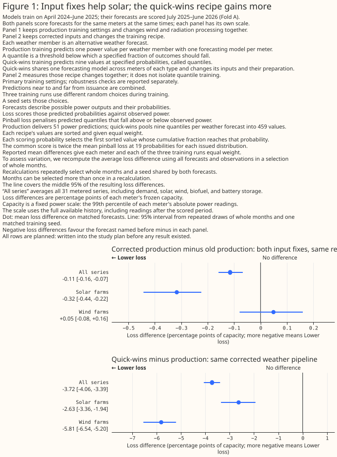

The figure evaluates the frozen implementations; it does not score the final merged radiation revision.

> **How this page was made.** A human supplied the research question. OpenAI Codex wrote this
> study's new code, analysis and text, using existing repository study machinery. Independent
> AI scientific, evidence and prose reviews informed the report. Human review of this page
> has not been completed.

## Key findings

- **The evaluated radiation revision consistently helps solar.** With the production configuration, its
  main-setting common pinball difference is -0.337 capacity points in Fold A (95% paired
  month-and-seed interval -0.473 to -0.236) and -0.346 in retrospective Fold B (-0.498 to -0.237).
  Both sensitivity settings also support lower solar loss. These comparisons cover six solar
  series and three fitting seeds, over 12 validation months in Fold A and 15 in Fold B.
- **Wind processing has no established general loss benefit.** Wind-only effects remain
  unresolved under the primary bootstrap in Fold A. For the three wind series in retrospective
  Fold B, wind-only processing increases common pinball loss by 0.194 capacity points in the
  main setting (0.002 to 0.470) and 0.121 in sensitivity (0.048 to 0.204). The combined corrections
  also worsen wind loss in Fold B sensitivity; their wind effects remain unresolved in the
  other fold/settings.
- **The winner's advantage is a recipe difference.** On corrected inputs, its all-series common
  pinball difference from refitted production is -3.723 capacity points in Fold A's main setting
  (-4.059 to -3.392) and -3.435 in Fold B's main setting (-3.936 to -2.982). Both sensitivity
  settings retain the advantage. The exact winner uses nine quantiles, pooling, forecast lead,
  lean wind inputs and training-only scaling, without early stopping. These contrasts do not
  isolate any one ingredient or establish adequate coverage.
- **The conditional best-point refit was not run.** Neither fold passes G3's preregistered
  0.15-capacity-point magnitude gate on main-setting production fair CRPS. Statistical
  significance alone does not pass that gate. The original lean-feature checks are complete;
  the requested minimal-feature fits and robustness reports are also complete.

## Introduction

[PR 1166](https://github.com/openclimatefix/nged-substation-forecast/pull/1166) reconstructs
half-hourly radiation from the means over the intervals ending at the weather timestamps.
The measured radiation treatment is its frozen revision `0f094c3`; the final merged `01ddf53`
changes short-wave shaping and support validation. Its forecast performance is outside the
completed comparison.
[PR 1167](https://github.com/openclimatefix/nged-substation-forecast/pull/1167) interpolates wind
components before deriving speed and bearing. This avoids interpolating a bearing through south
when it crosses north. Interpolating components also changes intermediate wind speeds, so the
wind comparison measures the joint speed-and-bearing processing change. The four treatments
are the old pipeline, radiation corrected, wind
corrected, and both corrected. Every comparison refits the same recipe on matched training keys
and scores matched forecasts against the same observed power and frozen capacities.

The wind archive was reconstructed from rounded archived speed and bearing. Its validation checks
that reconstruction against the archived values; it does not establish lossless recovery of
upstream components. The wind comparison includes the component migration and its storage
quantisation as well as component interpolation; native wind values can differ slightly too.
These two PRs address wind and radiation processing. They do not resolve every
fault listed in issue 1156. Guarding the windchill formula's temperature and speed domain is a
separate study-only comparison.

## Data and methods

### Reference recipes

The production recipe uses 500 trees, depth 6, learning rate 0.05, row subsampling 0.8 and column
subsampling 0.8. It fits one model per series through the public production training and prediction
methods. The quick-wins winner is `r2_e1_c1_a3w_d3`: nine-quantile training, a forecast-lead feature,
lean wind inputs and one pooled model per series type. It retains numeric site identifiers,
training-only per-series scaling, column subsampling 1 and the historical fitting method. It adds
no early stopping, analogues or calibration.

The production reference and the Part 1b control are different recipes. The latter keeps the
historical quick-wins fitting path, settling filter and full columns, with column subsampling
set to one. It provides a common control for the feature comparisons; its score must not be
labelled the public production configuration's score.

| Recipe | Training groups | Objective | Training path | Column subsampling | Scaling |
|---|---|---|---|---|---|
| Production configuration | One per series | Squared error | Public production methods, quantile data matrix | 0.8 | Production preprocessing |
| Part 1b full-input control | One per series | Squared error | Historical quick-wins data matrix | 1 | Historical preprocessing |
| Quick-wins winner | One pooled fit per series type | Nine quantiles, 0.1–0.9 | Historical quick-wins data matrix | 1 | Per-series training-only scaling |

The pooled winner adds a numeric Float32 series identifier after feature preparation. The
identifier is a feature, rather than a categorical encoding. It uses 26 trained columns for
solar and demand and 18 for wind; the per-series full-input controls use 24. Feature comparisons
within Part 1b retain 24 columns by duplicating retained columns, and their unpadded checks are
reported separately.

### Data and target support

The all-series estimates cover 31 metered series, including demand, solar, wind, biofuel and battery
storage. Feature comparisons target the six solar farms (`PV`) and three wind farms (`Wind`).
Rows below are unique target-supported forecast cases per seed; ensemble members
are not additional cases. Both treatments in a paired comparison use these same observations.
Fold A has complete month support. In Fold B, two demand series lack some months; three of the
2,000 bootstrap draws omit a series when its supported months are not drawn. The all-series
bootstrap then averages the remaining represented series. Solar and wind retain complete support.

#### Target-supported validation rows: Fold A

| Series type | Series | Forecast cases per seed | Fitting seeds | Validation months |
|---|---|---|---|---|
| all | 31 | 1070930 | 3 | 12 |
| PV | 6 | 175795 | 3 | 12 |
| Wind | 3 | 107121 | 3 | 12 |

#### Target-supported validation rows: Fold B

| Series type | Series | Forecast cases per seed | Fitting seeds | Validation months |
|---|---|---|---|---|
| all | 31 | 1326430 | 3 | 15 |
| PV | 6 | 253003 | 3 | 15 |
| Wind | 3 | 135921 | 3 | 15 |

### Scoring and uncertainty

The main comparison between recipes uses twice the mean pinball loss at the same 19 midpoint
probabilities for every issued distribution. Pinball loss measures whether a forecast quantile is
too high or too low, with the penalty set by its probability. Each loss is divided by that series'
frozen effective capacity before aggregation. This scale is the 99th percentile of absolute power
over the available history, shared by all recipes. It is a measured historical scale rather than a
connection rating. The frozen snapshot includes readings after the scored periods, so normalised
aggregate results are retrospective and conditional on that common scale. The scale enters
scoring only; pooled fitting uses a separately calculated training-only scale. Lower is better;
a difference of one point means one percentage point of capacity. This finite-grid score is a
study diagnostic, rather than the
official leaderboard score or an exact integral of continuous ranked probability score (CRPS).

The original study's fair CRPS is retained for reproduction and comparisons within the same
sample construction. Its sample-size correction assumes independent draws. The winner instead
crosses nine fixed quantile predictions with 51 weather members to make 459 values, so fair CRPS
cannot decide its comparison with a 51-value point-model ensemble. The main score sorts each
issued sample and uses empirical inverse-CDF rank `ceil(n*q)-1`, without extrapolating tails.
Coverage is the fraction of observations inside the specified interval; width and coverage alone
do not rank forecast quality.

Each estimate gives equal weight to each series and fitting seed. Paired intervals resample whole
validation months and one shared seed 2,000 times. The bootstrap represents variation across
validation months and an individual fitted seed; the central estimate averages the three observed
seeds. The separately reported t-interval gives months equal weight and averages the three fitted
seeds within each month before estimating variation across months. It does not include fitting-seed
variation in the same way as the bootstrap. Three seeds, a second hyperparameter setting and a
retrospective second fold provide robustness checks. An unresolved interval does not establish
that an effect is zero.

Fold A trains from April 2024 through June 2025 and validates from July 2025 through June 2026.
Fold B reverses these periods and is retrospective evidence. The original quick-wins selection
already used Fold A, so refitting its winner on that year is reproduction, rather than a new
independent confirmation. Validation uses weekly weather initialisations and all 51 members;
these scores must not be presented as official leaderboard results. All fitting targets, power-lag
observations and scored outcomes precede 1 July 2026. Score normalisation uses a separately frozen
effective-capacity table: each series' full-history
99th percentile of absolute observed power. That table can include observations after the study
cutoff. It is shared across treatments and does not enter fitting or prediction. Lags are checked
to precede forecast issuance.

Planned contrasts were written into the study plan before results existed; other analyses are
exploratory, and additions after results are labelled post hoc. The month-resampled intervals
cover weather-month variation and fitting seed, not generalisation to different generators.
There is no multiple-comparison correction: a null exploratory contrast has a nominal
5% chance of statistical significance at the 5% level. The number of false findings is unknown,
and shared months can make false findings cluster.

### Rebuilding the lean inputs

The feature comparisons use the cleaned 51-member point-model recipe, with 500 trees and column
subsampling 1. Deterministic duplicate columns keep the input width equal at 24 per series type;
with every column available to each tree, this controls random column availability. A separate
unpadded lean check tests sensitivity to that construction. The exact production and quick-wins
reference refits remain unpadded.

The [feature inventory](fixed-pipeline-feature-inventory.md) prints every configured recipe's
ordered inputs and duplicate padding. Solar retains 13 real inputs and removes 11 from the
production list; wind retains 16 and removes eight. Those removals include three weekday
columns for each type. The registry also lists conditional recipes that were not necessarily run.

For solar, the starting cut removes weather-regime proxies and weekday columns while retaining
power lags. The planned cumulative ladder adds 10 m wind speed, pressure, 500 hPa height, longwave
radiation and its temperature-adjusted residual, then replaces the clock features with sun
position. It stops at the first step whose three-seed mean solar gain is below 0.15 points. A gain
above that threshold only permits the next step; a recommendation also needs the uncertainty,
month consistency, second fold and sensitivity checks.

For wind, each removed radiation, dewpoint, precipitation-type, annual-cycle and weekday column
is added separately. Removing the weekday ordinal and local UTC offset provides negative controls.
The windchill domain guard is tested separately on the full and lean inputs. Total cloud cover
waits for the full post-introduction year required by the issue; this study does not evaluate it.

### Input audit

The input audit compares engineered columns on matched rows, counts changed values and missingness,
and checks domain and timing diagnostics. A deliberately delayed radiation input tests whether the
correlation diagnostic moves by an hour. That synthetic recovery does not establish power to
detect a forecast-loss improvement. Precipitation availability eras have different seasons and
training exposure, so their comparison is descriptive rather than a causal upgrade effect.

### Requested minimal-feature extension

**Five fixed feature sets form a separate post hoc extension.** The five feature sets were requested
after the original results and do not continue the stopped solar ladder. The five feature sets
inherit the historical cleaned per-series point recipe; untargeted series retain its full inputs.
None of the five
targeted sets includes power lags, calendar fields, a site identifier, or windchill. The
[generated inventory](fixed-pipeline-feature-inventory.md#requested-post-hoc-feature-sets)
prints their exact ordered real and trained columns. PV means photovoltaic in the solar result
labels.

| Result label / saved recipe | Target | Real input count | Exact real input columns, in fitted order |
|---|---|---|---|
| PV2 / `solar_minimal_requested` | Solar | 2 | `downward_short_wave_radiation_flux_surface`, `temperature_2m` |
| PV11 / `solar_expanded_requested` | Solar | 11 | `categorical_precipitation_type_surface`, `clear_sky_irradiance`, `dew_point_temperature_2m`, `downward_long_wave_radiation_flux_surface`, `downward_short_wave_radiation_flux_surface`, `precipitation_surface`, `sun_east`, `sun_north`, `sun_up`, `temperature_2m`, `wind_speed_10m` |
| Wind5 / `wind_minimal_requested` | Wind | 5 | `temperature_2m`, `wind_direction_100m`, `wind_direction_10m`, `wind_speed_100m`, `wind_speed_10m` |
| Wind9 u/v / `wind_minimal_uv_requested` | Wind | 9 | `temperature_2m`, `wind_direction_100m`, `wind_direction_10m`, `wind_speed_100m`, `wind_speed_10m`, `wind_u_100m`, `wind_u_10m`, `wind_v_100m`, `wind_v_10m` |
| Wind7 circular / `wind_minimal_circular_requested` | Wind | 7 | `temperature_2m`, `wind_direction_100m_cos`, `wind_direction_100m_sin`, `wind_direction_10m_cos`, `wind_direction_10m_sin`, `wind_speed_100m`, `wind_speed_10m` |

**The result labels count real input columns, while padding identifies the trained width.**
PV2, PV11, Wind5, Wind9 u/v, and Wind7 circular name exactly the columns in this table in every
requested-feature result and importance plot. The primary comparisons and both hyperparameter
settings append deterministic duplicates of each set's own columns to reach 24 trained columns;
the duplicates add no new measurements. The main-setting unpadded checks use exactly 2, 11, 5, 9,
and 7 trained columns respectively. The generated inventory prints the padding names and
complete trained order. These five targeted sets contain no unlisted lags, calendar fields,
windchill, or series identifiers.

**Full 24 and original lean Wind16 identify separate reference input sets.** Full 24 is
`production_cleaned`, the Part 1b point control defined above, rather than the production
configuration or the pooled quick-wins winner. Original lean Wind16 is `lean_wind`. The recipe
retains
`geopotential_height_500hpa`, `local_time_of_day_cos`, `local_time_of_day_sin`,
`local_utc_offset_minutes`, `power_lag_168h`, `power_lag_24h`, `power_lag_336h`, `power_lag_48h`,
`pressure_reduced_to_mean_sea_level`, `pressure_surface`, `temperature_2m`,
`wind_direction_100m`, `wind_direction_10m`, `wind_speed_100m`, `wind_speed_10m`, and `windchill`,
in that order, followed by eight duplicate columns in equal-width comparisons. The
[complete reference inventory](fixed-pipeline-feature-inventory.md) also prints Full 24's exact
columns and the production and pooled-winner recipes. A guarded-reference label changes the
reference's windchill calculation; the input columns stay fixed.

Expanded solar's seven weather fields are temperature, dewpoint, 10 m wind speed, downward
long-wave and short-wave radiation, precipitation rate, and precipitation type. Sun position
uses the existing apparent zenith and azimuth at the midpoint of the half-hour ending at valid
time. Three dimensionless components are `east = sin(zenith) * sin(azimuth)`,
`north = sin(zenith) * cos(azimuth)`, and `up = cos(zenith)`. The vertical component stays
negative below the horizon. Clear-sky irradiance is Haurwitz global horizontal irradiance
averaged at 30 one-minute midpoints over that preceding half-hour, in W/m². Clear-sky irradiance is
a deterministic model estimate, rather than measured irradiance or tilted-panel output.
Time and the fixed coordinates are known before forecast issuance; observed power is not used.

For each wind height, the component representation uses `u = -speed * sin(bearing)` and
`v = -speed * cos(bearing)`, after converting the meteorological bearing from degrees to radians.
The circular representation instead supplies the bearing's sine and cosine without raw
bearings or u/v. Both wind representations derive from the corrected, processed polar values, so the
representations add no weather information and do not recover native upstream components.
Calculations use Float64 and
stored additions use Float32; nulls propagate without zero imputation or input-dependent
row filtering. The augmented frames preserve every original column and copied support artifact.

The extension specifies seven deciding post hoc contrasts: each solar set versus full inputs,
expanded versus minimal solar, minimal wind versus full and original lean wind, and each
alternative wind representation versus minimal wind. Seven additional comparisons are
exploratory. Both folds, both training settings, and three seeds are retained. Equal-width fits
duplicate each set's own retained columns to 24; main-setting unpadded fits and direct
padded-minus-unpadded contrasts assess padding dependence. Targeted comparisons against
guarded full inputs, and against guarded original lean wind for the wind sets, assess dependence
on those references' windchill handling. The new sets omit windchill; their guard comparisons
reuse target predictions only after proving prepared-input invariance.

Fair CRPS is the deciding score for these matched 51-value point forecasts. The same paired
month-and-seed intervals, separate equal-month t-intervals, support counts, and unadjusted
multiple-comparison limitations apply. These post hoc results are not independent confirmation
on untouched folds. No new automatic adoption threshold or further feature search is specified.
Training gain is the reduction in squared-error fitting loss credited to an input when a tree
splits the training data. For each fitted model, duplicate columns return their credit to the
original input, and each input's gain share is its credit divided by the total credit.
Five descriptive gain-importance figures show main and sensitivity settings separately and include
zero-gain inputs. Their ranges describe variability across refits, rather than confidence intervals
or evidence that an input helps.

## Results

### Reproducing the old-pipeline references

These three-seed refits provide the matched old-pipeline references. `old_production` is the
production configuration, `old_quick_wins` is the named pooled quantile winner, and `old_cleaned`
is the cleaned point-model baseline used for the feature comparisons.
The [reproduction tables](fixed-pipeline-results-tables.md#old-pipeline-reproduction) were
selected and formatted directly from the aggregate report by the publication-table script.
The earlier page's headline comparison used commissioning cleaning and column subsampling 1;
that is the cleaned baseline here. The production-configuration row instead preserves column
subsampling 0.8 and the public production fitting path. Their difference is not a pipeline-fix effect.

The earlier study's quoted 57% coverage came from its standalone `e1_quantile` model on seed 0.
The headline winner also pooled series, added lead and used lean wind inputs. Its coverage is
measured separately here. A difference from the old quoted coverage cannot be credited to the
wind or radiation fixes; their effect requires the matched old-versus-corrected winner contrast.
The historical interval convention also differed from the empirical inverse-CDF convention here.

### Radiation correction improves the solar score in both folds (provisional)

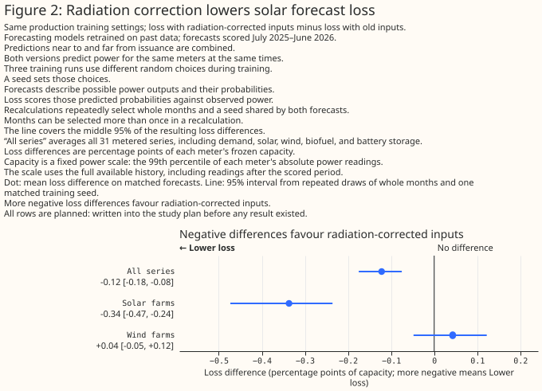

With the production configuration refitted, the radiation-only correction lowers solar's common
pinball score in both folds and both hyperparameter settings. The paired month-and-seed intervals
are statistically significant at the 5% level in all four comparisons. Solar's score improves in
every validation month in these comparisons. Wind's bootstrap intervals include both improvement
and deterioration in both settings and folds. In Fold B's main setting, the equal-month t-interval
favours deterioration. The point estimates agree in direction, but the intervals use different
weighting and treatment of fitting-seed variation, so the wind conclusion remains unresolved.

These planned contrasts subtract the old pipeline's common pinball score from the
radiation-only pipeline's score. Negative differences favour the correction. Loss differences
are percentage points of capacity; the bounds are paired month-and-seed intervals. `PV` means
solar farms. Fold A has 12 validation months and Fold B has 15. Other loss measures are retained
in the aggregate reports; the [radiation tables](fixed-pipeline-results-tables.md#radiation-comparisons)
show the common score used for the recipe comparison.

### Both corrections lower overall loss in the first fold

**Fold A's main setting shows a modest pipeline improvement alongside a much larger recipe
difference.** The combined wind and radiation corrections lower the all-series common pinball loss
by 0.115 capacity points within both the production configuration and the quick-wins winner. The
corrected winner's 3.723-point advantage over corrected production compares different training
recipes. That comparison changes the objective, pooling, features, and preprocessing together; it
cannot isolate the effect of quantile training or be credited to the pipeline corrections. These
combined-pipeline results apply to the frozen revisions. The sensitivity settings and
retrospective Fold B results follow the Fold A main results.

**The absolute scores keep the pipeline and recipe comparisons separate.** `old_production` and
`combined_production` use the production configuration; `old_winner` and `combined_winner` use the
quick-wins recipe. `combined` means both processing corrections. The deciding table below and
[Fold A appendix tables](fixed-pipeline-results-tables.md#fold-a-main) reproduce the report's
printed aggregate selections without recalculation. All loss differences use the same
19-level score and are in percentage points of frozen capacity. Negative differences favour the
treatment named first.

[Absolute scores](fixed-pipeline-results-tables.md#fold-a-main).

**Both corrections improve overall and solar loss within each recipe in Fold A's main setting,
while the wind effect remains unresolved.** For production, the all-series difference is
-0.115 points (95% interval -0.159 to
-0.067), and solar's difference is -0.317 (-0.443 to -0.224). For the winner, the corresponding
differences are -0.115 (-0.155 to -0.082) and -0.287 (-0.414 to -0.184). These paired improvements
are statistically significant at the 5% level in this fold and setting. Wind's production difference
is 0.049 (-0.079 to 0.160), and the winner's is -0.006 (-0.017 to 0.003). Both wind intervals allow
improvement and deterioration.

#### Deciding comparisons on common 19-level pinball loss: July 2025–June 2026, main setting

| Comparison | Series type | Loss difference (capacity points) | 95% lower | 95% upper | Months with lower loss |
|---|---|---|---|---|---|
| Both corrections minus old pipeline | all | -0.115 | -0.159 | -0.067 | 11 |
| Both corrections minus old pipeline | PV | -0.317 | -0.443 | -0.224 | 12 |
| Both corrections minus old pipeline | Wind | 0.049 | -0.079 | 0.160 | 2 |
| Both corrections on quick-wins winner | all | -0.115 | -0.155 | -0.082 | 12 |
| Both corrections on quick-wins winner | PV | -0.287 | -0.414 | -0.184 | 12 |
| Both corrections on quick-wins winner | Wind | -0.006 | -0.017 | 0.003 | 8 |
| Corrected quick-wins winner minus corrected production configuration | all | -3.723 | -4.059 | -3.392 | 12 |
| Corrected quick-wins winner minus corrected production configuration | PV | -2.631 | -3.356 | -1.940 | 12 |
| Corrected quick-wins winner minus corrected production configuration | Wind | -5.810 | -6.544 | -5.202 | 12 |

**The wind correction alone has no resolved loss effect in this fold and setting.** With the
production configuration, the wind-only difference is 0.005 points overall (95% interval -0.033 to
0.064) and -0.019 for wind farms (-0.117 to 0.080). Adding the wind correction after radiation is
corrected also leaves overall and wind effects unresolved. The intervals do not establish that the
wind correction has zero effect.

[Pipeline-isolation comparisons](fixed-pipeline-results-tables.md#fold-a-main).

In Fold A's main setting, the primary bootstrap remains unresolved for adding wind processing
after radiation on solar farms and for adding radiation processing after wind on wind farms.
Their equal-month t-intervals instead favour deterioration: 0.028 points (0.004 to 0.053) and
0.067 points (0.027 to 0.107), respectively. These intervals weight months and fitted seeds
differently, so the primary bootstrap conclusions remain unresolved.

**The interaction between the processing corrections remains unresolved.** The interaction subtracts
the radiation-only and wind-only scores from the combined score and adds the old-pipeline score. The
all-series interaction is 0.002 capacity points (95% interval -0.083 to 0.061). Solar and wind
interactions also remain unresolved. An interaction measures departure from additive correction
effects; the count of months with negative interaction is not a count of months with lower forecast
loss.

[Wind–radiation interaction](fixed-pipeline-results-tables.md#fold-a-main).

**The cleaned feature baseline also gains overall and for solar, with wind unresolved.** Both
corrections lower its all-series common pinball score by 0.147 points (95% interval -0.201 to
-0.079) and its solar score by 0.337 points (difference -0.337; -0.447 to -0.251). The wind
difference is 0.045 (-0.054 to 0.177). The cleaned baseline uses the historical point-model fitting
path and column subsampling one, so this comparison supports the feature-study control rather than
replacing the production-configuration comparison.

[Cleaned-control comparison](fixed-pipeline-results-tables.md#fold-a-main).

**Fold A does not pass the G3 material-fault threshold.** G3 uses the fair-CRPS comparison between
the matched 51-member production ensembles and requires an absolute change of at least 0.15 capacity
points. Fold A's three-seed fair-CRPS difference is -0.118 points, below that magnitude. The
separate equal-month mean is -0.124, with a month t-interval of -0.174 to -0.074: statistically
significant at the 5% level, but statistical significance does not satisfy the material-size
requirement. Fold B also falls below the threshold, as shown below; the material-fault gate is
not reached in either fold, so the conditional best-point refit is not triggered.

[G3 material-fault gate](fixed-pipeline-results-tables.md#fold-a-main).

### Both corrections lower overall loss in retrospective Fold B (provisional)

**Fold B supports modest overall and solar improvements within each recipe, alongside a larger
recipe difference.** Both corrected production and the corrected quick-wins winner have lower
common pinball loss than their old-pipeline counterparts overall and for solar. Their paired
95% intervals lie below zero. In this main setting, the combined corrections' wind effects
remain unresolved for both recipes. The winner's advantage over production again compares
whole recipes rather than
isolating the processing corrections. Fold B is retrospective; its sensitivity results follow
below. These pipeline comparisons support no feature recommendation.

[Absolute scores](fixed-pipeline-results-tables.md#fold-b-main-retrospective).

#### Deciding comparisons on common 19-level pinball loss: April 2024–June 2025 (retrospective), main setting

| Comparison | Series type | Loss difference (capacity points) | 95% lower | 95% upper | Months with lower loss |
|---|---|---|---|---|---|
| Both corrections minus old pipeline | all | -0.054 | -0.093 | -0.016 | 13 |
| Both corrections minus old pipeline | PV | -0.332 | -0.467 | -0.218 | 15 |
| Both corrections minus old pipeline | Wind | 0.159 | -0.082 | 0.431 | 4 |
| Both corrections on quick-wins winner | all | -0.080 | -0.116 | -0.043 | 13 |
| Both corrections on quick-wins winner | PV | -0.180 | -0.265 | -0.104 | 14 |
| Both corrections on quick-wins winner | Wind | 0.006 | -0.003 | 0.015 | 5 |
| Corrected quick-wins winner minus corrected production configuration | all | -3.435 | -3.936 | -2.982 | 15 |
| Corrected quick-wins winner minus corrected production configuration | PV | -2.916 | -3.496 | -2.332 | 15 |
| Corrected quick-wins winner minus corrected production configuration | Wind | -6.680 | -8.045 | -5.357 | 15 |

**Wind-only processing worsens wind's score in Fold B's main setting, while adding wind
processing after radiation remains unresolved.** The wind-only wind-farm interval lies above
zero; the conditional wind-after-radiation interval includes both improvement and deterioration.
The wind-only finding differs from Fold A's unresolved comparison; Fold B's sensitivity setting
also supports deterioration, as reported below. The primary bootstrap interaction intervals include
zero for every reported type. Negative loss
differences favour the treatment named first; all pinball differences are percentage points of
frozen capacity.

[Pipeline-isolation comparisons](fixed-pipeline-results-tables.md#fold-b-main-retrospective).

Fold B's main setting also has interval-method disagreements. The equal-month t-intervals
favour deterioration for wind-only processing across all series, both corrections on wind farms,
and wind processing after radiation across all series: 0.027 points (0.011 to 0.042),
0.159 (0.038 to 0.279), and 0.038 (0.015 to 0.060). The wind interaction has a negative equal-month
estimate of -0.152 (-0.266 to -0.039), while its primary bootstrap interval includes zero.
This interaction measures departures from additivity of losses; it does not establish a forecast
improvement from adding wind processing. The primary bootstrap remains unresolved for these
comparisons.

[Wind–radiation interaction](fixed-pipeline-results-tables.md#fold-b-main-retrospective).

**The cleaned feature baseline also improves overall and for solar in Fold B's main setting.**
Its wind interval remains unresolved. This pipeline comparison does not decide which feature
cuts or additions help; those require their own matched held-out tests.

[Cleaned-control comparison](fixed-pipeline-results-tables.md#fold-b-main-retrospective).

**Neither fold reaches G3's preregistered material-size threshold, so the conditional best-point
refit is not run.** Fold B's fair-CRPS difference is -0.0572 capacity points, with a separate
equal-month mean of -0.0534 and a month t-interval of [-0.0827, -0.0240]. The supported improvement
is below the required absolute change of 0.15 points, as is Fold A's improvement. Statistical
significance alone does not pass this gate.

[G3 material-fault gate](fixed-pipeline-results-tables.md#fold-b-main-retrospective).

### Fold A's sensitivity setting retains overall and solar gains (provisional)

**The second training setting retains the overall and solar improvements within each recipe.**
For the production configuration, both corrections change the all-series common pinball loss by
-0.102 capacity points (95% interval -0.174 to -0.004). For the quick-wins winner, the difference
is -0.134 (-0.174 to -0.099). The overall and solar gains are statistically significant at the 5%
level, and solar improves in all 12 validation months within both recipes. The corrected winner's
all-series advantage over corrected production is -3.497 points (-3.827 to -3.165). That larger
comparison changes the whole training recipe and does not isolate the processing corrections.

[Absolute scores](fixed-pipeline-results-tables.md#fold-a-sensitivity).

#### Deciding comparisons on common 19-level pinball loss: July 2025–June 2026, sensitivity setting

| Comparison | Series type | Loss difference (capacity points) | 95% lower | 95% upper | Months with lower loss |
|---|---|---|---|---|---|
| Both corrections minus old pipeline | all | -0.102 | -0.174 | -0.004 | 10 |
| Both corrections minus old pipeline | PV | -0.396 | -0.503 | -0.300 | 12 |
| Both corrections minus old pipeline | Wind | 0.055 | -0.077 | 0.153 | 3 |
| Both corrections on quick-wins winner | all | -0.134 | -0.174 | -0.099 | 12 |
| Both corrections on quick-wins winner | PV | -0.367 | -0.493 | -0.263 | 12 |
| Both corrections on quick-wins winner | Wind | 0.001 | -0.006 | 0.008 | 6 |
| Corrected quick-wins winner minus corrected production configuration | all | -3.497 | -3.827 | -3.165 | 12 |
| Corrected quick-wins winner minus corrected production configuration | PV | -2.633 | -3.340 | -1.971 | 12 |
| Corrected quick-wins winner minus corrected production configuration | Wind | -5.497 | -6.259 | -4.873 | 12 |

**Wind effects remain unresolved under the primary month-and-seed bootstrap in this setting.**
Both corrections and the wind-only correction have intervals allowing improvement and
deterioration for wind farms. Adding wind processing after radiation is corrected also remains
unresolved. For the wind-only correction across all series, the equal-month t-interval favours
deterioration: the equal-month difference is 0.018 points (0.001 to 0.036), while the primary
bootstrap difference is 0.013 (-0.032 to 0.075). The two intervals use different weighting and
treatment of fitting-seed variation, so the all-series wind-only effect remains unresolved across
those methods. The full sensitivity extract retains the equal-month estimates and support counts.

[Pipeline-isolation comparisons](fixed-pipeline-results-tables.md#fold-a-sensitivity).

**The wind–radiation interaction remains unresolved for all series, solar, and wind.**
The interaction intervals allow both signs, as in Fold A's main setting. These sensitivity checks
cover Fold A; the retrospective Fold B sensitivity results follow below. The cleaned control has
no sensitivity fit in this pipeline-isolation comparison.

[Wind–radiation interaction](fixed-pipeline-results-tables.md#fold-a-sensitivity).

### Fold B sensitivity retains overall and solar gains but worsens wind scores (provisional)

**Both corrections lower overall and solar loss within each recipe in Fold B's sensitivity
setting, but increase wind loss.** For production, the all-series common pinball difference is
-0.090 capacity points (95% paired month-and-seed interval -0.148 to -0.038), and solar's is
-0.322 (-0.418 to -0.235). Wind's difference is 0.172 (0.044 to 0.324), supporting deterioration
at the 5% level in this setting. For the quick-wins winner, the wind increase is much smaller:
0.009 (0.001 to 0.017), also statistically significant at 5%. Both recipes' combined-correction
wind effects remain unresolved in Fold B's main setting and in both Fold A settings. The
supported harm therefore applies to these Fold B sensitivity comparisons.

The corrected winner's all-series advantage over corrected production is -3.569 points
(-4.127 to -2.993). This changes the whole recipe; it does not isolate the processing corrections.
[Absolute scores](fixed-pipeline-results-tables.md#fold-b-sensitivity-retrospective) are retained
in the appendix. Fold B remains retrospective evidence.

#### Deciding comparisons on common 19-level pinball loss: April 2024–June 2025 (retrospective), sensitivity setting

| Comparison | Series type | Loss difference (capacity points) | 95% lower | 95% upper | Months with lower loss |
|---|---|---|---|---|---|
| Both corrections minus old pipeline | all | -0.090 | -0.148 | -0.038 | 11 |
| Both corrections minus old pipeline | PV | -0.322 | -0.418 | -0.235 | 15 |
| Both corrections minus old pipeline | Wind | 0.172 | 0.044 | 0.324 | 3 |
| Both corrections on quick-wins winner | all | -0.095 | -0.120 | -0.071 | 15 |
| Both corrections on quick-wins winner | PV | -0.197 | -0.254 | -0.145 | 15 |
| Both corrections on quick-wins winner | Wind | 0.009 | 0.001 | 0.017 | 5 |
| Corrected quick-wins winner minus corrected production configuration | all | -3.569 | -4.127 | -2.993 | 15 |
| Corrected quick-wins winner minus corrected production configuration | PV | -3.121 | -3.760 | -2.477 | 15 |
| Corrected quick-wins winner minus corrected production configuration | Wind | -6.734 | -8.075 | -5.458 | 15 |

**Wind-only processing worsens wind loss in both Fold B settings; adding wind processing after
radiation remains unresolved under the primary bootstrap.** The sensitivity wind-only difference
is 0.121 points (0.048 to 0.204), alongside 0.194 (0.002 to 0.470) in the main setting. In the
sensitivity setting, adding wind processing after radiation changes wind loss by 0.133 points
(-0.018 to 0.310), allowing both improvement and deterioration. The interaction's primary
bootstrap intervals also include zero for every reported type. See the
[pipeline-isolation and interaction tables](fixed-pipeline-results-tables.md#fold-b-sensitivity-retrospective).

**The equal-month t-intervals disagree with the primary bootstrap on several sensitivity
comparisons.** Across all series, wind-only processing has a bootstrap difference of 0.013 points
(-0.011 to 0.044), while its equal-month estimate is 0.013 (0.001 to 0.025). Adding wind processing
after radiation has an all-series bootstrap difference of 0.016 (-0.016 to 0.046), versus an
equal-month estimate of 0.015 (0.001 to 0.028). For wind farms, that conditional comparison's
equal-month estimate is 0.132 (0.051 to 0.213), favouring deterioration, while its bootstrap
interval includes zero. Solar's interaction likewise remains unresolved under the bootstrap
(0.015; -0.023 to 0.062), while the equal-month t-interval is positive: 0.0143
(0.0004 to 0.0282). These methods weight months and fitting-seed variation differently; the
primary bootstrap does not resolve those comparisons.

For the winner's combined-correction wind comparison, both intervals favour deterioration.
The equal-month t-interval's lower bound is 0.0002 points in the report; its printed 0.000 in the
three-decimal full extract is rounding, rather than an interval containing zero. The production
combined-correction wind and wind-only wind intervals also favour deterioration under both methods.
The [fair-CRPS sensitivity table](fixed-pipeline-results-tables.md#fold-b-sensitivity-retrospective)
is supplementary and does not replace the main-setting G3 gate. These pipeline comparisons do
not decide which lean inputs help; the matched feature comparisons remain separate.

### Lean wind lowers loss, while lean solar raises it in both main folds

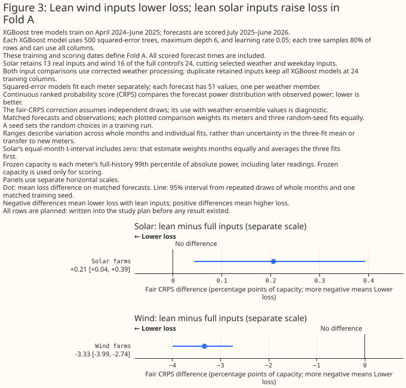

**The lean wind inputs lower fair CRPS in both main folds, while the lean solar inputs raise
it.** These comparisons use the combined wind/radiation-corrected pipeline and the historical
cleaned point-model fitting path. All arms have 24 trained columns, using deterministic duplicate
padding where needed, and column subsampling one. Their full-input control is
`production_cleaned`, which differs from the public production configuration. Each forecast has
51 values; fair CRPS compares these matched sample constructions. The results below cover
three fitting seeds, six solar series or three wind series, with 12 validation months in Fold A
and 15 in retrospective Fold B. Loss is a percentage of frozen effective capacity; differences
are capacity percentage points. Lower is better.

**Wind's loss reduction is statistically significant at the 5% level in both folds under both
interval methods.** In Fold A, full-input fair CRPS is 17.151 (95% month-and-seed bootstrap
interval 15.507 to 18.710), versus 13.821 (12.261 to 15.203) for lean wind. The paired
lean-minus-full difference is -3.330 capacity points (-3.989 to -2.739). In retrospective
Fold B, the corresponding absolute scores are 16.620 (14.859 to 18.291) and 12.876
(11.768 to 13.944), with a paired difference of -3.744 (-4.849 to -2.678). Every validation
month has lower loss: 12 of 12 in Fold A and 15 of 15 in Fold B.

The separate equal-month wind differences are -3.309 in Fold A (95% t-interval -4.026 to
-2.592) and -3.725 in Fold B (-4.923 to -2.527). The primary bootstrap resamples whole months
and one paired fitting seed; the equal-month t-interval averages the fitted seeds within each
month and gives months equal weight. Those methods represent different month weights and
treatment of fitting-seed variation. Their agreement here does not make their estimands identical.

**Solar's higher loss is statistically significant at the 5% level under the primary bootstrap
in both folds, while Fold A's equal-month t-interval remains unresolved.** In Fold A, full-input
fair CRPS is 7.889 (95% bootstrap interval 5.802 to 10.144), versus 8.095 (5.953 to 10.420)
for lean solar. The paired increase is 0.206 capacity points (0.044 to 0.393), while the
equal-month difference is 0.107 (t-interval -0.170 to 0.384). In retrospective Fold B, the
absolute scores are 8.612 (6.976 to 10.134) and 8.816 (7.103 to 10.392). Its paired increase
is 0.204 (0.070 to 0.337); the equal-month increase is 0.200 (0.044 to 0.355), also
statistically significant at the 5% level. Lean solar has lower loss in only four of 12 Fold A
months and four of 15 Fold B months.

The [feature-results appendix](fixed-pipeline-feature-results-tables.md) retains the unaltered
publication tables for the feature comparisons.

### The first solar addition stops the registered ladder

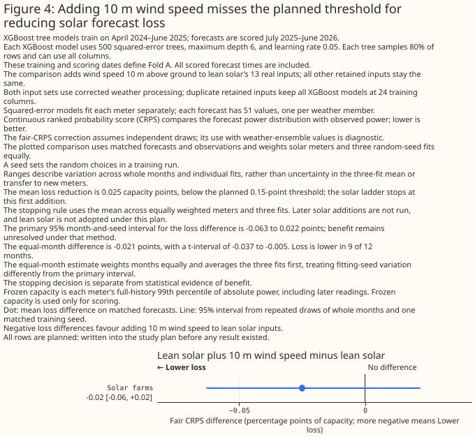

**Adding 10 m wind speed does not reach G4's continuation threshold.** Against lean solar,
Fold A's three-seed mean fair-CRPS reduction is 0.025 capacity points, below the registered
0.15-point threshold. Its absolute fair CRPS is 8.070 (95% bootstrap interval 5.940 to 10.402),
compared with lean solar's 8.095 (5.953 to 10.420). The paired difference is -0.025
(-0.063 to 0.022), so the primary bootstrap allows improvement and deterioration. The separate
equal-month difference is -0.021 (t-interval -0.037 to -0.005), statistically significant at the
5% level, with lower loss in nine of 12 months. The magnitude rule stops the ladder despite
that disagreement.
Later solar rungs are not run, and the registered rule does not adopt the lean solar set.

**Retrospective Fold B does not resolve a benefit from the first addition.** Its paired
difference is 0.005 capacity points (95% bootstrap interval -0.038 to 0.051), with the opposite
sign from Fold A. Its equal-month difference is 0.006 (t-interval -0.032 to 0.043); both
methods allow improvement and deterioration. The added-input arm's absolute fair CRPS is
8.821 (7.120 to 10.385), compared with lean solar's 8.816 (7.103 to 10.392), with lower loss
in seven of 15 months. The first rung still receives its planned alternate-setting check;
that check does not bypass the stopped ladder.

### Restoring individual calendar inputs worsens wind loss in Fold A

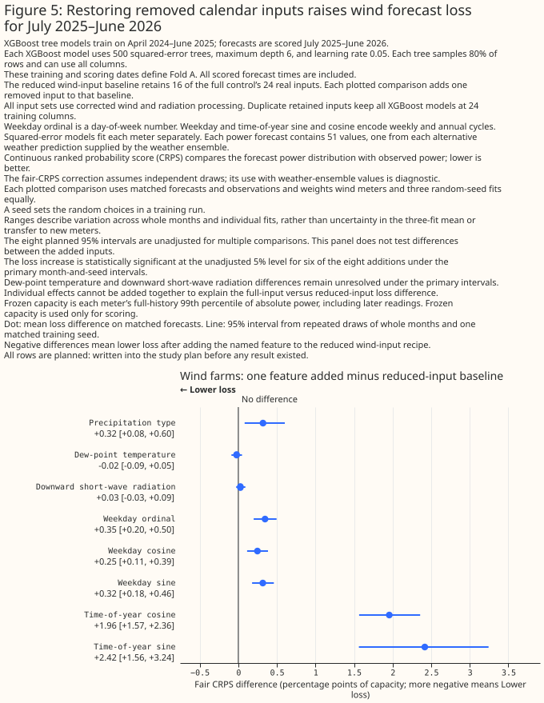

**Each tested calendar addition raises wind loss against the lean wind baseline in Fold A's
main setting, statistically significant at the unadjusted 5% level under both interval methods.**
The
annual-cycle sine and cosine and the three weekday columns are separate additions, each with
the other lean inputs retained. Precipitation type also raises loss in this fold and setting,
statistically significant at the unadjusted 5% level under both methods.
Dewpoint and downward short-wave radiation remain unresolved under both interval methods;
their intervals allow improvement and deterioration. These comparisons cover the same three
wind series, three seeds and 12 validation months as the lean-wind contrast.

**The isolated additions do not decompose the full-input model's loss.** Each test refits a
different feature set, and the effects need not add together. They do not identify a causal
mechanism for an individual feature's harm or show that a feature is useless under another
recipe. Precipitation also has an archive-availability boundary: the retrospective earlier era
cannot identify its information content from a wholly missing input. Its second-fold and era
comparisons require their own interpretation. The dewpoint and short-wave intervals do not
establish zero effects.

### Calendar additions also worsen wind loss in retrospective Fold B's main setting

**Each tested calendar addition raises wind loss in retrospective Fold B's main setting,
statistically significant at the unadjusted 5% level under both interval methods.** These are
separate additions to lean wind, using the historical cleaned point-model recipe, equal-width
padding to 24 trained columns and the combined wind/radiation-corrected pipeline. They cover
three wind series, three fitting seeds and 15 validation months. Lean wind's absolute fair CRPS
is 12.876 percent of frozen effective capacity (95% month-and-seed bootstrap interval 11.768
to 13.944). The differences below subtract that lean baseline and are capacity percentage points;
positive differences mean higher loss.

The annual-cycle sine increases fair CRPS by 2.741 points (95% paired bootstrap interval 1.960
to 3.491), and the cosine by 2.377 (1.566 to 3.211). Each addition has lower loss in only one
of 15 months. The weekday ordinal increases loss by 0.288 points (0.164 to 0.393), weekday
sine by 0.251 (0.160 to 0.331), and weekday cosine by 0.242 (0.131 to 0.347). Their separate
equal-month t-intervals also support higher loss. This agreement concerns these individual
main-setting refits; it does not establish additive effects or identify why a feature harms
this recipe.

**Precipitation type, dewpoint and short-wave radiation remain unresolved in this fold and
setting.** The precipitation-type difference is 0.225 capacity points (95% paired bootstrap
interval -0.072 to 0.572), dewpoint's is 0.007 (-0.067 to 0.086), and downward short-wave
radiation's is 0.055 (-0.013 to 0.127). Each equal-month t-interval also allows improvement
and deterioration. None of these intervals establishes a zero effect. The precipitation result
does not identify its information content: the archive's earlier wholly missing era and later
availability require separate descriptive comparisons, which cannot establish an era-balanced
causal benefit from this aggregate contrast.

**Input recommendations require both settings and the controls reported below.** Their completed
results follow these main-setting additions. The tests concern
this historical point-model recipe, rather than the public production configuration or the
pooled quantile winner.

**Splitting Fold B by precipitation availability does not resolve either era's loss effect.**
After the archive boundary, adding precipitation type changes wind fair CRPS by 0.032 capacity
points (95% paired bootstrap interval -0.008 to 0.085). Before it, the difference is 0.409
(-0.161 to 0.953). Both separate equal-month t-intervals also include zero. Each era has eight
supported valid-time months, sharing part of November rather than forming independent samples
of eight whole months. The [absolute and paired era tables](fixed-pipeline-feature-results-tables.md)
retain both arms' scores and support counts.

The split uses weather initialisation before or from 13 November 2024 at 00:00 UTC, the
[documented archive-availability boundary](../../architecture/ecmwf-ens-known-issues.md).
It differs from the [operational weather-model upgrade](../../roadmap/data-sources.md)
at 12 November 2024 at 06:00 UTC. An absent precipitation column in the earlier era cannot
identify that input's information content. Different seasons and training exposure also prevent
these summaries from identifying a causal upgrade effect. Fold A's scoring window is wholly
after the archive boundary.

**The post hoc second-setting era checks remain unresolved.** They were added after the main
era reports because the later-era main interval met the study skill's near-line rule; both
eras were retained. In sensitivity, the later-era precipitation-type difference is 0.012
capacity points (95% paired bootstrap interval -0.017 to 0.043), with an equal-month difference
of 0.013 (t-interval -0.007 to 0.033). The earlier-era difference is -0.177 (-0.593 to 0.216),
with an equal-month difference of -0.210 (-0.677 to 0.257). Both methods allow improvement and
deterioration in each era. The earlier-era point estimate changes sign from the main setting,
but neither setting establishes a benefit there. These are descriptive availability-era checks,
not evidence for precipitation information in a wholly missing input or a causal upgrade effect.
The inherited report metadata calls the contrast `planned`; this added sensitivity analysis
is post hoc. The appendix preserves both settings' absolute scores and support counts.

### Fold A sensitivity retains lean wind's benefit, while lean solar remains unresolved

**Lean wind retains lower loss under the second training setting, while lean solar's higher
loss is no longer statistically supported in Fold A.** These are combined-pipeline historical
point-model comparisons, with equal-width padding to 24 trained columns, three fitting seeds,
12 validation months, six solar series and three wind series. The full-input control remains
the historical cleaned recipe, distinct from public production and the pooled quantile winner.
Fair CRPS is expressed as a percentage of frozen effective capacity; paired differences are
capacity percentage points.

For wind, the control's absolute fair CRPS is 16.843 (95% month-and-seed bootstrap interval
15.085 to 18.527), versus 13.851 (12.308 to 15.275) for lean wind. The paired difference is
-2.992 points (-3.724 to -2.362), and the separate equal-month difference is -2.968
(t-interval -3.756 to -2.179). Both support improvement, statistically significant at the
unadjusted 5% level, with lower loss in all 12 months. This retains the main-setting direction
without attributing the benefit to a public-production change or an ingredient of the pooled
winner.

For solar, the control scores 7.763 (5.772 to 9.924), versus 7.881 (5.854 to 10.119) for
lean solar. The paired difference is 0.118 (-0.009 to 0.264); the equal-month difference is
0.097 (t-interval -0.077 to 0.270). Both allow improvement and deterioration. The main setting's
primary bootstrap supported higher lean-solar loss, while its t-interval remained unresolved;
the second setting therefore does not retain statistical support for that harm. This does not
establish equivalence or a zero effect.

### The first solar addition still cannot reopen the stopped ladder

**The first solar addition has a supported bootstrap improvement in this setting, but its
equal-month t-interval remains unresolved.** Adding 10 m wind speed scores 7.859 (95% bootstrap
interval 5.841 to 10.091), against lean solar's 7.881 (5.854 to 10.119). Its paired difference
is -0.022 points (-0.047 to -0.004), statistically significant at the unadjusted 5% level under
the primary bootstrap. The equal-month difference is -0.016 (t-interval -0.033 to 0.001),
allowing both signs, with lower loss in nine of 12 months. This reverses the main setting's
interval disagreement, where the t-interval supported improvement and the bootstrap did not.
The 0.022-point mean reduction remains below 0.15. More fundamentally, G4's registered
continuation decision used the main-setting mean and already stopped the ladder. This check
does not reopen it, imply later rungs were run or establish adoption of lean solar.

### Calendar and precipitation additions retain higher wind loss in Fold A

**The five calendar additions and precipitation type raise wind loss in both Fold A settings.**
In sensitivity, the annual-cycle sine's paired difference is 2.057 points (95% bootstrap
interval 1.280 to 2.839), and the cosine's is 1.529 (1.174 to 1.890). Weekday ordinal, sine
and cosine differences are 0.251 (0.137 to 0.355), 0.211 (0.103 to 0.314) and 0.176
(0.077 to 0.281), respectively. Precipitation type's difference is 0.331 (0.111 to 0.601).
For each individual addition, both the bootstrap and equal-month t-interval support higher
loss, statistically significant at the unadjusted 5% level. These separate refits do not
decompose the full-input model's loss or identify a causal feature effect.

Dewpoint remains unresolved, with a paired difference of -0.009 points (-0.064 to 0.045),
as does downward short-wave radiation at -0.001 (-0.046 to 0.041). Their equal-month
t-intervals also allow both signs. The short-wave point estimate changes sign from main,
but that small sign change does not establish a reversal. Neither unresolved comparison
establishes zero effect.

### Guard and negative-control checks retain important interval disagreements

**The guarded lean/full wind comparison retains its improvement, while the guard's own
lean-wind effect disagrees across methods.** Directly comparing guarded lean wind with guarded
full inputs gives -2.980 points (95% paired bootstrap interval -3.703 to -2.348), with an
equal-month difference of -2.956 (t-interval -3.735 to -2.177). Improvement is statistically
significant at the unadjusted 5% level under both methods, with lower loss in every month.
The corresponding guarded lean/full solar contrast is unresolved under both methods:
0.113 (-0.009 to 0.257), with an equal-month difference of 0.079 (-0.092 to 0.250).
These are direct contrasts; their differences from unguarded contrasts do not estimate a
guard interaction.

Within lean wind itself, adding the guard gives 0.009 points (-0.006 to 0.020), unresolved
under the bootstrap, while its equal-month difference is 0.009 (0.002 to 0.016), statistically
significant deterioration at the unadjusted 5% level under the t-interval. The full-input
guard effects remain unresolved under both methods for solar and wind. Lean solar omits
windchill, so its printed zero guard contrast is structural rather than independent evidence
that the guard is ineffective.

**Wind's weekday-removal negative control also disagrees across methods.** Its paired
difference is 0.078 points (95% bootstrap interval -0.004 to 0.171), while the equal-month
difference is 0.077 (t-interval 0.002 to 0.152), statistically significant deterioration at
the unadjusted 5% level only under the latter method. Its mean exceeds the expected 0.05-point
small-change scale, which is neither a measured noise ceiling nor an equivalence margin.
The other sensitivity negative-control contrasts—UTC-offset removal for solar and wind, and
weekday removal for solar—remain unresolved under both methods. They do not establish
negligible changes or passed equivalence checks. In particular, the main setting's supported
equal-month solar UTC-removal improvement is not retained in sensitivity.

The [feature-results appendix](fixed-pipeline-feature-results-tables.md) retains the emitted
absolute and paired tables. The bootstrap resamples whole months and one shared fitted seed;
the t-interval gives months equal weight after averaging fitting seeds within month. Their
estimands and treatment of seed variation differ, and these tests have no multiple-comparison
adjustment. The retrospective Fold B sensitivity findings follow below. These checks do not
establish performance beyond this fixed population and historical validation window.

### Retrospective Fold B sensitivity retains lean wind's benefit and lean solar's higher loss

**Both lean/full directions persist in retrospective Fold B's second setting.** Wind's full-input
fair CRPS is 16.677 (95% month-and-seed bootstrap interval 15.030 to 18.373), versus 13.045
(11.913 to 14.117) for lean wind. The paired difference is -3.632 capacity points (-4.756 to
-2.606); the separate equal-month difference is -3.606 (t-interval -4.793 to -2.419).
Both methods support lower loss, statistically significant at the unadjusted 5% level, in all
15 validation months across the same three wind series and three fitting seeds.

Solar's full-input score is 8.615 (6.985 to 10.146), versus 8.752 (7.082 to 10.307) for lean
solar. Its paired increase is 0.138 capacity points (0.023 to 0.242), with an equal-month
increase of 0.133 (t-interval 0.012 to 0.254). Both methods support higher loss, statistically
significant at the unadjusted 5% level; only four of 15 months have lower loss. These results
cover six solar series and three seeds. They retain the main-setting directions in this
retrospective fold, while Fold A's sensitivity lean-solar comparison remains unresolved.

### Calendar additions retain higher wind loss in retrospective Fold B sensitivity

**All five calendar additions worsen wind loss in both Fold B settings.** In sensitivity,
annual-cycle sine increases fair CRPS by 2.379 capacity points (95% paired month-and-seed
bootstrap interval 1.673 to 3.055), and cosine by 2.043 (1.282 to 2.793). Weekday ordinal,
cosine and sine increase loss by 0.205 (0.125 to 0.286), 0.189 (0.108 to 0.268) and
0.161 (0.088 to 0.231), respectively. Both the bootstrap and separate equal-month
t-intervals support higher loss, statistically significant at the unadjusted 5% level.
These comparisons cover three wind series, three fitting seeds and 15 validation months;
each addition lowers loss in only one or two months. Separate refits cannot decompose the
full-input model's loss or establish a causal feature effect.

Precipitation type remains unresolved in Fold B sensitivity: its paired difference is
-0.085 points (-0.321 to 0.120), with an equal-month difference of -0.081
(t-interval -0.268 to 0.105). Its point estimate changes sign from main's 0.225-point
increase, but both settings leave its direction unresolved. Fold A's supported
precipitation-type deterioration therefore does not generalise across both folds.
Dewpoint is also unresolved at -0.018 (-0.056 to 0.019), as is downward short-wave
radiation at 0.017 (-0.022 to 0.065); both equal-month t-intervals allow both signs.
Dewpoint's small point-estimate sign change from main does not establish a reversal.
The [supporting tables](fixed-pipeline-feature-results-tables.md) retain absolute scores
and both interval methods for every addition.

### Retrospective Fold B retains the guarded lean-wind benefit

**Guarded lean wind also beats guarded full inputs in Fold B sensitivity.** Their absolute
fair-CRPS scores are 13.028 (95% month-and-seed bootstrap interval 11.905 to 14.092) and
16.594 (14.900 to 18.304), respectively. The paired difference is -3.566 capacity points
(-4.626 to -2.561), with an equal-month difference of -3.541 (t-interval -4.705 to
-2.377). Both methods support lower loss, statistically significant at the unadjusted
5% level, with improvement in all 15 months across three wind series and three seeds.
The guarded lean/full solar difference remains a supported deterioration under both methods:
0.138 (0.025 to 0.241), with an equal-month difference of 0.133 (0.011 to 0.255).

**The guard's own wind effects remain sensitive to the interval method and training setting.**
Within full inputs, the sensitivity guard difference is -0.083 (-0.227 to 0.062), unresolved
under the bootstrap, whereas the equal-month difference is -0.082 (-0.143 to -0.021),
statistically significant improvement at the unadjusted 5% level. Main's corresponding
equal-month interval supports deterioration. Within lean wind, the sensitivity guard
difference is -0.0172 (-0.0426 to 0.0002), unresolved under the bootstrap, while the
equal-month difference is -0.0172 (-0.0308 to -0.0035) supports improvement. Four decimal
places retain the bootstrap's small positive upper bound. Its main-setting comparison is
unresolved under both methods. Full-input solar's guard effect is unresolved in both
settings. Lean solar's zero guard contrast is structural because that recipe omits windchill.
These direct contrasts establish no causal explanation for the lean/full difference.

### Fold B sensitivity supports a small first-solar improvement

**Adding 10 m wind speed to original lean solar lowers loss in Fold B sensitivity, while
main remains unresolved.** The sensitivity absolute scores are 8.752 for lean solar and
8.692 for the addition; their 95% month-and-seed bootstrap intervals are 7.082 to 10.307
and 7.048 to 10.223, respectively. The paired difference is -0.060 capacity points
(-0.090 to -0.033), with an equal-month difference of -0.060 (t-interval -0.090 to
-0.031). Both methods support improvement, statistically significant at the unadjusted
5% level, with lower loss in 12 of 15 months across six solar series and three seeds.
The corresponding main-setting difference is 0.005 (-0.038 to 0.051), unresolved under
both methods. Neither setting's mean reaches the 0.15-point continuation threshold;
G4 remains stopped, and no later ladder rung was fitted.

### Fold B sensitivity negative controls remain unresolved

**Neither removal resolves a solar or wind loss effect under either interval method.**
Removing UTC offset gives paired differences of -0.003 points for solar (95% bootstrap
interval -0.023 to 0.026) and -0.010 for wind (-0.148 to 0.108). Removing weekday ordinal
gives -0.008 for solar (-0.029 to 0.014) and 0.064 for wind (-0.101 to 0.234).
All separate equal-month t-intervals also allow both signs. Main's supported equal-month
UTC-removal deterioration therefore does not persist in sensitivity. Wind's weekday-removal
mean exceeds the expected 0.05-point small-change scale, but that expectation is neither
a measured noise ceiling nor an equivalence margin. These unresolved results do not
establish zero or negligible effects.

### Main-setting controls retain the lean-wind result, with unresolved small contrasts

**The guarded-windchill comparisons retain lower lean-wind loss and higher lean-solar loss
in both main folds.** These tests use the historical cleaned point-model recipe on the combined
pipeline, three fitting seeds, six solar or three wind series, and 12 validation months in
Fold A or 15 in retrospective Fold B. Loss differences are fair-CRPS capacity percentage points.
Against the full-input control with the same guard, lean wind's difference is -3.314 in Fold A
(95% paired month-and-seed bootstrap interval -3.953 to -2.730) and -3.811 in Fold B
(-4.896 to -2.766). Both reductions are statistically significant at the unadjusted 5% level
under the bootstrap and separate equal-month t-intervals, with lower loss in every validation
month. These are direct guarded lean-minus-guarded-full comparisons, rather than a difference
inferred between separate contrasts.

Guarded lean solar has higher loss than guarded full inputs: 0.198 points in Fold A
(0.028 to 0.394) and 0.190 in Fold B (0.046 to 0.325), statistically significant at the
unadjusted 5% level under the primary bootstrap. Fold A's equal-month difference is 0.099
(t-interval -0.195 to 0.392), leaving its direction unresolved under that method. Fold B's
equal-month difference is 0.186 (0.033 to 0.338), supporting higher loss at the unadjusted
5% level. Lean solar omits windchill, and its guarded-minus-unguarded solar score contrast
is printed as zero in both folds. The lean-solar arm's deliberately retained wind predictions
instead use the corresponding full-input control; similarly, the lean-wind arm retains the
corresponding full-input solar predictions. Those retained types are not tests of the lean
feature cut.

**The guard's own effect on the full-input control remains unresolved under the primary
bootstrap.** Fold A's differences are 0.008 for solar (-0.029 to 0.058) and -0.017 for wind
(-0.106 to 0.066); their equal-month t-intervals also allow both signs. Fold B's solar difference
is 0.014 (-0.017 to 0.042), also unresolved under both methods. Fold B wind disagrees across
methods: its primary difference is 0.081 (-0.111 to 0.314), while the equal-month difference
is 0.082 (0.022 to 0.142), statistically significant deterioration at the unadjusted 5% level
under the t-interval. The guard's effect within lean wind also remains unresolved under both
methods in each fold. Neither those unresolved contrasts nor agreement in the lean/full
direction establishes that the guard has zero effect.

**The negative controls do not establish a small-change ceiling.** Removing UTC offset from
the full-input control gives a Fold A solar difference of -0.016 points (95% paired bootstrap
interval -0.043 to 0.008), while its equal-month difference is -0.024 (t-interval -0.047 to
-0.001): improvement is statistically significant at the unadjusted 5% level only under the
latter method. Fold A wind's UTC-removal difference remains unresolved under both methods.
Removing the weekday ordinal also remains unresolved for both types under both methods in
Fold A; its wind point estimate is 0.067, above the expected 0.05-point small-change scale.

In retrospective Fold B, UTC removal again disagrees across methods for both types. Solar's
bootstrap difference is 0.012 (-0.079 to 0.094), versus an equal-month difference of 0.011
(0.001 to 0.022). Wind's bootstrap difference is 0.112 (-0.233 to 0.650), versus an equal-month
difference of 0.112 (0.047 to 0.177). Both t-intervals support deterioration at the unadjusted
5% level, while the bootstrap intervals allow both signs. Weekday-ordinal removal remains
unresolved under both methods: the primary differences are -0.005 for solar (-0.035 to 0.029)
and 0.121 for wind (-0.017 to 0.262). Both Fold B wind negative-control means exceed the
expected 0.05-point scale. That expectation is neither a measured noise ceiling nor an
equivalence margin; the intervals permit meaningful changes, so these controls cannot be
called negligible or treated as having passed an equivalence test. The injected radiation
correlation check tests the timing detector, not forecast-loss detectability.

**Removing duplicate padding retains the printed main-setting lean/full results.** The
unpadded wind differences are -3.330 in Fold A (95% paired bootstrap interval -3.989 to -2.739)
and -3.744 in Fold B (-4.849 to -2.678); the solar differences are 0.206 (0.044 to 0.393)
and 0.204 (0.070 to 0.337). The absolute scores, paired estimates and intervals match the
equal-padding publication tables at their printed precision, including Fold A solar's unresolved
equal-month t-interval. This supports the main-setting score conclusions without asserting
identical affected forecasts across padding policies. Separate artifact verification confirmed
that deliberately retained unaffected types match their corresponding full-input controls within
the unpadded policy in both folds. That proof concerns retained types within one padding policy,
rather than equality between padded and unpadded affected forecasts.

The [feature-results appendix](fixed-pipeline-feature-results-tables.md) retains the absolute
and paired control tables, including both interval methods and the completed alternate-setting
guarded and negative controls reported above.

**The original lean-wind benefit survives the completed robustness checks.** Both folds and
training settings support lower loss, including direct guarded lean/full comparisons. The
main unpadded checks retain the reported scores. The requested smaller-feature results follow
below. These weekly-initialisation scores do not
establish an official leaderboard result, adequate calibration or joint scenario coherence.

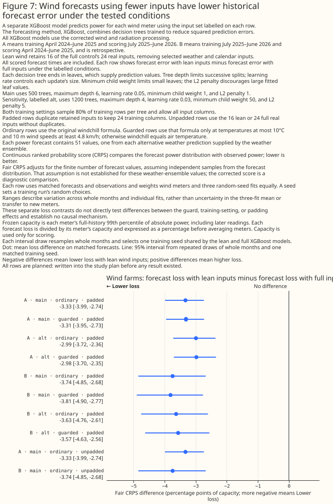

### Descriptive feature importance

**Training gain describes how the point-control models divide split credit; held-out feature
tests decide whether an input helps.** The figure uses squared-error models fitted separately
for each meter on corrected wind and radiation inputs, with all 24 production features. Short-wave
radiation receives the largest mean gain share for solar; time-of-year cosine and sine receive
the largest shares for wind. Correlated features can divide credit between themselves, so those
rankings do not establish feature benefit or justify removing a low-gain input. Quantile models
are excluded from this diagnostic.

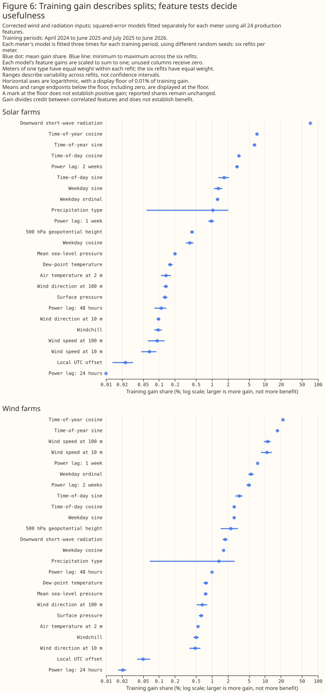

**The displayed ranges describe variability across six refits per meter, not confidence
intervals.** Each meter's model is fitted with three random seeds in each of the two training
periods. Feature gains are scaled to sum to one within each model, with zero for unused columns.
Meters within each type receive equal weight for each refit, and the six refits receive equal
weight in the final mean. The blue dots show mean gain shares; the blue lines show the minimum
and maximum across refits. These training summaries remain descriptive alongside the separate
held-out loss comparisons.

The logarithmic axes show small shares alongside large ones. Means and range endpoints below
0.01%, including zero, appear at that display floor; a floor mark does not establish positive gain.

**The input audit confirms changed radiation and wind-derived features in both folds; forecast
benefit requires the matched loss comparisons above.** Each treatment exposes the same 32
engineered fields on matched rows. That audit inventory includes fields available for feature
experiments and is distinct from the 24 trained columns in the full-input control. Radiation
changes short-wave and long-wave values and the temperature-adjusted long-wave residual. Wind
processing changes speed, bearing and derived windchill. Counts cover all weather members;
bearing differences use shortest angular distances, and other changes compare paired finite
Float32 values exactly.

**Null counts and domain screens need different interpretations.** Power-lag nulls include the
expected masking of observations unavailable at forecast issuance; missing lags alone do not
establish a pipeline error. The audit reports null and nonfinite counts separately and excludes
both from changed-value shares. Windchill is still evaluated outside its formula's temperature
and speed domain in the PR-only treatments; the separate guarded comparisons above test that
additional change.
Radiation threshold and midpoint-night flags are screens rather than definitive invalid values:
a half-hour whose midpoint is at night can still be partly sunlit.

**The deliberately delayed radiation passes the timing-detector check in both folds.** The
solar correlation peak moves from offset zero for the original input to offset one hour for
the input delayed by one hour; both reports print `Shift detector passed: True`. Offsets compare
power at time `t` with control-member weather at `t + offset`, after removing each series'
within-day, within-run mean and giving series equal weight. Recovery supports the detector's
response to the injected delay. Autocorrelation, curtailment and cloud regimes still confound
the observed peak, so the check establishes neither causal timing accuracy nor the ability of a
forecast-loss comparison to detect a timing fault.

**Precipitation availability remains an era limitation rather than evidence of an upgrade
benefit.** Fold B's earlier era has missing precipitation-type inputs, while the later era has
available inputs. The audit assigns eras by weather initialisation time, using the November
archive-availability boundary and a separate May cycle marker. Source-provenance verification
remains required before interpreting those markers. Different seasons and training exposure
prevent the era summaries from identifying precipitation's information content or a causal
upgrade effect.

The [input-audit tables](fixed-pipeline-input-audit-tables.md) print the solar and wind domain
counts, precipitation missingness and timing correlations for both folds. Counts include all
weather members and overlapping forecast windows; they count forecast input rows rather than
distinct observed hours. The separate guarded-windchill fits test whether the lean-feature
conclusions depend on inputs outside that formula's domain.

The separate [calibration diagnostics study](calibration-diagnostics-1156.md) starts Part 2 from
saved corrected-pipeline predictions. It does not fit a calibrator or establish joint scenario
coherence. This study changes no production code or forecast contract.

<!-- PROVENANCE_AND_DECISIONS -->

### Requested smaller solar sets improve loss; wind's advantage depends on the reference

**The two-input solar and five-input wind sets improve on the full-input point control, but the
comparison with original lean wind changes the wind conclusion.** These post hoc results cover both
main and sensitivity settings in the forward Fold A and retrospective Fold B. All four equal-padding
reports and both main-setting unpadded robustness reports are complete. The labels PV2, PV11,
Wind5, Wind9 u/v, and Wind7 circular refer to the [exact input
sets](#requested-minimal-feature-extension), with their own inputs duplicated to width 24 for
the
primary comparisons. Full input means the 24-input Part 1b point control; original lean wind means
the 16-input `lean_wind` recipe, not the production configuration or pooled quick-wins winner.

**Fair CRPS is the deciding loss for the matched 51-point delivered ensembles;** mean absolute error
and 19-level pinball loss are secondary diagnostics. Loss differences below are candidate minus
reference in capacity percentage points. Bootstrap intervals describe the equal-series estimate; the
separate equal-month estimate and t interval address a different estimand.

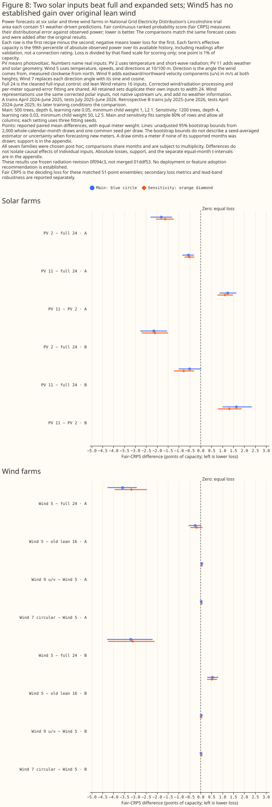

**Temperature and short-wave radiation alone reduce solar fair CRPS in all four comparisons.**
Against the full-input `production_cleaned` point control, the two-input solar set gives differences
of −1.800 in Fold A main, −2.147 in Fold B main, and −1.625 in Fold A sensitivity; Fold B
sensitivity
also improves. Both interval methods support lower loss at the unadjusted 5% level in each
comparison. For example, Fold B main has a paired bootstrap interval of [−2.769, −1.538], while its
equal-month estimate is −2.142 with a t interval of [−2.849, −1.435]. The solar comparisons assess
bundled feature policies under the fixed fitting procedure; the comparisons do not identify the
individual contribution of each omitted input.

**The expanded solar bundle performs worse than the two-input set in both folds and settings.** Its
fair-CRPS differences against the minimal set are +1.241 in Fold A main, +1.642 in Fold B main, and
+1.316 in Fold B sensitivity; Fold A sensitivity also deteriorates. Both interval methods support
deterioration at the unadjusted 5% level in all four comparisons. Against the full-input control,
the expanded set improves loss in both Fold A settings and Fold B sensitivity, but Fold B main
remains unresolved: the equal-series difference is −0.505 with bootstrap interval [−1.006, +0.016],
and the equal-month difference is −0.476 with a t interval that also includes zero. The added
weather and solar-geometry fields therefore do not establish an advantage over the minimal set in
these examined comparisons.

**Wind5 improves on the full-input control but does not establish an improvement on the original
lean-wind model.** The five-input set retains temperature, both wind speeds, and both raw
directions.
Against the full-input point control, fair-CRPS differences are −3.579 in Fold A main, −3.201 in
Fold B main, −3.177 in Fold A sensitivity, and −3.115 in Fold B sensitivity; both interval methods
support lower loss. Against original lean wind, both Fold A settings remain unresolved, while both
Fold B settings deteriorate. Fold B main gives +0.543, with bootstrap interval [+0.304, +0.805] and
equal-month estimate +0.543 with t interval [+0.263, +0.823]; Fold B sensitivity gives +0.517, with
both intervals above zero. The all-lead result also hides a lead reversal: in Fold A main, Wind5
minus original lean wind is +2.033 on days 0 to 2 and −1.817 from day 11 onward, with both interval
methods supporting those opposite directions. An all-lead gain against the full control is therefore
insufficient grounds to replace original lean wind.

**Wind representation changes show no fair-CRPS advantage here.** Adding u/v to Wind5 increases fair
CRPS by +0.052 in Fold A main, +0.030 in Fold B main, and +0.044 in Fold A sensitivity; both
interval
methods support deterioration at the unadjusted 5% level. Fold B sensitivity remains unresolved:
+0.018 with bootstrap interval [−0.002, +0.037], and equal-month estimate +0.018 with t interval
[−0.003, +0.040]. Replacing raw directions with their sine/cosine pairs remains unresolved in both
folds at the main setting but deteriorates in both sensitivity settings. Fold A sensitivity gives
+0.037 with
bootstrap interval [+0.013, +0.064]; Fold B sensitivity gives +0.031 with [+0.010, +0.055], and both
equal-month t intervals are above zero. Both representations derive from the same corrected
processed wind values and add no upstream weather information. These results do not isolate
windchill or establish a general benefit from changing direction representation.

**Main-setting padding checks retain the requested-feature conclusions.** In both folds, all five
direct padded-minus-unpadded fair-CRPS differences and both interval methods' bounds are zero in
the saved aggregate reports. The unpadded comparisons retain the main-setting conclusions.
This aggregate agreement does not establish bit-identical affected forecasts. The
[padding tables](fixed-pipeline-feature-results-tables.md#requested-minimal-feature-comparisons)
identify each padded reference explicitly; sensitivity-setting fits retain equal padding.

**Mean absolute error gives a less favourable view of Wind5 than fair CRPS against Wind16.**
In Fold A main, the Wind5-minus-original-lean mean-absolute-error difference is +0.277 capacity
points, with bootstrap interval [-0.045, +0.555], while the fair-CRPS difference is -0.249 [-0.554,
+0.026].
Both loss differences are unresolved, with opposite central signs. In Fold A sensitivity, mean
absolute error
increases by +0.391 [+0.114, +0.650], supported by both interval methods, while the fair-CRPS
difference remains unresolved at -0.185 [-0.467, +0.089]. The five-input set therefore does not
establish an
across-metric advantage over the original 16-input set.

**Secondary loss and coverage diagnostics qualify the deciding result.** Minimal solar and Wind5
also reduce mean absolute error and pinball loss against the full-input control in the completed
reports, but the representation comparisons are less uniform. For expanded versus minimal solar in
Fold A main, the mean-absolute-error bootstrap interval excludes zero while the equal-month t
interval includes zero; for circular versus raw-direction Wind5 in Fold A sensitivity, the same
interval disagreement occurs for mean absolute error. Lower fair CRPS does not establish calibrated
uncertainty: in Fold B main, minimal solar's nominal 80% and 90% intervals cover 57.274% and 65.290%
of cases, and Wind5's cover 24.507% and 32.750%. These descriptive coverage values are well below
their nominal levels; the coverage values are not evidence of calibrated forecasts or a calibration
improvement.

**Lead-specific and precipitation support constrain interpretation of the expanded solar bundle.**
In both completed Fold A settings, solar comparisons on days 0 to 2 and from day 11 onward have one
series supported in only 11 of the 12 validation months; the saved three-seed provisional flag does
not certify complete monthly support. Interval choice can also matter within a lead band: expanded
solar versus full input on days 0 to 2 in Fold A main has a bootstrap interval below zero but an
equal-month t interval that includes zero. Categorical precipitation type is absent in the early
archive before 13 November 2024 at 00:00 UTC; precipitation amount/rate has separate lead-zero and
corruption limitations and must not be described as wholly absent in that era. The availability and
support limitations of these fields are distinct. Neither the bundle comparison nor an
availability-era slice isolates precipitation information or an operational upgrade effect.

**These results support a bounded frozen-source finding, not an adoption decision.** The
requested-feature results use radiation revision `0f094c3`, not the final merged `01ddf53`
implementation. The partial merged-source checks described under
[Data and code availability](#data-and-code-availability) do not establish forecast equivalence
or a performance result for that source. The many post hoc feature, metric
and lead comparisons do not provide multiplicity-adjusted family-wide significance. The two
main-setting robustness reports are complete. The [authoritative generated
tables](fixed-pipeline-feature-results-tables.md#requested-minimal-feature-comparisons) include the
completed robustness and lead-specific comparisons. Training gain describes fitted-model use;
a large gain share does not establish a held-out feature benefit. No deployment or feature
adoption recommendation follows yet.

### Training gain for each requested feature set

Figures 9 to 13 show every real input in each requested set; the [ordered feature
lists](#requested-minimal-feature-extension) identify their exact implementation columns.
Main and sensitivity settings appear separately. Dots show mean training-gain shares and lines
show the range across six fold-and-seed refits. These ranges are descriptive variability, not
confidence intervals. Duplicate padding columns return their gain to the original input before
normalisation.

**Short-wave radiation dominates the two-input solar fit.** Clear-sky irradiance and the vertical
sun
component receive much of the expanded solar fit's gain, although that bundle has worse held-out
fair CRPS than the two-input set. Both wind speeds receive the largest gain shares in all three
requested wind representations. A large gain share therefore does not establish that adding an
input improves forecasting.

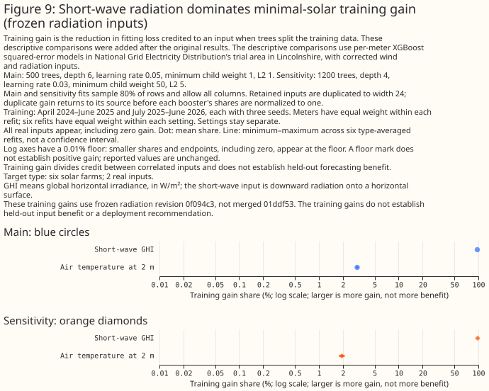

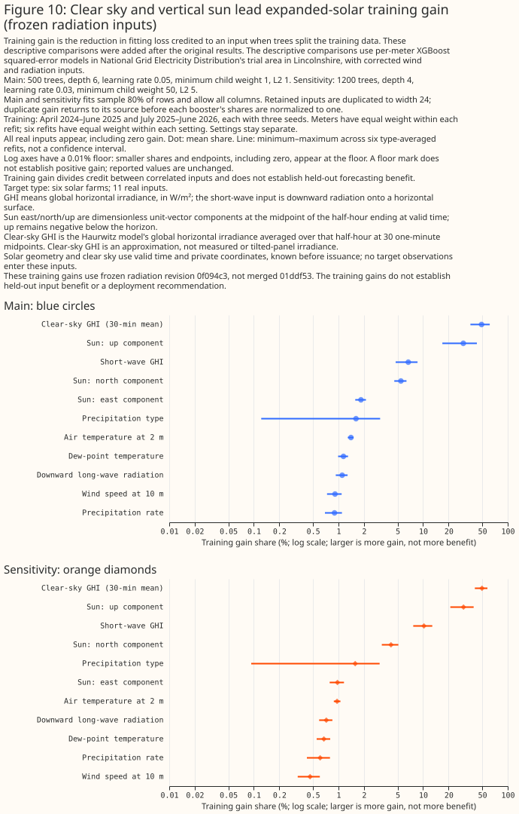

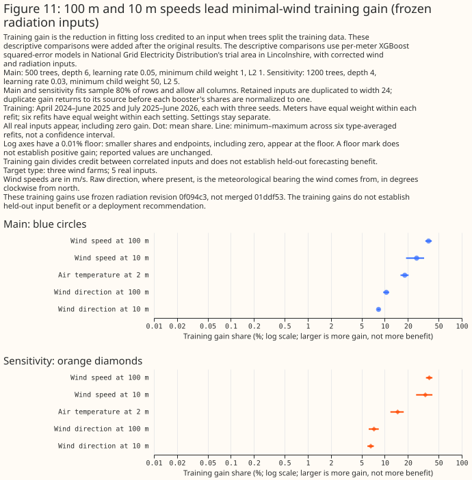

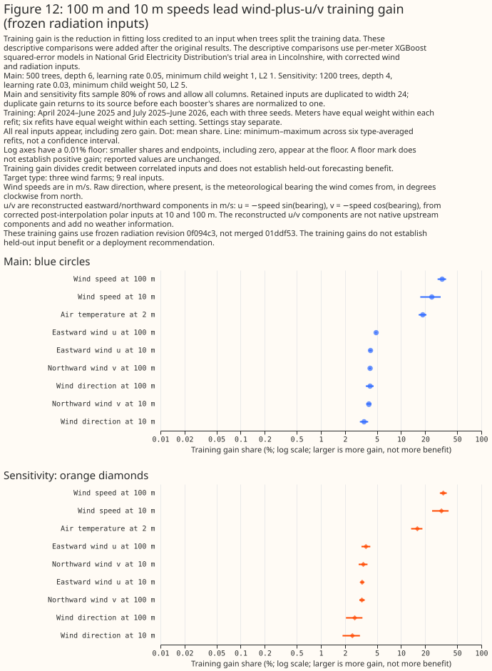

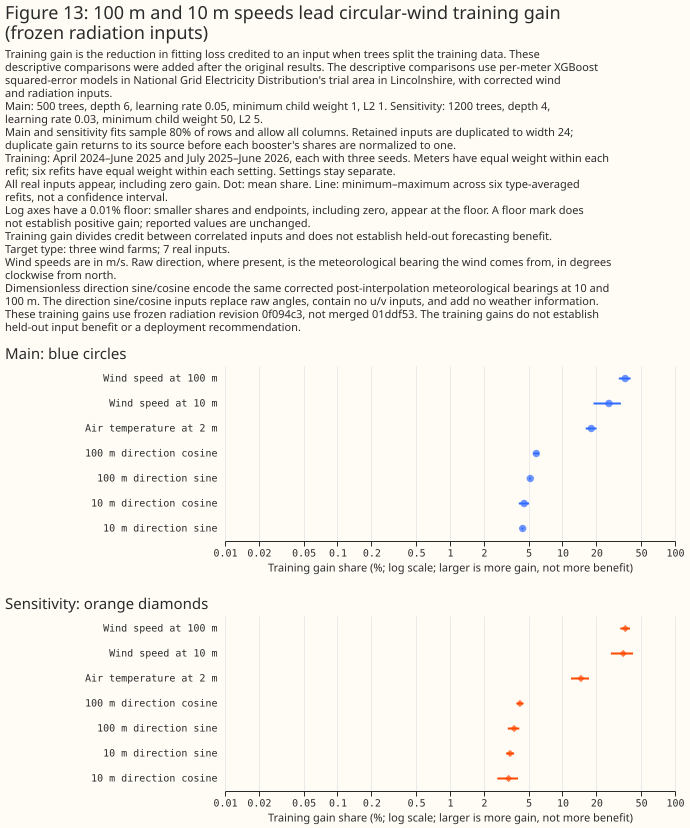

## Discussion: what to use

<!-- DISCUSSION_RESULTS -->

**The strongest processing result is the solar benefit from correcting radiation intervals.**
Its direction is supported in both folds and both training settings. The combined corrections
also lower overall and solar common pinball loss within both production and the quick-wins
winner. The wind evidence needs a narrower interpretation: wind-only processing has unresolved
Fold A effects and worsens wind-farm loss in retrospective Fold B. Adding the wind correction
after radiation remains unresolved under the primary bootstrap, so these results do not establish
a general wind forecast benefit. The combined-correction wind deterioration in Fold B sensitivity
also prevents an unqualified claim that both fixes improve every series type. Processing
correctness and measured forecast benefit are separate questions; these historical loss tests
address the latter within the pinned archives and recipes.

**A plausible wind-loss mechanism remains a hypothesis rather than a demonstrated bug.**
Interpolating vector components can reduce speed when directions turn, compared with
interpolating endpoint scalar speeds. The correction also changes bearings and derived
windchill, which can change tree predictions and forecast spread. Source inspection found no
demonstrated defect explaining the score deterioration, and these experiments do not isolate
those mechanisms or compare the interpolated weather with observations. The requested u/v
and circular tests examine downstream representations of the already processed values;
the requested u/v and circular tests do not isolate the interpolation algorithm or recover native
wind information.

**The corrected winner remains a stronger distributional-loss benchmark than refitted
production, while its coverage requires separate assessment.** The deciding score evaluates
both delivered distributions at the same 19 midpoint probabilities. It supports the winner in
both folds and both settings, but the comparison changes objective, pooling, inputs and
preprocessing together. Its advantage cannot be attributed to the PR fixes, quantile training
alone or early stopping, which the exact winner does not use. The original quick-wins selection
used Fold A, and Fold B is retrospective; neither comparison establishes future deployment
performance. Part 2 reports interval coverage alongside widths and assesses undercoverage
separately by interval and series type. A lower common loss does not establish adequate coverage
or coherent joint scenarios.

**The preregistered gate rules out the conditional best-point experiment in this study.** G3
uses the main-setting production fair-CRPS contrast between matched 51-member ensembles. Its
three-seed differences are -0.1176 capacity points in Fold A and -0.0572 in Fold B, each below
the required absolute change of 0.15. The separate equal-month t-intervals favour improvement,
but do not satisfy the magnitude requirement. The conditional best-point refit was therefore
not run. Fair CRPS remains a diagnostic for matched sample constructions; it does not decide
the point-versus-quantile recipe comparison.

## Proposed follow-up study

Further model fitting and validation stopped at the maintainer's request on 14 October 2026.
A matched forecast comparison using final merged radiation revision `01ddf53` remains an
unanswered question; no further experiment is scheduled or authorised by this report.

## Limitations

Effective capacity is an empirical output scale, rather than a nameplate or connection rating.
Because its frozen full-history estimate can use later observations, the normalised aggregate
results are retrospective and conditional on that capacity snapshot. They do not reproduce a
score normalised using only information available at forecast issuance.

These are weekly-initialisation diagnostics for this fixed eligible population and historical
windows. Fold B is retrospective, and the original quick-wins winner was selected using Fold A.
The component archive reconstructs rounded polar observations. Frozen capacities, commissioning
cleaning and available target months affect the estimand. In Fold B, some demand series have
incomplete month support; the report discloses that support and bootstrap draws omitting a series.
The two PRs leave other audited feature defects outside their scope. No official leaderboard
comparison follows from these weekly scores.

## Scope

This study covers the pinned ECMWF ensemble archive and the named XGBoost recipes. It does not
establish performance at new generators, on later forecast periods or under a live deployment.
Total cloud cover and calibration experiments remain outside Part 1b. The separate Part 2 study
examines marginal distributions and does not establish coherent joint scenarios.

## Data and code availability

**OpenAI Codex wrote the new study work; the reused code has historical Claude credits.**
Following the imported study helpers and chart theme through their commit histories finds
Claude Fable 5, Opus 5 and 5.5 (including 1M-context credits), and Sonnet 4.6, 5 and 5.5;
some commits credit Claude without a model name. These are authorship records for reused code,
not the identities of this study's reviewers. Available Codex agents performed the independent
reviews in place of the study skill's unavailable named models.

ECMWF ensemble weather and NGED observed power are the production-system inputs. The weather
component migration reconstructs archived speed and direction; it does not download new native
components. The NGED observations, generator metadata, fitted boosters and row-level forecasts
remain private. Published artifacts contain aggregate scores, feature names, code and execution
specifications, without a private generator mapping.

The old implementation is pinned to repository commit
`4e820d24c0129c8c95c567ff7355abff8d416144`; the executed wind and radiation PR revisions are
`38025f4eab457b9605b8c124006609869dbfca0d` and
`0f094c356da82e75c4014664ad7fb33fe1df8b7f`. Isolated package source trees preserve those
implementations while the study code evolves. A committed integration patch combines their
feature-processing order, and the runtime inventory hashes every selected Python source file.
The runs use XGBoost 3.4.1 and Polars 2.0.0. Fit manifests record source and dependency hashes,
parameters, data snapshots, seeds and hardware selection; report provenance verifies saved fit
artifacts before aggregation.

Commit `af5201f2` preserves the executed requested-feature producer, audit, and chart source
versions.
Later type-check corrections add annotations and identity casts while preserving the calculations.
Reproducing the archived requested-feature artifacts requires that recorded revision because their
manifests verify exact source hashes. Keep the original execution receipts and use new output
directories for reproductions.

A subsequent check found PR 1167 at `70dd58f9da75c2500bcf7a3f6dc5ad1b663ffb95`.
It moves the wind-derivation function to `weather_utils` without changing its executable
syntax tree or its placement after interpolation. The added storage schema guard, dashboard
support and documentation do not change the frozen study inputs. Historical runs retain their
actual earlier revision; they are not relabelled as executions of the later commit. PR 1166's
revision was unchanged at that check.

At the subsequent 13 October check, wind PR 1167 was merged at
`754954a66fdbfa540ce068e38716f9774a5c5f7e`; its additional changes were comments and documentation.
Radiation PR 1166 was at `99a40cf586f93524f1034608faf285ae7cb91c2d`, incorporating the wind caller
ordering already represented by the study's combined runtime. Those updates preserve the
calculations used for the frozen frames. The requested feature comparisons reuse those frames; the
comparisons do not evaluate subsequent changes to either implementation.

**The final merged radiation revision has not been forecast-scored in this study.**
PR 1166 subsequently merged at `01ddf5332063e369827787c5f23ec75d58a607a6`. Among its changes,
the minimum native clear-sky mean for an index to influence neighbouring windows rises from
1 to 20 W/m². Each window still retains its own native radiation energy. The merged revision
also changes daylight-block and neighbouring-index processing and adds source-schedule and
solar-coordinate validation. These changes prevent an equivalence claim with the executed
snapshot. The recorded forecasts and requested feature comparisons retain the frozen inputs;
their scores do not measure the final merged radiation implementation.

Work toward a separate merged-source comparison rebuilt both folds and completed a Fold A
input, wind-matrix and short-wave energy audit. Fold B follow-up checks and merged-source model
refits were not completed before the maintainer stopped further fitting and validation. Those
partial checks supply no new forecast scores and do not replace the frozen-revision evidence.

**Reproduction requires the registered private snapshots.** Old and radiation-only frames use
polar archive version 1830; wind-only and combined frames use component archive version 924.
All four treatments use observed-power version 70, capacity version 1 and eligibility snapshot 1.
Observed power is bounded before 1 July 2026, with each fold's additional training and scoring
bounds recorded separately. The frozen effective-capacity denominator is a full-history 99th
percentile and can include readings after that cutoff. It enters scoring only; normalised scores
therefore remain retrospective and conditional on this common snapshot.

**The public inventory separates executed specifications from derived configuration records.**
The [executed-specification index](https://github.com/openclimatefix/nged-substation-forecast/blob/b15a675c8f83b95851f3b02ec6c0e2408e382951/studies/quick_wins/fixed_pipeline_specs/index.json)
contains 97 files. The [derived-record index](https://github.com/openclimatefix/nged-substation-forecast/blob/b15a675c8f83b95851f3b02ec6c0e2408e382951/studies/quick_wins/fixed_pipeline_runtime_records/index.json)
contains 27 files, including separate text and render records for the requested figures.
Each index records file and executed-provenance hashes. A derived record is neither an original
executed JSON specification nor a transcript of historical shell arguments. The
[reproduction guide](https://github.com/openclimatefix/nged-substation-forecast/blob/b15a675c8f83b95851f3b02ec6c0e2408e382951/studies/quick_wins/fixed_pipeline_runtime/README.md)
explains the source revisions and the categorical-precipitation limitation in archived gate text.
Dependency snapshots document the recorded environment; they do not constitute a complete
environment lock or guarantee numerical equality on different hardware. Prepared queues and the
full recipe registry are not evidence that every listed job completed. Private manifests and
generator mappings are excluded from the public inventory.

## Reproducing the figures

The [feature inventory and reproduction appendix](fixed-pipeline-feature-inventory.md#reproducing-the-figures)
contains the recorded runtime setup, frame-building, fitting, reporting and figure commands.
These instructions document reproduction; they are not a queue of further experiments.
