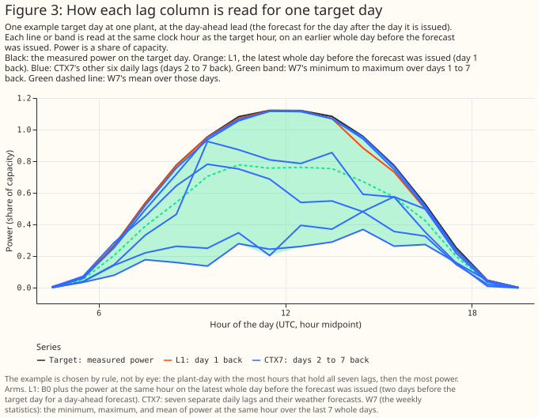

# A same-hour power lag did not improve day-ahead solar forecasts at six plants in Lincolnshire

**At six solar plants over 18 months, giving an XGBoost model each plant's own power from the same
hour two days earlier did not change its day-ahead error by a statistically significant amount in
any of the five planned comparisons.** For this lag, the 99% interval of the change in mean absolute
error runs from −0.075 to +0.073 percentage points of the plant's capacity, against a baseline error
of 8.93 points. A post hoc reading of the planned intervals rules out a gain as large as the 0.18
points the study plan treated as worth acting on, for a lag against no lag and for a two-step
forecast against a lag with its weather. For Flexpectation (this project), that lag is therefore not
worth building into the day-ahead service for these six utility-scale plants on this evidence.
Inputs that track a plant's recent output did better in post hoc analyses, but most of their gain
came from one plant whose months of low output were in the training data, so those results are
hypotheses to test on more plants and not a recommendation. Eighteen months at six plants in one 25
km box cannot show whether a longer history, more plants, or a faster data feed would change this.


**Terms used on this page.**

- **Points:** percentage points of a plant's capacity, where capacity is the plant's 99th percentile
  of metered output and not its nameplate rating. Differences are an input's error minus the
  baseline's, so a negative difference means a lower error.
- **Lag:** the plant's power at the same clock hour on the latest whole day before the forecast is
  issued, which is two days (48 hours) before the target hour for a day-ahead forecast.
- **Arm:** one XGBoost model configuration with its own inputs. The baseline arm, B0, has no lagged
  power. The table in "Data and methods" names every arm.
- **Lead-day:** days between the weather forecast run and the target day. Day-ahead is lead-day 1.
- **Fold:** a block of whole months held out from training, so that every month is forecast by an
  XGBoost model that never trained on that month.
- **Planned, exploratory, post hoc:** a planned contrast was fixed before any result existed, every
  other number is exploratory, and a post hoc number was added after the first results were seen, so
  it is a hypothesis.
- **Interval:** the range of changes in error that the data are consistent with, allowing for
  month-to-month weather and the random fitting seed. An interval that includes zero means no
  detectable change. The forecast's own 10%–90% range is called the forecast band.
- **Oracle:** an arm told the true size of a planted power loss. It shows what knowing the loss
  exactly gains an XGBoost model.
- **CRPS:** the continuous ranked probability score, an error score for a whole forecast
  distribution, in the same points as mean absolute error and lower is better.

**Can a same-hour lag improve a day-ahead point forecast?** No change was detectable. The lag
changed the error by −0.001 points [−0.075, +0.073] at the primary hyperparameter setting and by
+0.012 points [−0.043, +0.058] at a second, more regularised setting (planned comparison P1, 99%
intervals, Figure 1).

**Can it improve the probabilistic forecast?** No change was detectable: the CRPS changed by +0.009
points [−0.020, +0.036] (P4). The 10%–90% forecast band held 68.9% of hours without the lag and
68.5% with it, against a nominal 80% ([Figure
17](#the-1090-forecast-band-holds-about-69-of-hours-rather-than-80-with-and-without-the-lag)).

**Does it help one XGBoost model shared by all plants?** No change was detectable: −0.059 points
[−0.151, +0.029] (P5).

**Do the other lag ideas help?** None of the planned comparisons found a gain. The analogue
ensemble, the arm with the lowest error in the first 10 months, was no better than the lag on the 8
months it was not chosen on (+0.012 points [−0.243, +0.278], P2, which cannot rule out a gain of the
threshold's size), and a two-step forecast was no better than the lag with its weather forecast
(+0.039 points [−0.059, +0.143], P3).

**How large a gain does the ruling-out cover?** The 2% threshold (0.18 points) is about half of what
an oracle gains from knowing a 10% power loss in half the months (0.39 points). The study can
therefore rule out only a large gain, at these six plants pooled. The plan's own verdict for all
five comparisons is "unresolved", the label it gives any interval that includes zero, because the
plan's rule has no outcome for "any gain is smaller than the threshold".

**Did the study detect a planted power loss, and which inputs could?** The lag did not detectably
recover one. In a post hoc test that cuts every plant's power by 10% in the same 9 months, the lag
recovered 0.09 [−0.04, 0.27] of what the oracle recovers, the analogue ensemble 0.23 [0.05, 0.46],
weekly statistics 0.39 [0.21, 0.73], and the ratio of power to satellite irradiance 0.74 [0.57,
1.21] (95% intervals, [Figure
8](#the-satellite-ratio-recovers-74-of-a-planted-10-power-loss-across-all-plants-one-days-lag-recovers-9)).
A second control cut each plant separately for weeks at a time, but even the oracle gained less than
0.1 points there, too little to separate any input. A null for the lag is therefore not evidence
that no input could track a plant's level.

**Do the level-tracking inputs help in the real data?** Mostly not. The satellite ratio and weekly
statistics gained 0.23 and 0.17 points over the baseline on the 8 months they were picked on (post
hoc, so biased upward), and a second method of computing the intervals includes zero for both.
Removing one plant's three low-output months from its training cut the two gains to 0.04 and 0.05
points, with intervals that include zero ([Figure
11](#dropping-one-plants-three-low-output-months-from-training-removes-the-satellite-ratios-and-weekly-statistics-gains)).
Against a baseline fitted without the day of the year, neither input gained.

**Do lags help at the longest leads?** Weekly statistics lowered the error by 0.45 points [−0.74,
−0.16] at day 14 (exploratory), but a 50/50 blend of the baseline with a climatology built only from
earlier years lowered it by 1.16 points [−1.50, −0.80], so no lag arm beat that simpler fix ([Figure
14](#blending-the-baseline-with-climatology-lowers-long-lead-error-more-than-any-lag-arm-shown-does)).

**Can lagged inputs describe each plant to a model shared by many plants?** Partly (post hoc,
intervals over months and not over plants). Adding each plant's ratio of power to forecast
irradiance and its daily shape lowered a shared model's error by 0.31 points [−0.49, −0.14], and by
0.32 points [−0.51, −0.14] for a plant left out of training; adding the plant's clipping ceiling to
those inputs raised the error for an unseen plant by 0.15 points [+0.02, +0.29] ([Figure
16](#plant-information-lowers-a-shared-models-error-the-clipping-ceiling-raises-it-for-unseen-plants)).

**What can these data support?** They support the absence of a large gain from the same-hour lag at
these six plants, and a hypothesis that inputs tracking a plant's recent output mostly repair
training months in which the plant's output was low. They do not support a claim about domestic
solar, other regions, more than 18 months, a plant that is partly offline in the scored month, or
hundreds of plants.

> **How this page was made.** The research question came from a human. Everything else — the code
> behind every result, the analysis, the figures, and the text — was written by Claude, Anthropic's
> AI model (for this page, Claude Sonnet 5.5, Claude Opus 5.5, and Claude Sonnet 5). Several
> independent Claude reviewers have checked the method, the evidence, and the prose adversarially.

## Key findings

- **A post hoc reading of the planned intervals rules out a gain as large as the 0.18-point
  threshold for P1, P3, P4, and P5 at both settings.** P2, which rests on 8 months, cannot rule one
  out, and the planned rule's verdict is "unresolved" for all five (Figure 1).
- **The lag recovered little of a planted level change, while multi-day statistics and the satellite
  ratio recovered more.** In a planted 10% loss in the same 9 months, the lag recovered 0.09 of the
  oracle's gain, weekly statistics 0.39, and the satellite ratio 0.74, which is consistent with one
  day's weather masking a level change; in the control that cut plants separately no input could be
  separated (post hoc, [Figure
  7](#a-single-days-lag-neither-detects-a-planted-power-loss-nor-beats-a-random-day-lag), [Figure
  8](#the-satellite-ratio-recovers-74-of-a-planted-10-power-loss-across-all-plants-one-days-lag-recovers-9)).
- **The screening winner lost most of its gain outside the months it was chosen on.** The analogue
  ensemble beat the baseline by 0.231 points [−0.392, −0.102] in the 10 screening months, and by
  0.046 points [−0.243, +0.169] on the 8 months it was not chosen on; part of that fall is the
  winner's curse and part may be the different months ([Figure
  9](#the-screen-picked-the-analogue-ensemble-on-these-months-so-its-023-point-gain-is-biased-upward),
  [Figure
  10](#on-the-8-unscreened-months-three-level-tracking-inputs-gained-most-the-analogue-ensemble-did-not)).
- **The gains of the satellite ratio and weekly statistics came from low-output months in one
  plant's training data.** In March 2026, when the gains were largest, the plant produced as much as
  the other five relative to their output, but in March 2025, 2024-12, and 2026-04 it produced two
  thirds to three quarters as much, and the baseline, which is given the day of the year, had
  learned the low March (post hoc, [Figure
  11](#dropping-one-plants-three-low-output-months-from-training-removes-the-satellite-ratios-and-weekly-statistics-gains)).
- **At day 14 the baseline XGBoost model, trained on 18 months, scores worse than a climatology
  built from up to 6 earlier years, and a random-day lag gains too.** The baseline scored 15.35
  points against 14.18, and a random-day lag lowered the error by 0.07 to 0.12 points depending on
  the draw ([Figure
  13](#at-lead-day-14-the-baseline-is-12-points-worse-than-climatology-from-earlier-years-and-a-random-day-lag-gains-too),
  [Figure
  14](#blending-the-baseline-with-climatology-lowers-long-lead-error-more-than-any-lag-arm-shown-does)).
- **The forecast bands are too narrow with or without a lag** ([Figure
  17](#the-1090-forecast-band-holds-about-69-of-hours-rather-than-80-with-and-without-the-lag),
  [Figure
  18](#the-baselines-and-the-lags-forecast-bands-are-too-narrow-too-many-hours-fall-outside-their-10-and-90-quantiles)).

## Introduction

**Flexpectation needs to know whether a plant's own recent power helps its forecast.** A lag could
correct for soiling, panel degradation, a failed string, part of a plant offline, and changes in the
weather forecast product. In a model shared by many plants, a lag could also tell the model about
each plant, such as its ratio of direct-current to alternating-current capacity, without a physical
model of the plant. The question came from [issue #1138 (Lag features for solar power
forecasting)](https://github.com/openclimatefix/nged-substation-forecast/issues/1138).

**Short-term photovoltaic forecasting often uses recently observed power as an input.** [Bacher et
al. (2009)](https://doi.org/10.1016/j.solener.2009.05.016) forecast up to 36 hours ahead from
15-minute power observations, and the review by [Antonanzas et al.
(2016)](https://doi.org/10.1016/j.solener.2016.06.069) covers forecast horizons from seconds to
weeks. This study asks the narrower question of whether such a lag helps an XGBoost model that
already has a numerical weather forecast, at one lead (a day ahead) and at utility-scale plants.

**The study compares an XGBoost model with no lag (B0) against XGBoost models given one of 17 other
inputs, at six NGED solar plants.** The forecast is for the day after the day it is issued (lead-day
1), driven by the mean of the 51-member ECMWF ensemble forecast (the ENS mean). The reference
forecasts that read no weather forecast score far worse on the same 29,445 daylight rows: diurnal
persistence (the lag used directly as the forecast) 16.56 points and climatology 14.54, against the
baseline's 8.93.

| Input | Source and grid | Lead read | Plant data read | Delay assumed |
|---|---|---|---|---|
| ENS mean of ECMWF's 51 members | ECMWF open data at 0.25° (the forecast system runs at about 9 km), averaged over each plant's H3 cell; 3-hourly steps to 144 hours and 6-hourly beyond, interpolated to hourly as in the matched-lead study | the 00 UTC run, lead-days 0, 1, 2, 3, 5, 7, 10, and 14, treated as available at 09:00 UTC | NGED power up to the issue time (09:00 UTC on the run's day; 00 UTC at lead-day 0) | none for power: the live service reads NGED power from an S3 bucket [updated every 6 hours](../../roadmap/data-sources.md), and a delay of up to 9 hours changes only one arm |
| All-sky global horizontal irradiance from the Copernicus Atmosphere Monitoring Service (CAMS) Radiation Service, retrieved from Meteosat Second Generation imagery (one input, PC) | point time series at each plant: hourly irradiation, stamped at the end of the hour | whole days before the issue day | not applicable | 1 day: at 09:00 UTC the whole previous day is available ([the service's latency since February 2026](../../roadmap/data-sources.md); 2 days before then) |

## Data and methods

**The rows.** The study uses the matched-lead study's rows, which are limited to the months for
which that study holds archived ENS-mean forecasts: 35,263 hourly solar rows at 6 plants, all
daylight hours, from December 2024 (the first whole month after ECMWF's Cycle 49r1) to
September 2026. January 2026 is absent because the matched-lead study drops the month of the Met
Office's UKV upgrade; no ENS data are missing. The power record the lags are read from ends on
2026-07-01 (the final-test date, which the study does not open), which drops 5,144 rows; of the
remaining 30,119, the 29,445 that have a lag at lead-day 1 cover 18 calendar months. Every error is
divided by its own plant's capacity before any mean or difference.

**The models.** Each XGBoost model uses the absolute-error objective, column subsampling off, three
fitting seeds, and five folds of whole months. The primary hyperparameter setting is depth 6,
learning rate 0.05, 500 rounds, and row subsampling 0.8. The baseline B0 has seven columns: hour of
day, day of year, an era code, the sun's elevation and azimuth, and the ENS mean's irradiance and
temperature at the same lead. The era code and the folds follow the matched-lead study's cuts at
2025-10 and 2026-02. The 2025-10 cut comes from that study's shared fold helper and marks no change
in any weather product; the 2026-02 cut follows the UKV upgrade, which does not affect the ENS mean.
The one ENS change inside the record, ECMWF's Cycle 50r1 on 2026-05-12, is not cut. A training row
may read a test month's measured power as its lag. That does not leak the test month's answer into
the model, because the model is trained to predict the training row's own power, so the study keeps
rows near fold boundaries.

**The arms.** Every arm other than B0 adds columns to those seven. Arms with more columns can score
slightly differently purely because they have more columns to choose from, and the study does not
pad narrower arms with copies, because an XGBoost model never uses a copied column. It measures that
effect with random-day lag columns instead: one extra random-day lag raised B0's error by 0.011
points [−0.025, +0.051], two by 0.038 [−0.005, +0.085], and three by 0.033 [−0.024, +0.092]
(lead-day 1, 95% intervals; the two- and three-column controls are post hoc).

| Code | Name | What it adds to B0 |
|---|---|---|
| L1 | the lag | the plant's power at the same hour two days before the target hour |
| IM | issue morning | the plant's power on the issue day's morning, up to 09:00 UTC |
| L2 | lag with weather | L1 plus that hour's weather forecast |
| CTX7 | seven daily lags | seven separate daily lags and their weather forecasts |
| W7 | weekly statistics | the minimum, maximum, and mean of the same hour over the last 7 whole days |
| Q30 | 30-day percentiles | the 30-day 90th percentile and median of the same hour |
| CK | clipping ceiling | the plant's clipping ceiling |
| TF | transfer ratio | the 30-day ratio of power to forecast irradiance |
| AN | analogue ensemble | the mean, the forecast clear-sky index, and the spread of the power, rescaled by the Haurwitz clear-sky model's irradiance, on the 5 of the last 30 days whose forecast clear-sky index was closest to the target's |
| PC | satellite ratio | the 7-day ratio of power to CAMS satellite irradiance, and the 30-day ratio of CAMS to forecast irradiance |
| S2, S3 | two-step forecasts | the output and residuals of a first-stage XGBoost model (S2 at the lag hour, S3 averaged over 1, 7, and 30 days) |
| RP | relative output | the plant's recent energy relative to the other plants |
| T1 | days since start | days since the record began, which lets trees interpolate a test month's level from the months on both sides |
| KS | combination | L1, IM, W7, Q30, TF, S3, and RP together |
| N1, N2 | random-day controls | one random day 8 to 28 days earlier (N1), or from months not being scored (N2), in place of the lag |

Post-model corrections (rescalings of B0's forecast by recent error, and a clamp at the clipping
ceiling) need no fit. Every window except N2's random day is anchored at the issue day, and the
build asserts and probes that none reads data after the issue time. PC's second column contains no
power, so part of PC's and TF's gain may correct the weather forecast's bias and not track the
plant. The live service does not ingest CAMS, so PC would need a new data feed.

**Planned and exploratory results.** The five planned comparisons are P1 (the lag minus B0, one
XGBoost model per plant), P2 (the best sweep arm minus the lag on the 8 months the sweep never
screened), P3 (S2 minus L2), P4 (the CRPS of the lag minus that of B0), and P5 (the lag minus B0 in
one model shared by all plants). The plan's rule counts a lag as helping if both hyperparameter
settings give a 99% interval wholly below zero and a point estimate of at least 2% of the reference
arm's own error (about 0.18 points for P1, P3, and P5, 0.17 for P2, and 0.12 for P4), the smallest
gain the plan treated as worth acting on. It labels a contrast "unresolved" when the interval
includes zero, and has no outcome for "any gain is smaller than the threshold". The statement that a
contrast rules out a gain that large is therefore a post hoc reading: the 99% interval lies wholly
between minus and plus the threshold at both settings, which holds for P1, P3, P4, and P5 and not
for P2. A t-interval over months gives the same verdict, and P5's margin is thin (its lower bound is
−0.151 from the bootstrap and −0.171 from the t-interval, against −0.182). The sweep scores each arm
on the first 10 months, and the arm with the lowest error among 11 eligible arms (the analogue
ensemble) is chosen before any planned comparison is run. The plan is the file
`plans/study-lag-features-1138.md` in the repository's git history (on the study branch, [pull
request #1139](https://github.com/openclimatefix/nged-substation-forecast/pull/1139)).

**What the significance test covers.** Each interval resamples whole calendar months, paired across
arms, and one of the three fitting seeds, 2,000 times. The test covers month-to-month weather and
the fitting seed, not differences between plants, so these six plants pooled are the unit, and no
interval shows how a seventh plant would fare. An exploratory row with no real effect has a nominal
5% chance of a 95% interval that excludes zero, the number of such rows is unknown, shared months
make them cluster, and the page does not correct exploratory intervals for multiple comparisons. Of
83 exploratory intervals in the first run, 14 lay wholly below zero and 20 wholly above, and of 87
in the first follow-ups 27 and 7; with no real effects about 2 in 83 would lie wholly on each side,
but the arms share columns and months, so the intervals are not independent tests. With 8 or 18
month clusters a percentile bootstrap tends to under-cover, so the follow-ups also give t-intervals
over months. The planned comparisons use 99% intervals (a Bonferroni correction over five) and need
both settings to agree. The planted-loss oracle and lag rows are 99% intervals too, and all other
intervals on this page are 95%.

**Controls.** N2 and N1 show what an extra column and a level-only lag do. A positive control
multiplies power by 1 minus a planted loss in 9 of the 18 scored months and in a random half of the
months used only for training, applied before the lags are built, at 5% and 10% (and 2% in the first
run). An oracle arm given the true loss factor shows what knowing the loss exactly gains a tree
model, and a second control gives each plant persistent steps of 4 to 12 weeks. An arm's recovery
share is its gain over B0 on the shifted data, minus its gain on the unshifted data, divided by the
oracle's gain. A share divides by the oracle's gain, which is itself uncertain, so its interval is
wide and unstable where the oracle's gain is small, and the shifted months are one random draw. The
reason the second control's oracle gains about a quarter as much as the first's is not established.

**Cleaning.** Outage, commissioning-ramp, and export-cap hours are dropped from targets and lags.
The rule that drops every hour of a run of 24 or more zero hours looks at later hours, and a live
service cannot yet know whether a run of zeros will last 24 hours, so a backtest lag inside such a
run is cleaner than a live service's. The cleaning kept whole months in which one plant produced a
fraction of its usual output (see [Figure
11](#dropping-one-plants-three-low-output-months-from-training-removes-the-satellite-ratios-and-weekly-statistics-gains)),
so the study cannot say whether a lag helps when a plant is partly offline in the scored month.

## Results

### Power follows forecast irradiance more closely than it follows the lag


### How each lag column is built, and what the first-stage forecast never sees




### The XGBoost models follow measured power


### A single day's lag neither detects a planted power loss nor beats a random-day lag


**A random-day lag changes the error as much as the real lag does.** The change in error from the
shuffled-lag control N2 against B0 is +0.011 points [−0.025, +0.051], and the lag minus N2 is −0.013
points [−0.066, +0.037] (exploratory). The planted-loss control detects no recovery by the lag at
2%, 5%, or 10%: the lag minus B0 is −0.036 points [−0.126, +0.049] at 10%, where the oracle gains
0.392 points [−0.708, −0.052] (99% intervals, post hoc).

### The satellite ratio recovers 74% of a planted 10% power loss across all plants; one day's lag recovers 9%


**In a control that cuts every plant's power in the same 9 months, the satellite ratio recovers 0.74
of the oracle's gain [0.57, 1.21], weekly statistics 0.39 [0.21, 0.73], the analogue ensemble 0.23
[0.05, 0.46], the 30-day percentiles 0.16 [−0.04, 0.36], the transfer ratio 0.17 [−0.13, 0.48], and
the lag 0.09 [−0.04, 0.27] (post hoc, 10% loss, 95% intervals).** A 5% loss is too small for even
the oracle to be statistically detectable (−0.110 points, 99% interval [−0.214, +0.013]), so no
share is computed for it, and the 2% rule cannot be the pass criterion for a control. The control
cuts every plant in the same months, so it cannot tell an input that tracks one plant's level from
one that tracks a change shared by every plant. In the control that cuts each plant separately for 4
to 12 weeks, the oracle's gains are statistically detectable but small (0.057 and 0.096 points at 5%
and 10%), so every arm's share interval includes zero, including the satellite ratio's (−0.21
[−0.67, 0.41] at 10%), and that control cannot separate the arms.

### The screen picked the analogue ensemble on these months, so its 0.23-point gain is biased upward


**The analogue ensemble had the lowest error in the first 10 months (8.97 points against 9.20 for
B0), and beat B0 by 0.231 points [−0.392, −0.102] in the paired comparison.** It was the best of 11
eligible arms, so some of that gain is a winner's curse. Six arms were worse than B0: L2 by 0.105,
RP by 0.130, S2 by 0.132, CK by 0.156, CTX7 by 0.246, and S3 by 0.286 points (exploratory 95%
intervals; about 1 of the 17 would reach statistical significance by chance).

### On the 8 unscreened months, three level-tracking inputs gained most; the analogue ensemble did not


**Outside the screening months the analogue ensemble's gain over the baseline fell from 0.231 points
to 0.046 points [−0.243, +0.169].** The satellite ratio (−0.234 points [−0.507, −0.031]), weekly
statistics (−0.165 [−0.353, −0.005]), and transfer ratio (−0.141 [−0.281, −0.015]) gained most on
those 8 months, but these three arms were picked on the same 8 months they are scored on, so their
gains carry the same upward bias as the analogue ensemble's 0.231. The t-intervals over the 8 months
include zero for all three (for example [−0.486, +0.023] for the satellite ratio), and at 99% the
weekly statistics' and transfer ratio's intervals include zero and the satellite ratio's is
borderline. The era rows of the figure rest on 3 or 5 months, so their percentile intervals are
unreliable and can be too narrow. Three of the 8 months fall before February 2026, when the CAMS
latency was 2 days; a version of the satellite ratio that waits two days throughout gains 0.240
points [−0.554, −0.012] on the same 8 months, against 0.234 for the satellite ratio (the difference
is −0.006 points [−0.062, +0.059]).

### Dropping one plant's three low-output months from training removes the satellite ratio's and weekly statistics' gains


**Most of the satellite ratio's and weekly statistics' gain on the 8 months comes from one plant in
one month, where the baseline under-forecast the plant's output by 14.6 points of capacity on
average.** That plant produced as much as the other five relative to their output in that month, but
in the same calendar month a year earlier it produced about two thirds as much (the baseline
over-forecast it by 15.6 points), and in 2024-12 and 2026-04 it produced two thirds to three
quarters as much. The cause of the low output is unknown: an outage, curtailment, or a metering or
capacity-table fault would each give the same ratio, and the cleaning removed none of those months.
The baseline is given the day of the year, so it learned the low March and under-forecast a normal
one, and the inputs that see the plant's recent output corrected the error. Dropping the day of the
year from the baseline lowered its error in that plant-month by 3.96 points and over all 18 months
by 0.117 points [−0.308, +0.063]. Against that baseline without the day of the year, none of the
satellite ratio, weekly statistics, or transfer ratio gained over 18 months (+0.02, +0.04, and +0.06
points, intervals including zero).

**Removing the plant's three low-output months from its training only lowered the baseline's error
in that plant-month by 5.17 points, and removed most of the two inputs' gains.** The 5.17 varies
between 4.74 and 5.81 across fitting seeds; a single month gives no interval over months. The rule
for a low-output month was output below 80% of the other plants' output. The gain of the satellite
ratio in that plant-month fell from 6.19 to 0.50 points and of weekly statistics from 4.61 to 0.57.
Across all six plants the 8-month gains fell from 0.234 to 0.040 points for the satellite ratio (95%
interval [−0.141, +0.040]) and from 0.165 to 0.046 for weekly statistics ([−0.137, +0.047]), and the
transfer ratio's from 0.141 to 0.109. The 30-day percentiles' gain did not change (−0.081 points
[−0.127, −0.048] on the 8 months and −0.062 [−0.109, −0.013] on all 18). **The plant and its three
months were chosen after the first run's results were known, from the whole record including one of
the scored months, so this is an after-the-fact cleaning that a live service could make only once a
month had ended.** The refit tests whether low-output training months explain the plant-month's
error; it does not estimate what a live forecast would gain. A live service would also have trained
on the low March a year earlier, so the baseline's error in that plant-month is not only an artefact
of cross-validation, but whether a live service would make an error of the same size was not tested.
The selection is robust to how the output ratio is computed: with the hours at which the plant and
at least two other plants are scored, the same three months fall below 80%.

**Against random-day controls of the same width, the four inputs still gained 0.07 to 0.10 points
over 18 months without the dominant plant-month** (the satellite ratio minus the two-column control
−0.078 points [−0.143, −0.009], the transfer ratio −0.085 [−0.166, −0.009], the 30-day percentiles
−0.097 [−0.145, −0.057], and weekly statistics minus the three-column control −0.070 [−0.125,
−0.017]). The gain over the baseline is what a service would see, and the gain over a random-day
control of the same width estimates what an input's information adds once the extra columns are
allowed for, from one random draw per width. Both are below the 0.18-point threshold, and removing
the plant-month in which these inputs gained most, chosen after the results were known, biases both
towards zero. Rescaling each plant-month's forecast in hindsight gains 0.35 to 0.44 points on the 8
months, which is the gain from a perfect monthly scale and not a ceiling for finer corrections.

### Month by month, the differences from the baseline are small and change sign


### At lead-day 14 the baseline is 1.2 points worse than climatology from earlier years, and a random-day lag gains too


**At lead-day 14 the baseline XGBoost model's error (15.35 points) is above that of a climatology
built from earlier years (14.18), a difference of −1.17 points [−1.82, −0.50] on the rows where that
climatology exists.** The comparison is between an XGBoost model trained on 18 months and a median
over up to 6 earlier years of the same plant's power. A climatology built from the study's own 18
months was not distinguishable from the baseline at day 14 (−0.73 points [−1.52, +0.17] on the same
rows), so most of the gap reflects how much history each forecast has and not the ENS mean alone,
and the study does not separate the two. Weekly statistics gain 0.45 points [−0.74, −0.16] at day 14
on all rows and 0.20 points [−0.37, −0.004] at day 10, and the 30-day percentiles 0.22 points
[−0.34, −0.10] at day 10 and 0.22 points [−0.35, −0.07] at day 14 (exploratory). The
weekly-statistics gain at day 10 is not distinguishable from that of a random-day control of the
same width (weekly statistics minus the three-column control is −0.058 points [−0.173, +0.048]); at
day 14 it is (−0.275 [−0.508, −0.048]). At lead-days 0 and 1, no lag arm beat B0 by more than 0.1
points except the analogue ensemble (−0.164 points [−0.281, −0.044] at day 1, over 18 months that
include the 10 on which it was selected); four arms (CK, CTX7, RP, S3) were worse by 0.12 to 0.19
points. At lead-day 2 a lag raised the error by 0.080 points [+0.015, +0.147] (exploratory, one of
many such rows), and with IFS HRES as the weather input the same contrast was −0.027 points [−0.101,
+0.047].

### Blending the baseline with climatology lowers long-lead error more than any lag arm shown does


**A 50/50 blend of the baseline with a climatology built from earlier years lowers the error by 0.54
points [−0.90, −0.16] at day 7, 0.90 [−1.20, −0.59] at day 10, and 1.16 [−1.50, −0.80] at day 14,
and a blend of the weekly-statistics arm with it by 1.31 points [−1.74, −0.85] at day 14.** The
earlier-years climatology is the plant's median capacity-normalised power by calendar month and
hour. On the same rows at day 14 the blend beats weekly statistics by 0.646 points [−0.939, −0.390],
more than weekly statistics beat the baseline (−0.512 [−0.819, −0.208]). The same blends at lead-day
1 raise the error by about 1.6 points. Adding the climatology as one input column gains little
(−0.060 points [−0.234, +0.109] at day 14). The climatology in the figure's arms uses months after
the target day, which a live service would not have, so the figure's blends are about 0.2 points
weaker than those built from earlier years only (0.17 to 0.23); the earlier-years climatology reads
up to 6 earlier years from 2019 whereas the other one reads the 18-month record, so the gap mixes
look-ahead with history depth. Random-day lag controls gain too, because the shuffled-lag control N2
samples the plant's own power from other months, which acts as a weak climatology: the refit gained
0.069 points [−0.147, +0.018] at day 14, the first run's draw 0.120 points [−0.213, −0.032], and a
control as wide as weekly statistics 0.174 points [−0.334, −0.006]. The first run's draw cannot be
regenerated, because its build did not fix the draw order.

### A shared XGBoost model scored worse than one XGBoost model per plant


**On the same folds, one shared model given no plant information scored 0.255 points [+0.078,
+0.450] worse than one model per plant, and a plant code closed the gap (+0.002 points [−0.113,
+0.137]).**

### Plant information lowers a shared model's error; the clipping ceiling raises it for unseen plants


**The transfer ratio and daily shape together lower a shared model's error by about as much as a
plant code does.** Compared with the shared baseline, a plant code lowers the error by 0.252 points
[−0.368, −0.137], a plant code with the transfer ratio by 0.435 points [−0.567, −0.308], the
transfer ratio and daily shape together by 0.311 points [−0.485, −0.144], and the full fingerprint
(those plus the clipping ceiling) by 0.402 points [−0.596, −0.209]. For a plant left out of training
the full fingerprint gains 0.172 points [−0.381, +0.055] and the version without the ceiling 0.321
points [−0.510, −0.136]. Adding the ceiling changes the error by −0.091 points [−0.188, +0.017] for
seen plants and +0.149 points [+0.018, +0.290] for unseen plants. The ceiling is nearly constant
within a plant and differs between plants, so in training it acts as a plant code, which cannot
transfer to an unseen plant. These intervals resample months, not plants, so with six plants they do
not show how a seventh would fare, and six plants say nothing about whether a fingerprint scales to
hundreds of systems, because the trees have only five training plants to interpolate between.

### The 10%–90% forecast band holds about 69% of hours rather than 80%, with and without the lag


### The baseline's and the lag's forecast bands are too narrow: too many hours fall outside their 10% and 90% quantiles


**The share of hours below the 10% quantile is 14.0%, and above the 90% quantile 17.0%, for B0, and
the lag changes neither.** Adding the quantiles of recent residuals to the baseline's point forecast
(R5) made the CRPS 0.562 points [+0.415, +0.693] worse.

### Where each arm's trees split (descriptive)


**Importance is descriptive, not evidence.** The lagged power of the lag arm carries 1.3% of the
total split gain [0.8%, 2.5% across refits].

## Discussion: what to use

**For the day-ahead solar forecast at these six utility-scale plants, do not add the same-hour
lag.** Its effect on mean absolute error is within ±0.075 points of the baseline's 8.93 at a 99%
interval, which rules out a gain as large as the 0.18-point threshold at both settings (a post hoc
reading). The training data kept whole months in which one plant ran at two thirds to three quarters
of its usual output, which favours inputs that track a plant's level, and even so the lag did not
help.

**A same-hour lag from two days earlier is the wrong input for tracking a lasting drop in a plant's
output.** In the planted-loss test it recovered 9% of what the oracle recovered, against 39% for
weekly statistics and 74% for the satellite ratio. The study cannot say whether any input helps when
a single plant is partly offline in the month being forecast, because the per-plant test was too
weak and the data held too few such months.

**Remove low-output months from training, in the service and in any further study of lag inputs.**
In these data, removing one plant's three low-output months from its training removed most of the
satellite ratio's and weekly statistics' gains. A rule that flags a finished month in which a plant
produced less than 80% of its neighbours' output needs only metered power, whereas the satellite
ratio needs a CAMS feed. The rule can flag a month only once it has ended, and needs other plants
nearby.

**The 30-day percentiles gave the most consistent small gain, about 0.06 points (0.7% of the
baseline's error), far below the threshold.** The gain did not show in either planted-loss control,
and it fell to 0.04 points [−0.12, +0.05] against a baseline without the day of the year, so it is a
hypothesis to test and not a recommendation.

**At days 10 to 14, test a blend with a climatology built from earlier years before testing lag
inputs.** The blend beat every lag arm at those leads, and it needs no extra data feed. It raises
the error at day 1, so it belongs only at the longest leads.

**For a model shared by many plants, the transfer ratio and daily shape described each plant about
as well as a plant code, and still helped a plant left out of training.** At these six plants adding
the clipping ceiling lowered the unseen-plant gain (post hoc). Test the transfer ratio and daily
shape on more plants before relying on them.

**The 10%–90% forecast band is too narrow, with or without a lag.** It holds about 69% of hours
instead of 80%, so the forecast understates its uncertainty and a lag does not change that.

## Limitations

- **Sample:** 18 scored months at 6 plants in one 25 km box. P2 rests on 8 months (2025-10 to
  2026-06, without 2026-01), spanning the matched-lead study's second and third fold eras and with
  no July to September.
- **Day of year with 18 months:** the baseline sees each calendar month once or twice, so its
  day-of-year column can memorise one plant's anomalous month. The post hoc lag gains depend on that
  memorisation, and a baseline without the day of the year scored 0.117 points [−0.308, +0.063]
  lower over all 18 months.
- **Intervals:** a percentile bootstrap over 18 month clusters tends to under-cover; plants are
  pooled and weighted by row count; the test does not cover differences between plants. A 99% bound
  within 0.01 points of zero changes with the random stream, so such results are called borderline
  at 99%, neither significant nor not significant.
- **Selection:** the analogue ensemble was chosen on the first 10 months, and the arms and the plant
  highlighted in the follow-ups were chosen after seeing the first run, so those results are
  hypotheses.
- **Low-output months:** the study has too few months in which a plant is partly offline to say
  whether a lag helps in the scored month, and the refit that removes three months from one plant's
  training is an after-the-fact cleaning and not an estimate of a live gain.
- **Controls:** the month-level control cuts every plant in the same months, so it cannot separate
  an input that tracks one plant's level from one that tracks a change shared by every plant, and
  the per-plant control has a small oracle gain, so its shares are imprecise.
- **Weather-product changes:** the record holds one ENS change, IFS Cycle 50r1 on 2026-05-12, with
  about 7 weeks of power after it, so the study does not test whether a lag absorbs a change in the
  weather forecast product.
- **Ensemble spread:** every arm is given the ENS mean only, never the ensemble's spread, so the
  forecast band cannot follow the ensemble's own estimate of each day's uncertainty. The study did
  not test adding the spread.
- **Climatology and the climatology column in Figure 14** read months after the target day, which a
  live service would not have; the earlier-years climatology figures above do not.
- **The first run's N2** came from a build whose draw order was not fixed and cannot be regenerated;
  the follow-ups refit N2 on a fixed seeded draw and both are shown.
- **Latency:** the study assumes observed power up to the issue time, and CAMS with a one-day delay.
  A delay of up to 9 hours in the power feed leaves every whole-day input unchanged; only the
  issue-morning arm would lose hours. Before February 2026 the CAMS latency was 2 days, so in the 13
  scored months from 2024-12 to 2025-12 the backtest reads CAMS a day fresher than the service then
  offered; the version that waits 2 days throughout gained the same (a difference of −0.019 points
  [−0.056, +0.020] over 18 months). The CAMS point service recomputes each request with its current
  processing, so the backtest reads values fetched after the fact, which may differ from those a
  live service would have received the next day.
- **Capacity table:** errors are divided by the effective-capacity table built for the matched-lead
  study.
- **IFS HRES replicate:** with IFS HRES as the weather input (ECMWF's single forecast, which since
  Cycle 50r1 on 2026-05-12 is the ENS control member), the lag minus B0 was +0.014 points [−0.030,
  +0.053] at lead-day 1 and −0.027 [−0.101, +0.047] at lead-day 2, so the single-lag null also holds
  with a second ECMWF product on the same rows (post hoc). B0's error was 9.86 with IFS HRES against
  8.95 with the ENS mean on the same rows, which is not a ranking of the products, because an
  ensemble mean is smoother than a single forecast and usually scores lower on absolute error.
- **Reference scores:** 8.93 points is B0's error over all 18 months, 9.20 over the 10 screening
  months, and 8.771% the matched-lead study's published figure for the same model, which the
  reproduction check matched exactly.

## Scope

The study does not cover domestic solar, wind, other regions, a plant that is partly offline in the
scored month, a change in the weather forecast product, lead times shorter than the 00 UTC run, a
power feed that is minutes old, longer histories than 18 months, or hundreds of plants.

## Data and code availability

The ENS-mean forecasts, CAMS irradiance, and the matched-lead study's rows are inputs the project
holds; NGED's power data are private, and no plant's name, identifier, or coordinates appear on this
page. The scripts are in
[`studies/lag_features/`](https://github.com/openclimatefix/nged-substation-forecast/tree/main/studies/lag_features),
at the commit that merged this page. XGBoost 3.4.1 (from the repository's lock file) fitted every
model on a GPU with 4 workers, at the primary setting (maximum depth 6, learning rate 0.05, 500
rounds, row subsampling 0.8) and the sensitivity setting (maximum depth 4, learning rate 0.03, 1,200
rounds). The reproduction check refitted the ENS-mean baseline at lead-day 1 and matched the
matched-lead study's published 8.771% exactly, and a refit of one plant's baseline on the GPU
reproduced the first run's per-row losses bit for bit (the plant-control section of the round 3
report).

## Reproducing the figures

```bash
uv run python studies/lag_features/build_lag_frame.py
uv run python studies/lag_features/build_lag_frame.py --weather-product ifs_single
uv run python studies/lag_features/fit_lag_arms.py --reproduction-check --device cuda --max-workers 4
uv run python studies/lag_features/fit_lag_arms.py --device cuda --max-workers 4
uv run python studies/lag_features/report_lag_features.py
uv run python studies/lag_features/followup_frames.py
uv run python studies/lag_features/fit_followups.py --device cuda --max-workers 4
uv run python studies/lag_features/report_followups.py
uv run python studies/lag_features/followup2_frames.py
uv run python studies/lag_features/fit_followups2.py --device cuda --max-workers 4
uv run python studies/lag_features/report_followups2.py
uv run python studies/lag_features/followup3_plan.py
uv run python studies/lag_features/fit_followups3.py --device cuda --max-workers 4
uv run python studies/lag_features/report_followups3.py
uv run python studies/lag_features/lag_features_charts.py
uv run python studies/lag_features/lag_features_charts.py --followups
```
