# Lagged power did not improve day-ahead solar power forecasts at six plants in Lincolnshire

**At six solar plants over 18 months, giving an XGBoost model the plant's own power from an earlier day did not change its day-ahead error by a statistically significant amount in any of the five planned comparisons.** For a single lag, the 99% interval of the change in mean absolute error runs from −0.075 to +0.073 percentage points of the plant's capacity, against a baseline error of 8.93 points. For Flexpectation, that means a lag of one day is not worth building into the day-ahead service for utility-scale solar on this evidence. Exploratory results chosen after the first run point to inputs that track a plant's recent level, such as the ratio of power to satellite irradiance and weekly power statistics, as the candidates worth a planned test on more plants. Eighteen months at six plants in one 25 km box cannot show whether a longer history, more plants, or a faster data feed would change this.

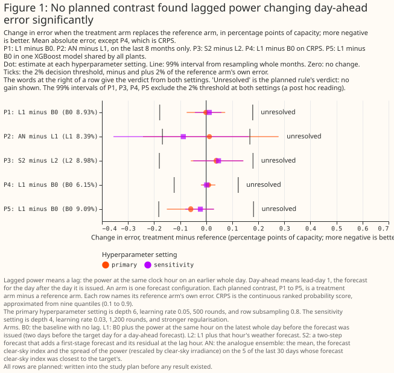

**Can lagged power improve a day-ahead point forecast?** No change was detectable. A single lag changed the error by −0.001 points [−0.075, +0.073] at the primary setting, and by +0.012 points [−0.043, +0.058] at a second, more regularised setting (planned contrast P1, Figure 1).

**Can lagged power improve the probabilistic forecast?** No. The continuous ranked probability score changed by +0.009 points [−0.020, +0.036] (P4). The 10% to 90% interval held 68.9% of hours without the lag and 68.5% with it, against a nominal 80% ([Figure 16](#the-10-to-90-interval-holds-about-69-of-hours-with-or-without-the-lag)).

**Does a lag help one XGBoost model shared by all plants?** No change was detectable: −0.059 points [−0.151, +0.029] (P5).

**Do the other lag ideas help?** None of the planned comparisons found a gain. The analogue ensemble, the arm with the lowest screening error, was no better than a single lag on the 8 months it was not chosen on (+0.012 points [−0.243, +0.278], P2), and a two-step forecast was no better than a lag with its weather (+0.039 points [−0.059, +0.143], P3).

**Can this study detect a planted power loss?** A single lag cannot: it recovers 9% of what an oracle that knows the planted 10% loss recovers. Arms that average over days or use satellite irradiance recover 59% to 100% of the oracle's gain (exploratory, [Figure 8](#arms-that-average-over-days-or-use-satellite-irradiance-recover-more-of-a-planted-loss)). A null for a single lag is therefore not evidence that no input tracking a plant's level could help.

**Do lags help at the longest leads?** Weekly statistics lowered the error by 0.449 points [−0.739, −0.157] at day 14 (exploratory), but blending the baseline with climatology lowered it by 0.925 points [−1.331, −0.474], so no lag arm beat that simpler fix ([Figure 13](#blending-the-baseline-with-climatology-lowers-long-lead-error-more-than-any-lag-arm-shown-does)).

**Can lagged inputs describe each plant to a model shared by many plants?** Partly. Adding each plant's ratio of power to forecast irradiance and its daily shape lowered a shared model's error by 0.311 points [−0.485, −0.144], including for a plant left out of training (−0.321 points [−0.510, −0.136] for the leave-one-plant-out fit), and this looks like level tracking rather than plant identity (exploratory, [Figure 15](#describing-each-plant-to-a-shared-xgboost-model-lowers-error-less-so-for-an-unseen-plant)).

**What can these data support?** They support the absence of a large gain from a single lag at these six plants, and hypotheses about level-tracking inputs. They do not support a claim about domestic solar, other regions, more than 18 months, plants with faults, or hundreds of plants.

> **How this page was made.** The research question came from a human. Everything else — the code behind every result, the analysis, the figures, and the text — was written by Claude, Anthropic's AI model (for this page, Claude Sonnet 5.5, Claude Opus 5.5, and Claude Sonnet 5). Several independent Claude reviewers have checked the method, the evidence, and the prose adversarially.

## Key findings

- **A single lag is a weak guide to a plant's level, because one day's weather swamps a level change.** A planted 10% power loss is recovered at 9% of the oracle's gain by one lag, against 59% by weekly statistics ([Figure 7](#a-single-days-lag-neither-detects-a-planted-power-loss-nor-beats-a-random-day-lag), [Figure 8](#arms-that-average-over-days-or-use-satellite-irradiance-recover-more-of-a-planted-loss)).
- **The screening winner did not hold up outside the months it was chosen on.** The analogue ensemble gained 0.164 points over the baseline across all 18 months, but 0.046 points (interval includes zero) on the 8 months it was not chosen on ([Figure 10](#on-the-8-months-not-used-for-screening-pc-w7-and-tf-gained-most-over-b0-but-an-did-not)).
- **The arms that gained most outside the screening months track level, and they gained mostly from 2026-02.** The satellite ratio, weekly statistics, and transfer ratio each lowered the error by 0.14 to 0.23 points on those 8 months, and a hindsight rescaling of each plant-month bounds what any level correction could gain at 0.34 points ([Figure 10](#on-the-8-months-not-used-for-screening-pc-w7-and-tf-gained-most-over-b0-but-an-did-not)).
- **At day 14 the ENS mean is worse than climatology, and most of a lag arm's gain there is the baseline moving towards climatology.** A random-day lag that carries no information gained 0.12 points in the first run ([Figure 12](#at-lead-day-14-b0-is-worse-than-climatology-and-a-random-day-lag-gains-too), [Figure 13](#blending-the-baseline-with-climatology-lowers-long-lead-error-more-than-any-lag-arm-shown-does)).
- **The quantile forecasts are over-confident with or without a lag**, because month-level errors push many hours outside the 10% to 90% interval ([Figure 16](#the-10-to-90-interval-holds-about-69-of-hours-with-or-without-the-lag), [Figure 17](#quantile-forecasts-are-too-narrow-too-many-hours-fall-outside-the-10-and-90-quantiles)).

## Introduction

**Flexpectation needs to know whether a plant's own recent power helps its forecast.** A lag could correct for soiling, panel degradation, a failed string, part of a plant offline, and changes in the weather forecast product. In a model shared by many plants, a lag could also tell the model about each plant, such as its ratio of direct-current to alternating-current capacity, without a physical model of the plant. The question came from [issue #1138 (Lag features for solar power forecasting)](https://github.com/openclimatefix/nged-substation-forecast/issues/1138).

**The study compares an XGBoost model with no lag (B0) against XGBoost models given one of 17 other inputs, at six NGED solar plants.** The forecast is for the day after the day it is issued (lead-day 1), driven by the mean of the 51-member ECMWF ensemble forecast (the ENS mean). A lag is the plant's power at the same clock hour on the latest whole day before the forecast was issued, which is two days before the target day for a day-ahead forecast.

| Weather input | Grid | Lead read | Plant data read | Delay assumed |
|---|---|---|---|---|
| ENS mean of ECMWF's 51 members | 0.25° | the 00 UTC run, lead-days 0 to 14 | power up to the issue time (09:00 UTC on the run's day) | none: the live service currently receives NGED power at least 6 hours late, which the study ignores |
| CAMS satellite irradiance (one input, PC) | point service | whole days before the issue day | the previous day is available at 09:00 UTC | 1 day (the service's latency since February 2026) |

## Data and methods

**The rows, the arms, and the models.** The study uses the matched-lead study's rows: 35,263 hourly solar rows at 6 plants from December 2024 to September 2026. The power record the lags are read from ends on 2026-07-01 (the final-test date, which the study does not open), so 29,445 rows at 18 calendar months remain at lead-day 1. Every error is divided by its own plant's capacity (its 99th percentile of metered output) before any mean or difference, and is reported in percentage points of capacity. Each XGBoost model uses the absolute-error objective, column subsampling off, three fitting seeds, and five folds of whole months. The baseline B0 has seven columns: hour of day, day of year, an era code, the sun's elevation and azimuth, and the ENS mean's irradiance and temperature at the same lead. Every other arm adds columns to those seven, and no arm is padded to equal width, because a duplicate column cannot win a split. The shuffled-lag null controls measure the bias of an extra column instead.

**The 18 sweep arms.** L1 (the lag), IM (the morning's power on the forecast day), L2 (L1 plus that hour's weather forecast), CTX7 (seven separate daily lags and their weather), W7 (the minimum, maximum, and mean of the same hour over the last 7 whole days), Q30 (the 30-day 90th percentile and median of the same hour), CK (the clipping ceiling), TF (the 30-day ratio of power to forecast irradiance), AN (the analogue ensemble: the power on the 5 recent days whose forecast clear-sky index was closest to the target's), PC (the ratio of power to CAMS satellite irradiance), S2 and S3 (two-step forecasts built on a first-stage model), RP (the plant's recent energy relative to the other plants), T1 (days since the record began, an interpolation bound), KS (a combination), N1 and N2 (random-day lag controls), and B0. Post-model corrections need no fit. Every window is anchored at the issue day, and the build asserts and probes that none reads data after the issue time.

**Planned and exploratory results.** A planned contrast was written into the study plan before any result existed; every other number is exploratory. The five planned contrasts are P1 (L1 minus B0, per plant), P2 (the best sweep arm minus L1 on the 8 months the sweep never screened), P3 (S2 minus L2), P4 (the continuous ranked probability score of L1 minus that of B0), and P5 (L1 minus B0 in one model shared by all plants). A lag "helps" if both hyperparameter settings give a 99% interval wholly below zero and a point estimate of at least 2% of the baseline's own error, which is about 0.2 points. The sweep scores each arm on the first 10 months, and picks the arm with the lowest error among 11 eligible arms (the analogue ensemble, AN) before any planned contrast is run. The follow-ups added after the first run's review are post hoc and labelled so.

**What the significance test covers.** Each interval resamples whole calendar months, paired across arms, and one of the three fitting seeds, 2,000 times. The test covers month-to-month weather and the fitting seed, not differences between plants. An exploratory row with no real effect has a nominal 5% chance of a 95% interval that excludes zero, the number of such rows is unknown, shared months make them cluster, and the page does not correct exploratory intervals for multiple comparisons. Of 83 exploratory intervals in the first run, 14 lay wholly below zero and 20 wholly above; of 87 in the follow-ups, 27 and 7. The planned contrasts use 99% intervals (a Bonferroni correction over five) and need both settings to agree.

**Controls.** B0 padded with nothing, N2 (a random day from months not being scored), and N1 (a random day 8 to 28 days earlier, keeping the plant's slow level) show what an extra column and a level-only lag do. A positive control multiplies power by 1 minus a planted loss in 9 of the 18 scored months and in a random half of the other months, applied before the lags are built, at 2%, 5%, and 10%. An oracle arm that is given the true shift factor shows the most any lag could gain, and a second control gives each plant persistent 4 to 12 week steps.

## Results

### Power follows forecast irradiance more closely than it follows the lag

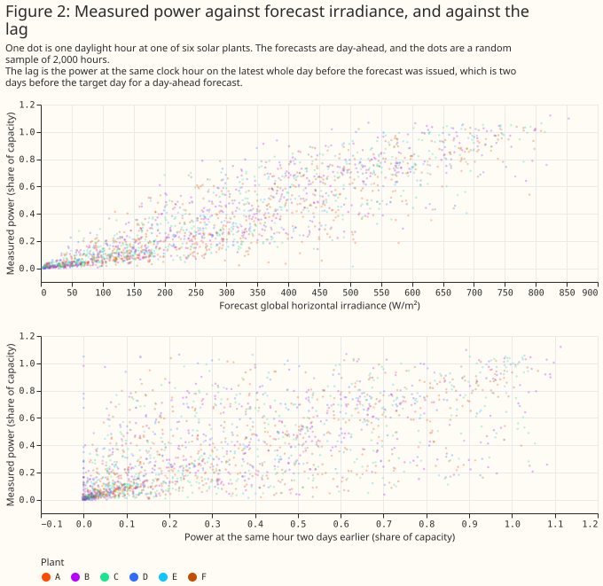

### How each lag column is built, and what the first-stage forecast never sees


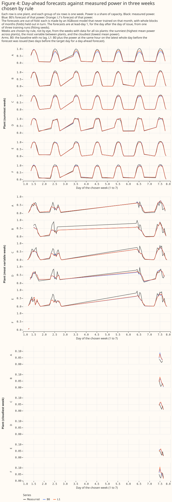

### The XGBoost models follow measured power

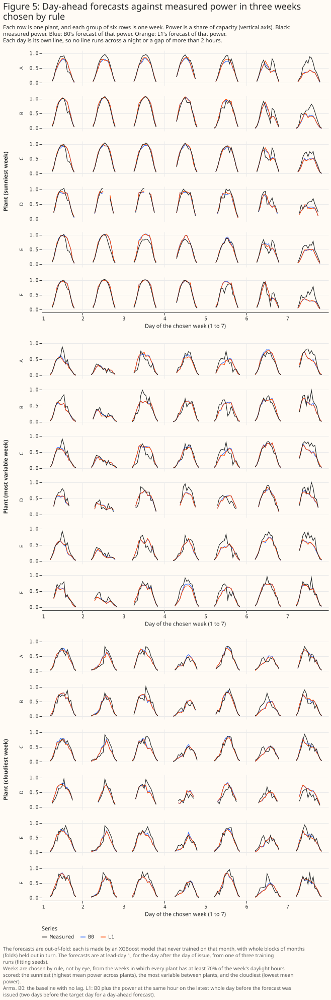

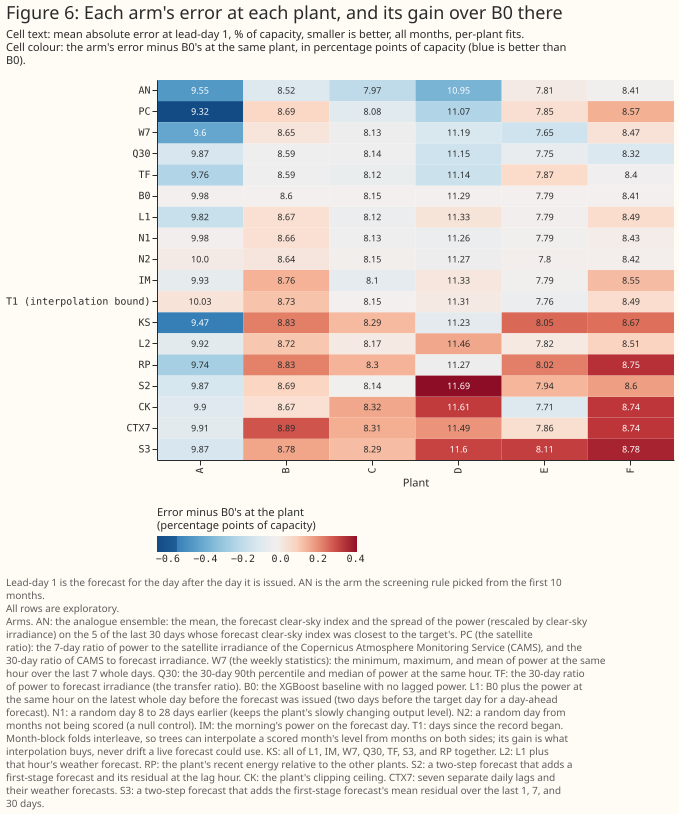

### A single day's lag neither detects a planted power loss nor beats a random-day lag

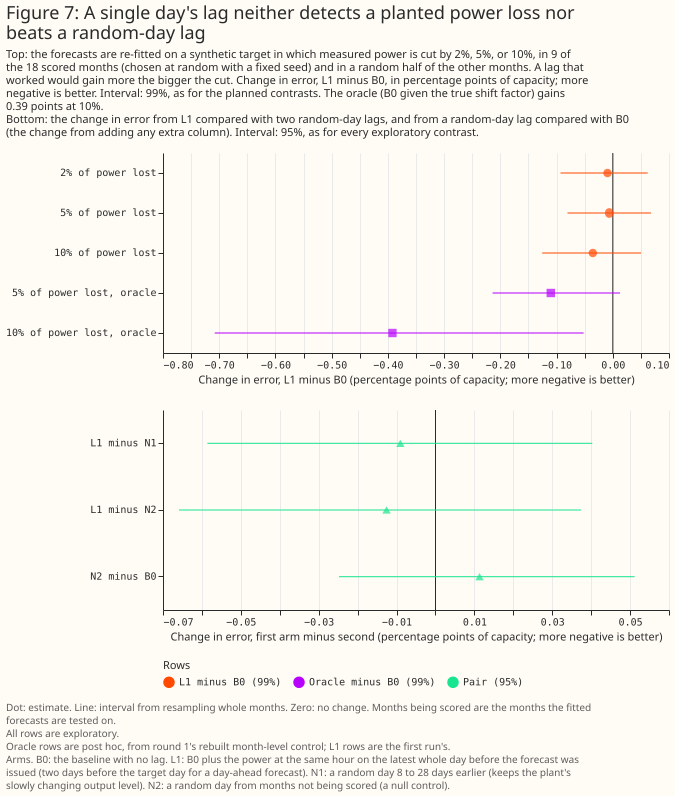

**A random-day lag changes the error as much as the real lag does.** The change in error from the shuffled-lag control N2 against B0 is +0.011 points [−0.025, +0.051], and L1 minus N2 is −0.013 points [−0.066, +0.037] (exploratory). The planted-loss control recovers none of 2%, 5%, or 10% for the single lag (L1 minus B0 is −0.036 points [−0.126, +0.049] at 10%, where the oracle gains 0.392 points).

### Arms that average over days or use satellite irradiance recover more of a planted loss

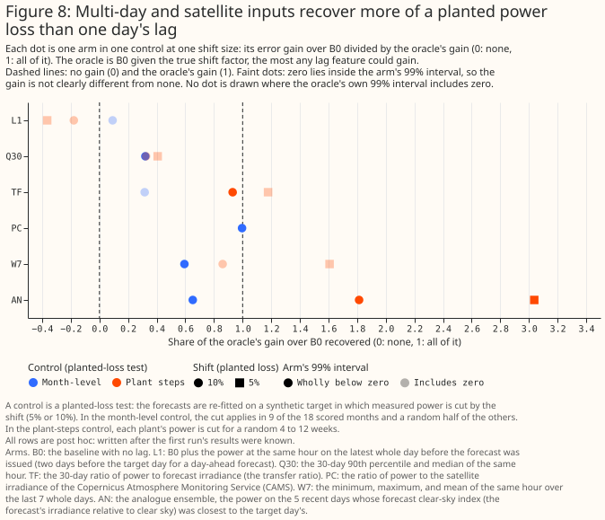

**At a planted 10% loss, the satellite ratio recovers all of the oracle's gain, the analogue ensemble 65%, weekly statistics 59%, and one lag 9% (post hoc, month-level control).** A 5% loss is too small for even the oracle to be statistically detectable (−0.110 points [−0.214, +0.013]), which is why the 2% rule cannot be the pass criterion for a control. In the plant-specific control the oracle gains only 0.057 and 0.096 points at 5% and 10%, so the shares of its gain are noisy (some exceed 1) and the page does not interpret them.

### The screen: no lag idea clearly beat the baseline in the screening months

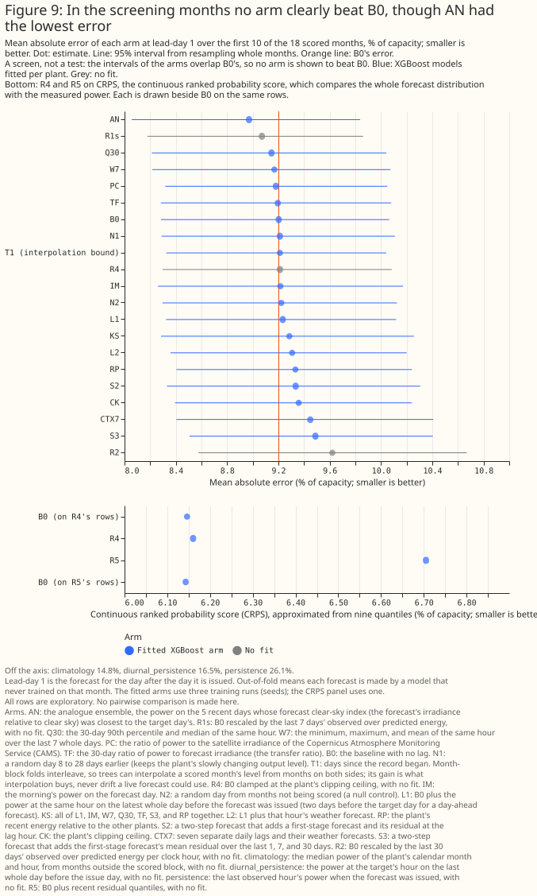

**The analogue ensemble had the lowest error in the first 10 months (8.97 points against 9.20 for B0), and most arms were within 0.2 points of the baseline.** Intervals overlap across arms, so the screen only chooses the arm for planned contrast P2.

### On the 8 months not used for screening, PC, W7, and TF gained most over B0, but AN did not

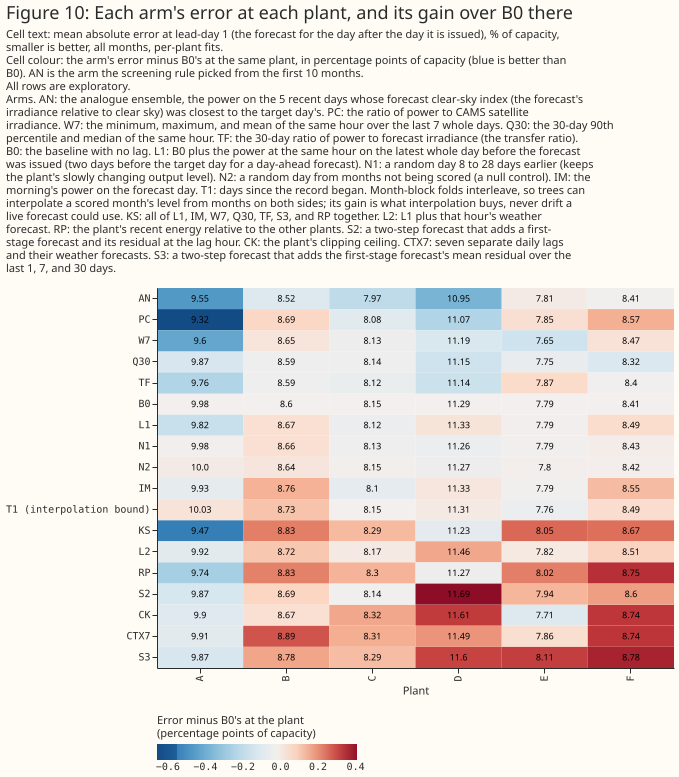

**Outside the screening months the analogue ensemble's gain over the baseline fell from 0.231 points to 0.046 points [−0.243, +0.169], a winner's curse.** The satellite ratio (−0.234 points [−0.507, −0.031]), weekly statistics (−0.165 [−0.353, −0.005]), and transfer ratio (−0.141 [−0.281, −0.015]) gained most on those 8 months, mostly from 2026-02, and selecting them now is a second selection that this page labels post hoc. Hindsight rescaling of each plant-month's forecast gains 0.337 points [−0.473, −0.215], the most any level correction could gain on these data. A version of the satellite ratio that waits two days for CAMS gains 0.240 points [−0.554, −0.012] on the same 8 months, as 0.234 points did with a one-day wait.

### Month by month, the differences from the baseline are small and change sign

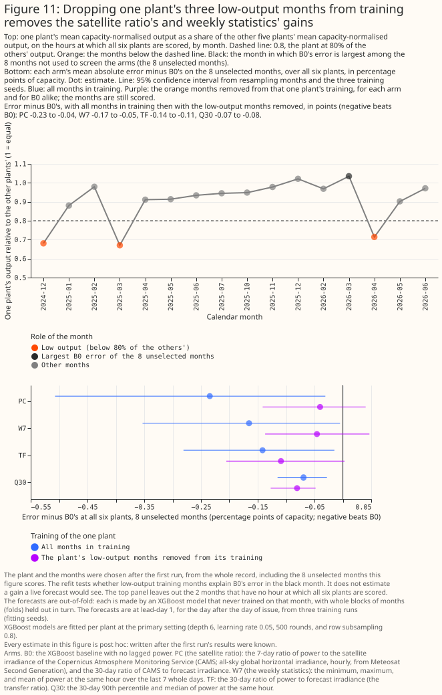

### At long leads, gains appear only where the baseline is worse than climatology

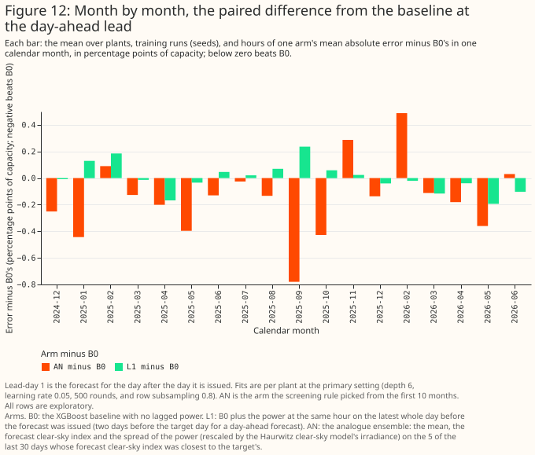

**At lead-day 14 the ENS-mean baseline's error (15.23 points) is above climatology's (14.54).** Weekly statistics gain 0.449 points [−0.739, −0.157] at day 14 and 0.196 points [−0.369, −0.004] at day 10, and the 30-day tracker gains 0.220 points [−0.342, −0.097] at day 10 and 0.217 points [−0.352, −0.070] at day 14. At lead-day 0 and 1 none of the arms differ from the baseline by more than 0.1 points except the satellite ratio and the analogue ensemble, which are described above.

### Blending the baseline with climatology lowers long-lead error more than any lag arm shown does

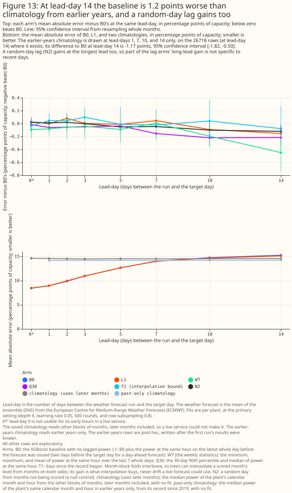

**A 50/50 blend of the baseline with climatology lowers the error by 0.925 points [−1.331, −0.474] at day 14, and a blend of the weekly-statistics arm with climatology by 1.072 points [−1.550, −0.567].** Adding climatology as one input column gains little (−0.060 points [−0.234, +0.109] at day 14). The shuffled-lag controls gain too: the refit N2 by 0.069 points [−0.147, +0.018], the first run's N2 by 0.120 points [−0.213, −0.032], and a control as wide as W7 by 0.174 points [−0.334, −0.006] at day 14, so part of a lag arm's long-lead gain does not come from recent information. Climatology in these arms uses months after the target day, which a live service would not have.

### A shared XGBoost model scored worse than one XGBoost model per plant

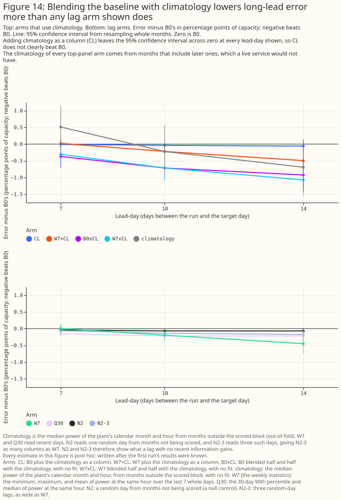

**On the same folds, one shared model given no plant information scored 0.255 points [+0.078, +0.450] worse than one model per plant, and a plant code closed the gap (+0.002 points [−0.113, +0.137]).**

### Describing each plant to a shared XGBoost model lowers error, less so for an unseen plant

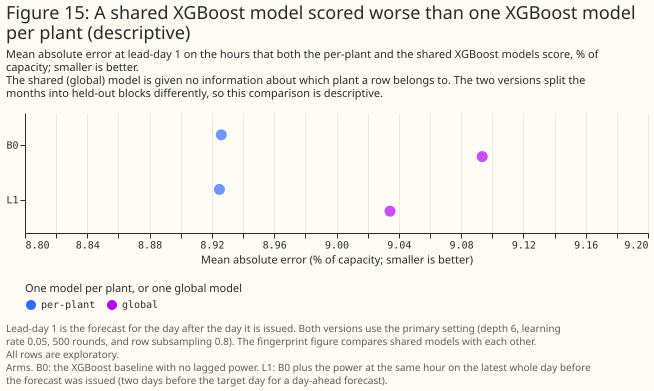

**A plant's ratio of power to forecast irradiance lowers a shared model's error by as much as a plant code does.** Compared with the shared baseline G-B0, adding a plant code lowers the error by 0.252 points [−0.368, −0.137], the plant code with the transfer ratio by 0.435 points [−0.567, −0.308], and the full fingerprint (transfer ratio, clipping ceiling, daily shape) by 0.402 points [−0.596, −0.209]. For a plant left out of training the full fingerprint gains 0.172 points [−0.381, +0.055], but the fingerprint without the clipping ceiling gains 0.321 points [−0.510, −0.136], and the ceiling alone lifts the unseen-plant error by 0.149 points [+0.018, +0.290]. The clipping ceiling is nearly constant within a plant and differs between plants, so in training it acts as a plant code, which cannot transfer to an unseen plant. Six plants say nothing about whether a fingerprint scales to hundreds of systems, because the trees have only five training points to interpolate between.

### The 10% to 90% interval holds about 69% of hours, with or without the lag

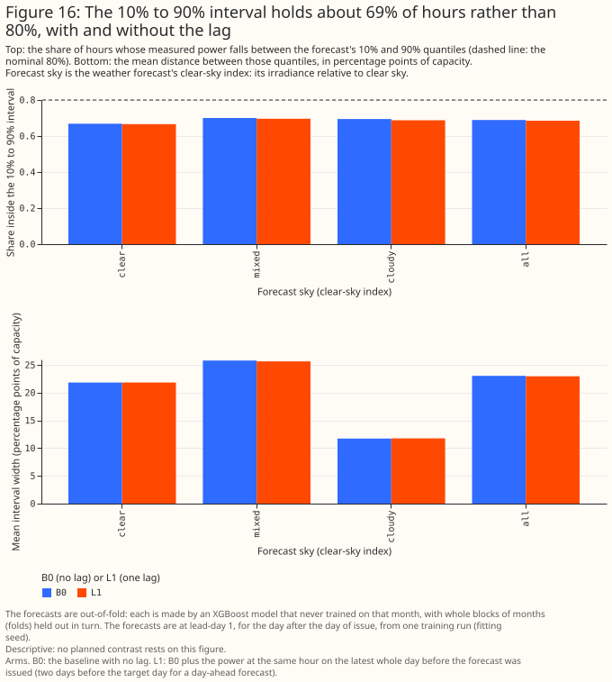

### Quantile forecasts are too narrow: too many hours fall outside the 10% and 90% quantiles

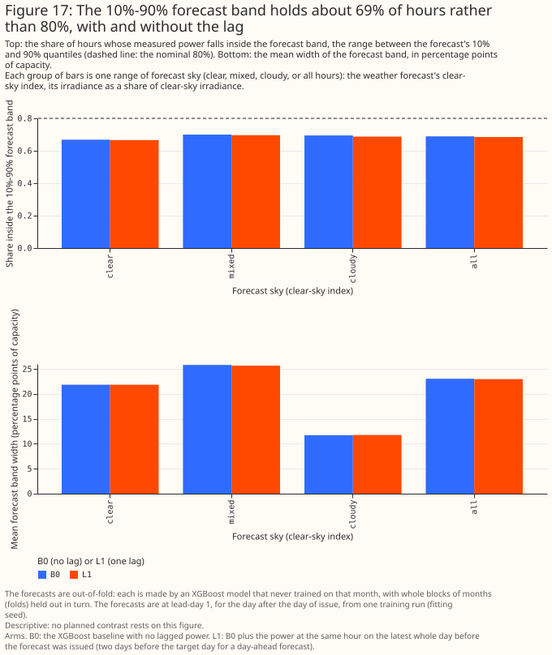

**The share of hours below the 10% quantile is 14.0%, and below the 90% quantile 83.0%, for B0, and the lag changes neither.** Adding the quantiles of recent residuals to the baseline's point forecast (R5) made the continuous ranked probability score 0.562 points [+0.415, +0.693] worse.

### Where each arm's trees split (descriptive)

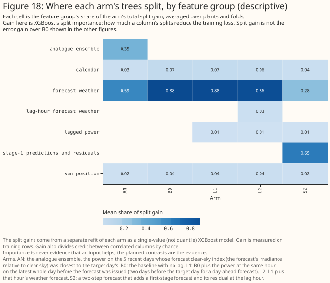

**Importance is descriptive, not evidence.** The lagged power of L1 carries 1.3% of the total split gain [0.8%, 2.5% across refits].

## Discussion: what to use

**For the day-ahead utility-scale solar forecast, do not add a one-day lagged power input on this evidence.** The 99% interval of its effect on mean absolute error is within ±0.075 points of the baseline's 8.93, and a lag of this kind could not detect even a planted 10% loss.

**If the project wants a level-tracking input, test the satellite ratio, weekly power statistics, and the transfer ratio in a planned study on more plants and a longer record.** Each gained 0.14 to 0.23 points on the 8 months outside the screening months, with an interval that excludes zero, but those results were chosen after the first run and cluster after 2026-02, the newest era of the weather forecast product. The satellite ratio needs CAMS ingested into the live system, and a CAMS delay of one day.

**At days 10 to 14, anchor the forecast to climatology before testing lag inputs.** A 50/50 blend with climatology beat every lag arm, so the first step at those leads is a climatology blend, not a lag.

**For a model shared by many plants, treat a plant fingerprint as level tracking and test it on more plants.** The gain for an unseen plant came from the transfer ratio, not the clipping ceiling.

## Limitations

- **Sample:** 18 scored months at 6 plants in one 25 km box. P2 rests on 8 months in two eras of the weather forecast product, with no summer.
- **Intervals:** a percentile bootstrap over 18 month clusters tends to under-cover; plants are pooled and weighted by row count; the test does not cover differences between plants.
- **Selection:** the analogue ensemble was chosen on the first 10 months, and the arms highlighted in the follow-ups were chosen after seeing the first run, so those results are hypotheses.
- **Cleaning removes the case the issue names:** outage, commissioning-ramp, and export-cap hours are dropped from targets and lags, so the study cannot show whether a lag helps when a plant is partly offline.
- **Controls:** the month-level control shifts every plant in the same months, which cancels the cross-plant arm, and the plant-specific control has a small oracle gain, so its shares are noisy.
- **Climatology and the climatology column** read months after the target day, which a live service would not have.
- **The first run's N2** came from a build whose draw order was not fixed and cannot be regenerated; the follow-ups refit N2 on a fixed seeded draw and both are shown. N2 at long leads is not a pure null, because it samples the plant's own power from other months, which acts as a weak climatology.
- **Latency:** the study assumes observed power up to the issue time, and CAMS with a one-day delay. The live system currently receives power at least 6 hours late, which the study ignores.
- **Capacity table:** errors are divided by the effective-capacity table built for the matched-lead study.
- **No era cut:** the folds cross ECMWF's Cycle 49r1 (2024-11-12) and Cycle 50r1 (2026-05-12) with no cut, as the matched-lead study does.

## Scope

The study does not cover domestic solar, wind, other regions, plants with known faults, lead times shorter than the 00 UTC run, a power feed that is minutes old, other weather products as the primary input (IFS HRES is not reported here), longer histories than 18 months, or hundreds of plants.

## Data and code availability

The ENS-mean forecasts, CAMS irradiance, and the matched-lead study's rows are inputs the project holds; NGED's power data are private, and no plant's name, identifier, or coordinates appear on this page. The scripts are in [`studies/lag_features/`](https://github.com/openclimatefix/nged-substation-forecast/tree/main/studies/lag_features), at the commit that merged this page. XGBoost 3.4.1 fitted every model on a GPU with 4 workers, at the primary setting (maximum depth 6, learning rate 0.05, 500 rounds, row subsampling 0.8) and the sensitivity setting (maximum depth 4, learning rate 0.03, 1,200 rounds). The reproduction check refitted the ENS-mean baseline at lead-day 1 and matched the matched-lead study's published 8.771% exactly.

## Reproducing the figures

```bash
uv run python studies/lag_features/build_lag_frame.py
uv run python studies/lag_features/fit_lag_arms.py --reproduction-check --device cuda --max-workers 4
uv run python studies/lag_features/fit_lag_arms.py --device cuda --max-workers 4
uv run python studies/lag_features/report_lag_features.py
uv run python studies/lag_features/followup_frames.py
uv run python studies/lag_features/fit_followups.py --device cuda --max-workers 4
uv run python studies/lag_features/report_followups.py
uv run python studies/lag_features/lag_features_charts.py
uv run python studies/lag_features/lag_features_charts.py --followups
```
