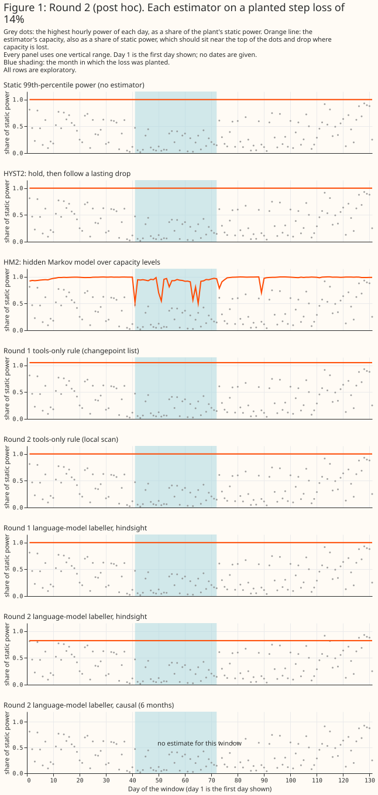

# Claude Sonnet 5.5 followed a clear 60% loss but found almost no small planted loss, so the planned contrasts are untested

**Bottom line.** With six deterministic evidence tools, Claude Sonnet 5.5 found almost no one-month
planted loss, but it found nearly every large, long one. **In the planned round it found 0 of 32
planted one-month losses (the fixed tools-only rule found 1), and the positive control (2 of 17
found, against an 80% gate) failed, so the planned contrasts C1 to C3 are untested and not null.**
A post hoc round 2 added a local scan to the tools and softened the prompt. On 34 new planted
losses the model with the tools then marked 8 of 68 (12%, 6 of the 34 events) before the hard
checks and **2 of 68 (3%) after them**, against 5 of 34 (15%) for the fixed rule on the scan. A
post hoc round 3, with an amended check written down first, scored 4 of 64 (6%) on 32 fresh losses,
so the 12% did not repeat. **In a post hoc easy case (a 60% loss lasting 90 days, starting on any
day) the model marked 23 of 24 (96%, 95% interval 80% to 99%) and the fixed rule marked 1 of 12.**
For Flexpectation (this project), a capacity labeller is not ready to use as a reference for
small losses. In this setup, with two prompts, one model, and two samples, no arm passed the 80%
control, so the study cannot say whether the model could pass it. The samples are small (32 to 34
losses), and every round 2 and round 3 figure is post hoc.


> **Status: all three rounds have run and are scored, and the page has had no science review of
> its revised text.** Round 1 was planned. Rounds 2 and 3 and the easy case are post hoc, and every
> number from them is labelled so.

**Costs.** The 138 round 1 calls cost US$3.04, the 156 round 2 calls US$3.93, and the 48 round 3
calls US$1.42, so the three rounds spent US$8.39 of the US$15 ceiling. The two probe calls cost a
further US$0.05.

## How the study works

**The record, the planted losses, and the score are the first study's.** The record holds 6 solar
plants over 2,495 days. A planted loss multiplies one plant's power for one calendar month by a
step, a ramp, or an intermittent pattern of 5% to 40%. The capacity error of an estimator is the
mean
absolute gap between its capacity on the planted record over its capacity on the original record and
the factor the loss applied, over the loss month and the 60 days after it. Two fresh draws (seeds
11441 and 11442, 16 losses each, never run before) carry every planned contrast. The first study's
tuning draw (seed 11430) sets Part 1's settings.

**Part 1 divides the physics model's seasonal bias out before an estimator reads the ratio.** The
reference for one plant on one day is the median of the other five plants' ratio on that day, plus
the plant's own day-of-year profile from earlier calendar years. Both read only days up to that day.
The shared part would hide a loss that hit all six plants on the same day, which the planted losses
(one plant per event) do not test.

**Part 2 gives a labeller six deterministic evidence tools.** They are the clear-sky ratio with
data-quality masks, the seasonal correction with the 7-day neighbour ratio, the hour-of-day shape
with the power envelope, the export-cap overlay for the one plant that has a cap, changepoint
candidates with permutation p-values, and a tools-only rule that writes a knot at each strong
changepoint. A case file is text tables and two small charts. It is a function of one plant's record
up to a cut-off day, and the builder has no argument that names a planted event.

**Part 3 asks Claude Sonnet 5.5 to write capacity knots.** A knot is a date, a capacity in
megawatts, and one of six causes. Capacity is linear between knots and constant outside them, so a
step is two knots one day apart, and an empty list means the static power. The hindsight role
reads the whole record once per plant. The causal role reads the record up to two days before each
of six monthly issue dates and is shown its previous estimate. A causal case file states the
static power and the knot dates it allows, and the static power is the 99th percentile of the
readings up to the cut-off day. The plants' fitted tilts, azimuths, and capacities are left out of
causal case files because they were fitted on the whole record. The physics model's output was
built from those fits, so one look-ahead remains in the modelled output.

**Part 4 rejects an implausible estimate with four hard checks.** The checks are bounds (0.2 to 1.1
times the static power), a step that a changepoint candidate supports, a variance of the corrected
ratio that the estimate does not raise, and consistency with the export cap. A causal estimate that
fails any check is replaced by the static power. A hindsight estimate loses only the failing knots.

**Planned contrasts (fixed in the plan before any result).** C1 compares tools plus model with tools
only, and C2 compares tools plus model with the model reading weekly energy totals alone, both as
the
change in mean absolute capacity error in points on the two fresh draws, with a 97.5% bootstrap
over (event, sample) pairs. The model adds value at a change of −1.0 point or lower with the
interval wholly below zero. C3 is the share of days that the capacity moves more than 5% from its
trailing median on the 23 quiet plant-months, against the 10% gate. The positive control (17 steps
of
30%) must be found at 80% or more, or C1 to C3 are reported as untested. A synthetic null record, in
which no plant ever changes, gives the false-alarm floor.

**Statistics and caveats.** A hit needs a drop segment within 14 days of the loss's start, of the
right sign and a size within 50% of the loss, and a recovery segment within 14 days of its end.
Hit rates carry Wilson 95% intervals, and a model hit rate counts each event twice (two samples),
so the report also gives the number of events with at least one hit. The planned bootstrap resamples
(event, sample) pairs. The post hoc contrasts resample whole events, keeping both samples of an
event together, and separately whole calendar months, because the six plants share weather and all
draws reuse one record. The two ways agree to within about 0.2 points. **A chance baseline** scores each
arm's answers on the record where nothing changes against the event dates of each draw.
**Powering.**
The spread of one event's paired difference was 3.4 to 3.5 points in round 1, so detecting a change
of −1.0 point at the 97.5% level with 80% power needs about 90 to 100 events, and 32 events could
never power C1 or C2. **Multiplicity.** Round 2 reports five post hoc contrasts, each before and
after the hard checks, at 97.5% with no correction, so read them as descriptive; roughly one in 40
intervals excludes zero by chance, and a lower bound of −0.03 is no firmer than that. **Noise
floor.** The mean absolute difference between the model's two samples on the original record was
0.45 points in round 1 and 0.07 to 0.12 points for the round 2 prompt, so a contrast under about
0.5 points is within sample-to-sample variation in round 1's terms.

**Round 2's prompt encodes the planted design.** It says a loss of a month or more is a legitimate
knot pair when the scan and the monthly table agree, and planted losses are exactly one calendar
month starting on the first, which lines up with the monthly table. Real losses persist and have no
calendar alignment, so round 2 is optimistic for real use. The easy case starts losses on random
days, which tests alignment in part.

**Leakage the page states.** The physics model's output rests on fits made from the whole record.
Hindsight case files print the 99th percentile of the whole record as the static power, the local
scan's windows read days on both sides of a date, and the model sees real calendar dates, so it can
draw on what it learned about UK weather. Nothing in a prompt names a planted event.

## Probe of the model route

**`claude -p` accepts images, reports its token counts and cost, and serves the requested model.**
The study calls Claude Code's print mode from an empty temporary directory with every tool disabled,
no settings, memory, skills, or MCP servers, and a fixed system prompt. It needs no API key. The
probe made two calls for US$0.054 in all. A 200 by 100 pixel line chart passed as a base64 image was
read correctly (the answer was 5), and an 18,016-character numeric table cost 12,559 input tokens,
or 1.44 characters per token. The command-line tool bills a prompt as cache-creation input at about
US$4 per million tokens, and it has no temperature flag, so every arm shares its default sampling.

**The planned 138 calls were estimated at US$12.87 and cost US$3.04.** The estimate assumed 4,000
output tokens a call, and the model wrote far fewer. A guard counts the cost the tool reports and
stops a run before a call that could reach the US$15 ceiling.

## Results

### Part 1: only HYST2 passed the false-movement gate, and it recovered nothing

| Estimator | Mean absolute capacity error, 32 planted losses (points) | Days that moved, 23 quiet plant-months | Mean delay to find a step (days) |
|---|---|---|---|
| Static power (S0) | 5.17 | 0.0% | not applicable |
| HYST2 (drop 15%, 3 days) | 5.31 | 4.1% | 12.4 |
| HM2 (stay 0.95, spread 0.2) | 3.59 | 13.8% | 6.2 |
| CX2S (the first study's tuned CX2) | 2.39 | 59.7% | 2.1 |

**The tuning rule picks the lowest recovery error among settings within the gate, and no HM2
setting was within it** (the least-moving setting moved on 13.8% of quiet days against the 10%
gate).
The HM2 row above is therefore the least-moving setting, and it is outside the gate. **The 23 quiet
plant-months both tune and score the gate, so "within the gate" is an in-sample result for HYST2.**
The
first study's published figures for its own estimators, scored on its ten selection draws, were 4.40
points and 2.6% of days for HYST, 2.9 points and 31.5% for HM, and 2.2 points and 63.4% for CX2,
against 5.00 points for doing nothing. The comparison is loose, because the draws differ. The
seasonal
correction cut HM's false movement from 31.5% to 13.8% and left CX2's roughly unchanged.

### Round 1 (planned): the model and the tools found almost no planted loss, and the control failed

**The model with the tools hit 0 of 32 planted losses (95% interval 0% to 5.7% over 64 answers, and
no events with a hit), the model on weekly summaries hit 0 of 32, and the tools-only rule hit 1.**
Zero of 32 rules out a hit rate above about 11% (the exact one-sided 97.5% bound), not a rate of
zero. The model did write knots on the real record, so it was not refusing to answer.

**The changepoint list had a candidate for few losses.** It listed a down candidate within 14 days
of the start for 3 of the 32 losses and an up candidate near the end for 7. The tools-only rule hit
one of the 3, and the model marked a drop near none of them. For two of the 3 the model answered no
change; round 1's answers carry no reason, because the prompt did not ask for one. Round 1's system
prompt also said to write a knot "only when several tools agree on a change that lasts", which
discourages marking a one-month loss.

| Planned contrast (round 1, mean absolute capacity error, points) | Estimate | 97.5% interval |
|---|---|---|
| C1: tools plus model minus tools only | +0.64 | [−0.50, +3.04] |
| C2: tools plus model minus model on weekly summaries | +1.04 | [+0.00, +3.45] |

**C1 to C3 are untested because the positive control failed.** C2's interval just excludes zero in
the wrong direction (the report's verdict is "worse"), and the gap comes from knots the model wrote
that differ between the planted record and the original one, not from detection, since no arm hit.
Of the 17 steps of 30%, the model with the tools found 2 (11.8%) and the tools-only rule found 2,
against the 80% gate. The control plants steps in consecutive months at three plants, and the model
read three consecutive planted months as one longer loss. Rescored per run of adjacent months (post
hoc), the control has 13 runs, and the model found 5 (38.5%) and the tools-only rule found 3
(23.1%),
still under the gate. C3, the false movement on the 23 quiet plant-months, was 0.0% for the model
and 6.7% [0.0%, 15.5%] for the tools-only rule, but a labeller that marks nothing scores zero, so
C3 is read with C1.

### Round 2 (post hoc): a local scan helped the fixed rule, and the checks cost the model its hits

**Round 2 changed the tools and the prompt after seeing draws 01 and 02, so it is post hoc and
judged on two new draws (03 and 04) that nobody tuned on.** The seventh evidence table compares
each 30-day window with the 30 days either side of it, on the corrected clear-sky ratio and on the
all-sky energy ratio. The system prompt says a loss that lasts a month is a legitimate knot pair
when the scan and the monthly table agree, and asks for a one-sentence note when there is no
change. The hard checks are unchanged.

| Arm (draws 03 and 04, 34 planted losses) | Hits (Wilson 95% interval) | Events with a hit | Mean capacity error (points) |
|---|---|---|---|
| Round 1 tools-only rule | 0 of 34 (0% to 10%) | 0 | 5.4 |
| Round 2 tools-only rule | 5 of 34 (6% to 30%) | 5 | 4.3 |
| Round 1 model with tools, 2 samples | 0 of 68 (0% to 5%) | 0 | 5.3 |
| Round 2 model, before the hard checks | 8 of 68 (6% to 22%) | 6 | 4.6 |
| Round 2 model, after the hard checks | **2 of 68 (1% to 10%)** | 1 | 7.1 |
| Model on weekly summaries | 0 of 34 (0% to 10%) | 0 | 5.2 |



**The checks removed most of the model's hits, and the cause is a design fault.** Check 2 accepts a
step only if a changepoint-list candidate lies within 14 days, but round 2's evidence adds a second
list, the local scan, so a knot the scan supports is dropped. After the checks the round 2 model
scored worse than round 1's (+1.65 points [+0.73, +2.72] resampling events). **The result after the
checks measures an internally inconsistent system and is reported as such.**

| Post hoc contrast (before the hard checks, points; negative favours the first arm) | Estimate | 97.5% interval, resampling events |
|---|---|---|
| Round 2 tools only minus round 1 tools only | −1.11 | [−2.28, −0.03] |
| Round 2 model minus round 1 model | −0.70 | [−1.61, −0.04] |
| Round 2 model minus round 2 tools only | +0.25 | [−0.53, +0.99] |
| Round 2 model minus the model on weekly summaries | −0.65 | [−1.56, +0.03] |

**The chance baseline is zero hits, so the round 2 hits are not chance.** Scored against the same
event dates on the record where nothing changes, every arm hit 0 of 34, including the dense round 2
rule that marks 40 steps on that record. By planted size, no arm hit a loss under 25% except the
fixed rule on the scan (18% of the 15% to 25% band), and the model's hits were all of losses of 25%
or more (6 of the 13 events). **The model and the fixed rule differ by control.** On the non-adjacent
control (18 steps of 30%), the model found 10 (55.6%, Wilson 34% to 75%, which does not exclude the
80% gate) with 0 false alarms, round 1's tools-only rule found 10 with 4, and round 2's tools-only
rule found 3 (16.7%) with 15. On the draws, the model added nothing detectable over the round 2
tools-only rule (+0.25 points). The two results do not agree, and the page does not choose between
them. On the null record round 2's tools-only rule marked 40 steps and the model marked none. The
model's false movement on the quiet plant-months was 4.4% [0.0%, 16.2%] and the fixed rule's was
1.2% [0.0%, 4.7%].

**Round 2 asked the model why it answered no change, and most of its notes cite the scan as noise.**
Of the 27 notes, 19 name the local scan and 17 of those also name seasonal effects, weather, or
noise (the rule is in the report). Two of them, with no plant named:

- "Apparent falls cluster in each Oct-Jan winter and repeat yearly (shared seasonal correction
  swings, low sun, afternoon shading), the corrected ratio returns to about 100 every year, and the
  hour-of-day table shows no lasting hole, so there is no lasting capacity change."
- "The local-scan episodes are mostly winter/summer seasonal-correction artifacts that recur every
  year, and the 2025-06 to 2025-07 dip is matched by the neighbour ratio (84-85) and a similar dip in
  June 2023, so it reads as weather."

The scan lists up to 15 episodes per plant at the noisiest plants, and the model reads many as
weather, which is partly right because the early years of the record are noisy.

### Round 3 and the easy case (post hoc): the amended check restored the model's hits, and the model followed a clear loss

**Round 3 is the only evaluation of the amended step check.** The amended check, written down with
a test before any round 3 call, accepts a knot pair when the local scan or the changepoint list has
a candidate within 14 days (a changepoint candidate keeps its size tolerance). Everything else was
frozen. It was evaluated on fresh draws 05 and 06 (32 losses), with 2 samples.

| Arm (draws 05 and 06, 32 planted losses) | Hits (Wilson 95% interval) | Events with a hit | Mean capacity error (points) |
|---|---|---|---|
| Round 1 tools-only rule | 1 of 32 (1% to 16%) | 1 | 4.7 |
| Round 2 tools-only rule | 3 of 32 (3% to 24%) | 3 | 5.0 |
| Model, before the hard checks | 4 of 64 (3% to 15%) | 2 | 5.7 |
| Model, original checks | 0 of 64 (0% to 6%) | 0 | 7.3 |
| Model, **amended checks** | 4 of 64 (3% to 15%) | 2 | 5.4 |

**The amended check removed the check's damage, and round 2's 12% did not repeat.** The model with
the amended checks hit 4 of 64 (6%), the same as before any check, against 0 of 64 under the
original checks. It did not detectably beat the fixed rule (+0.33 points [−1.27, +1.92]). Replaying
draws 03 and 04 through the amended check gives 8 of 68 and is exploratory, because those draws
informed round 2. The gap between round 2's 12% and round 3's 6% is the size that two samples of 32
to 34 losses produce by chance.

**In the easy case the model followed the signal and the fixed rule did not.** The easy case plants
one 60% loss lasting 90 days at every plant, starting on a random day, in two records (12 losses).
The model hit 23 of 24 answers (96%, 80% to 99%), with a hit on every event, before the checks, and
22 of 24 (92%) under the amended check. The original check kept 12 of 24 (50%). The fixed rule on
the scan hit 1 of 12. **This shows the model follows a large, long loss that the tools list, and
that the 30% control's failure is mainly about size and about the tools' lists, not an inability to
use the tools.** The easy case does not show that the model can find a loss it cannot see in the
tools.

### Exploratory: real low months, the plant under network management, and the causal role

**These results are the model's opinion on the real record, and they rest on no ground truth.** In
the lag study's 3 low-output plant-months at one plant, the round 1 model's hindsight capacity
averaged 0.77, 0.81, and 0.91 of the static power, and the tools-only rule's averaged 0.84, 0.88,
and
0.81. Round 2's model gave 0.77, 1.00, and 0.93, and round 2's tools-only rule gave 1.00, 0.35, and
1.00, so the labels vary between versions. For the one plant under active network management, the
tools-only rule wrote 3 knots on the record with the capped hours left in, none naming curtailment,
although the export cap bound on 134 days. That is a failure of the cause rule on the one case where
the cap should explain a fall. The causal role ran only in round 1: it wrote knots in 15 of 72
calls and 5 calls failed a hard check. It was not scored for detection and was not re-run in
round 2, so this page makes no claim about it.

## Discussion

### Where else a language model could help in the NGED data pipeline

**Each idea below is speculation unless a repository page is cited, and each follows one pattern:
deterministic tools first, the model reads their output.** The pattern is the one this study tests.
The tools produce numbers that can be checked. The model chooses among them and explains the choice.

- **Labelling faulty metering and switching events.** The [requirements](../../background/requirements.md)
  list switching-event detection and faulty-meter detection as objectives, and say that a negative
  result on detecting switching from power data would inform extracting switching records from
  operational systems. A model could read changepoint candidates, stuck-run flags, and neighbouring
  substations' power and propose a label. The risk is a confident label with no evidence behind it.
- **Reading outage notices, curtailment notices, and DNO documents (speculation).** A model could
  turn free text into dated rows for a table the pipeline already reads. The risk is a
  mis-parsed date or substation that enters the data without anyone noticing.
- **Turning data-quality warnings into operator-readable explanations (speculation).** The
  [inherent-stability](../../design-philosophy/inherent-stability.md#three-audiences-three-channels)
  design already sends an attributable event to the developers through Sentry. A model could write
  the one-paragraph explanation from the event's tags. The risk is an explanation that sounds
  plausible and names the wrong cause.
- **Cleaning the substation metadata table (speculation).** A model could propose fixes to
  inconsistent names or coordinates for a human to accept. The risk is a silent edit to a table the
  rest of the system trusts.
- **Writing the daily health summary, and explaining a forecast miss (speculation).** A model could
  read the day's check results and the largest errors against the forecast and write a few
sentences.
  The risk is that the explanation attributes a miss to a cause it never tested.

**Every use shares three risks and three requirements.** The risks are non-determinism (the same
input can give a different answer), leakage (a model that has read the real dates of a period
carries what it learned about the weather in them), and cost (this study's probe shows a
case file costs a few US cents, so a use on every series every day needs a budget). A live use would
need the answer cached by the hash of its prompt, every prompt and answer logged, and a guarded
fallback to the path that has no model. That follows the
[degradation rules](../../design-philosophy/inherent-stability.md#the-rules): an absent or invalid
model answer is treated as missing input, widens the uncertainty, and is recorded on the row, and a
warning path never raises. Following the same rules, a capability that could live in the training
loop belongs there, so the model's output would be a training label, never part of the serving path.

### Proposed follow-up study

**The follow-up would give the labeller a detector built for one-month losses, a hard check that
shares the detector's candidates, and a larger model, then re-test them on fresh draws that include
losses starting mid-month.** This study learned that the fixed tools set a floor of about 10% on
small losses, that the model followed a loss of 60% and added hits on the 30% control (10 of 18
against 3 of 18 for the fixed rule), and that the hard checks and the evidence must share one list
of candidates. It also learned that round 2's gain over round 1 on small losses was 12% once and 6%
once. The follow-up would add two things this study excluded: a matched one-month filter whose
threshold is set on the null record (which gave 40 false steps), and a run with a larger model (an
Opus-class model, whose cost at five times Sonnet's price would be about US$6 to 10 for 78 calls,
an estimate and not a measurement). A rough cost is two days of agent time, no downloads, and
about US$10. The case for it is that the lag study's neighbour-ratio threshold flags only 3
plant-months, and this study did not search for other real losses. The case against is that no
planted-loss draw in this study had a persistent, calendar-unaligned small loss, and 32 losses give
wide intervals. The proposal commits the project to nothing.

## Limitations

**The numbers depend on small samples, a shared record, and a prompt written for the planted
design.** Each round rests on 32 to 34 planted losses, so the intervals are wide, and a null result
is a finding about sample size. All draws reuse one record, the six plants share weather and one
satellite box, and the model's labels share the tools' inputs, so they cannot score the physics
model's own errors. The planted losses last one month and start on the first, while real losses
persist. Round 2's local scan, its 15% threshold, its softer prompt, and the amended check followed
earlier results, so rounds 2 and 3 and the easy case are post hoc. The hard checks were not retuned
on draws 03 and 04. Real calendar dates let a model draw on what it learned about UK weather, and
the satellite normalisation mutes that and does not remove it. The study tests only Sonnet 5.5.

## Scope

**This page says nothing about wind, about plants outside the 6 studied, or about a forecast.** The
exploratory forecast-level check (`fit_forecast_arms.py`) divides the lag study's baseline forecast
by
each capacity series at one XGBoost setting, has no decision rule, and has not been run.

## Data and code availability

**The satellite irradiance and the lag-features study's rows are inputs that the project holds.**
NGED's power data are private, and no plant's name, identifier, or coordinates appear on this page.
The prompt and answer log pairs plant letters with dates, so it stays in the private data store and
is
never committed. The scripts are in
[`studies/llm_capacity_labeller/`](https://github.com/openclimatefix/nged-substation-
forecast/tree/main/studies/llm_capacity_labeller),
at the commit that merged this page, and the shared code is in `packages/studies/`. The model is
Claude Sonnet 5.5 through `claude -p` (version 2.1.296).

## Reproducing the figures

```bash
uv run python studies/llm_capacity_labeller/build_labeller_inputs.py
uv run python studies/llm_capacity_labeller/estimate_part1.py
uv run python studies/llm_capacity_labeller/probe_claude_cli.py --summarise
uv run python studies/llm_capacity_labeller/run_labeller.py --phase estimate
uv run python studies/llm_capacity_labeller/run_labeller.py --phase hindsight --confirm-spend
uv run python studies/llm_capacity_labeller/run_labeller.py --phase causal --confirm-spend
uv run python studies/llm_capacity_labeller/score_labeller.py
uv run python studies/llm_capacity_labeller/build_round2_inputs.py
uv run python studies/llm_capacity_labeller/run_round2.py --phase estimate
uv run python studies/llm_capacity_labeller/run_round2.py --phase all --confirm-spend
uv run python studies/llm_capacity_labeller/score_round2.py
uv run python studies/llm_capacity_labeller/build_round3_inputs.py
uv run python studies/llm_capacity_labeller/run_round3.py --phase estimate
uv run python studies/llm_capacity_labeller/run_round3.py --phase run --confirm-spend
uv run python studies/llm_capacity_labeller/score_round3.py
uv run python studies/llm_capacity_labeller/fit_forecast_arms.py --device cuda --max-workers 4
uv run python studies/llm_capacity_labeller/llm_capacity_labeller_charts.py
uv run python studies/llm_capacity_labeller/llm_capacity_labeller_charts.py --round 2
uv run python studies/llm_capacity_labeller/report_llm_capacity_labeller.py
```
