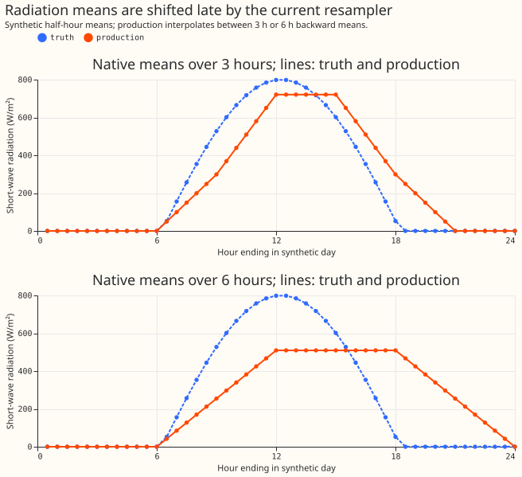
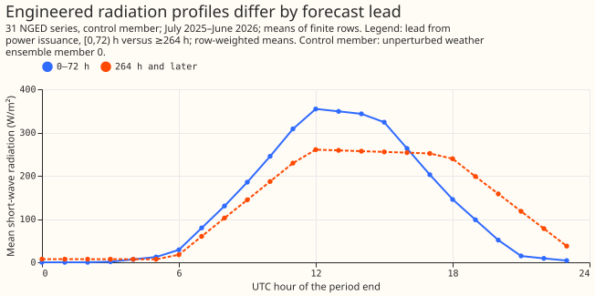
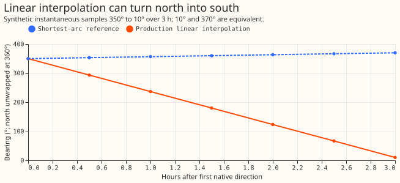
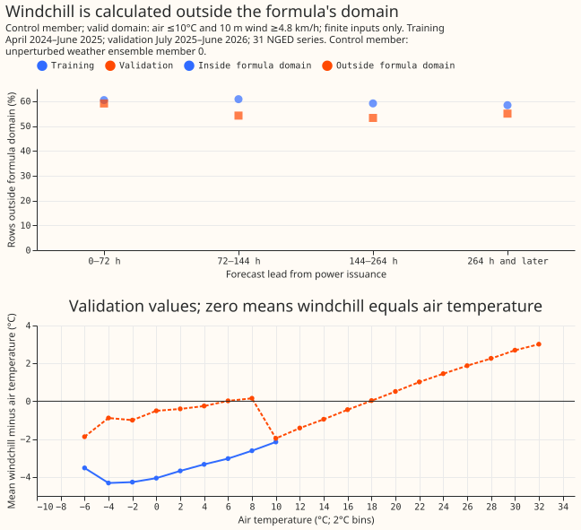
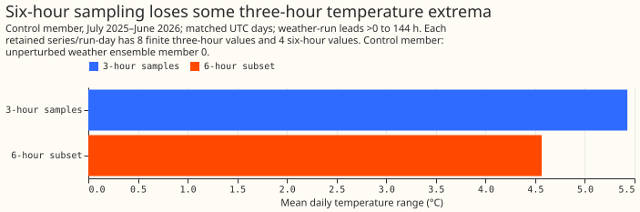
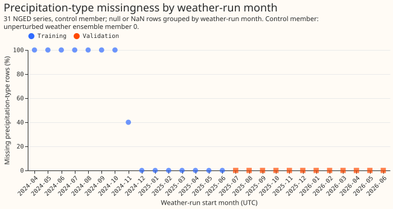
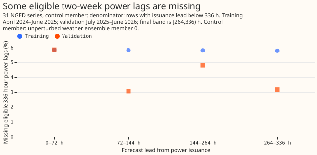
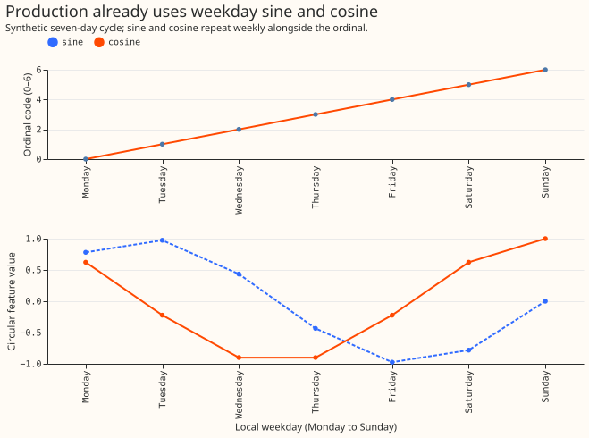
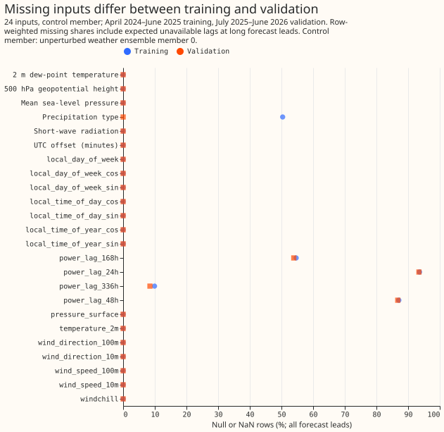

# Production feature faults: diagnosis and forecast effects

> **Draft study.** The diagnostic audit is complete. Forecast experiments and the final scientific
> and prose reviews are still in progress. Forecast-effect conclusions will follow.

Two reproducible calculation problems affect the conversion of weather inputs to the half-hourly
timestamps used by the power forecast. Radiation values are averages over the interval ending at
their timestamp, but the current conversion treats them as measurements at that instant. Wind
directions near north can be interpolated through south. Windchill is also evaluated outside the
formula’s stated domain. Temperature loses some extrema on the coarser weather grid; precipitation
has a historical availability boundary; and the checked two-week lag gaps correspond to absent
observations.

This study investigates Part 1 of [issue
1156](https://github.com/openclimatefix/nged-substation-forecast/issues/1156), following the
suspicious input plots in [quick wins](quick-wins.md). It includes a diagnostic audit and
study-only corrected-feature experiments. No production code was changed.

The diagnostic audit covers **9,762,768 training control-member rows** from April 2024 through
June 2025 and weekly validation weather runs from July 2025 through June 2026, across 31 series.
Its prevalence statements apply to the unperturbed ensemble member 0. Forecast experiments train
on that member and predict all 51 members of the same weekly runs. They use observed power.

A series is one power time series being forecast. Forecast lead is the time from issuance to the
forecasted time. The control member is the unperturbed member of the weather ensemble. Training
and validation refer to the two periods above.

## Forecast baseline and comparisons

The baseline is a newly trained XGBoost forecast for each power time series, using production’s
input features and training settings. XGBoost fits an ensemble of decision trees. Every corrected
comparison uses the same saved training examples. This baseline is distinct from the stored
quick-wins forecasts and from a production deployment. Every fit uses the graphics processor
(GPU).

The primary comparison retains all 24 input columns and makes every column available when each
decision tree is fitted. This setting, called column subsampling of 1, follows the study protocol.
Otherwise it uses production’s 500 trees, depth 6, learning rate 0.05, minimum child weight 1, and
row subsampling 0.8. The separate production-hyperparameter comparison uses production’s column
subsampling of 0.8. A second, more regularised setting checks the planned contrasts. Each setting
uses fitting seeds 0, 1, and 2.

The five forecast contrasts were planned before fitting:

| Contrast | What it measures |
| --- | --- |
| All corrections versus baseline (planned) | Combined candidate effect |
| All corrections versus all except radiation (planned) | Radiation’s contribution with the other corrections enabled |
| All corrections versus all except wind direction (planned) | Wind’s contribution with the other corrections enabled |
| All corrections versus all except guarded windchill (planned) | Windchill’s contribution with the other corrections enabled |
| Precipitation masked versus all corrections (planned) | Sensitivity to the availability mismatch |

The effects of removing individual corrections need not add to the effect of applying them all.
Ordinal-weekday masking, with weekday sine and cosine retained, is exploratory. Missing history
and the true extrema between native weather samples cannot be reconstructed from these inputs, so
neither receives an invented “corrected” score.

<!-- SCORE_RESULTS -->

## Radiation: interval means are displaced and flattened

Each native radiation value is a mean over the **interval before its timestamp**. Here, “native”
means the weather forecast’s original sampling grid. The current upsampler fills the half-hourly
grid by drawing straight lines between the timestamped means. This spreads daylight energy later
and flattens the daily peak. The independent synthetic probe aggregates half-hour backward means
into three- or six-hour means before calling the current production upsampler. It therefore has a
known answer, rather than treating a different interpolant as observed truth.

On the complete interior day, the radiation-weighted mean time is late by **1.25 hours** for
three-hour inputs and **2.75 hours** for six-hour inputs. Both reconstructions preserve this
probe’s daily energy of **6.115915 kWh/m²**. Energy conservation therefore does not establish
correct timing. The synthetic reference labels each half-hour by its ending timestamp.

The cached engineered profiles show the same broad flattening at longer leads. This comparison is
descriptive: the lead groups differ in weather and forecast error, so it cannot by itself measure
the resampler’s causal effect.

A positive native mean at a dark endpoint can be legitimate: the preceding interval may contain
daylight. The audit separately checks fully dark native intervals, and finds no native radiation
above 1 W/m² in those checked intervals. Do not repair native means by setting every dark endpoint to
zero.

**Recommended production change:** give interval-mean fields a dedicated resampling path in
`ml_core/features/_nwp.py`. For short-wave, divide each native mean by the clear-sky mean over the
same native window, anchor that ratio at the window midpoint, interpolate daylight ratios, hold
the nearest daylight ratio outside daylight, and multiply by the backward half-hour clear-sky
mean. Validate timing, nighttime output, and interval energy independently. The experiment uses
the existing reviewed study helper with Haurwitz clear sky and 15-minute midpoint quadrature. It
is a candidate shape reconstruction, not recovery of the unknown sub-grid truth.

Long-wave and precipitation rates also need their interval convention respected, using a suitable
conservative policy. Long-wave is absent from the current 24-feature forecast recipe, so
correcting it alone cannot change the XGBoost forecast’s predictions. Review the generic
continuous-field set’s storage, rounding, and dashboard callers when implementing the resampling
change.

See [variable
conventions](../../architecture/nwp-variable-conventions.md#period-ending-variables-are-interpolated-as-though-they-were-instantaneous)
and the [resampling roadmap](../../roadmap/xgboost-improvements.md).

## Wind: interpolation crosses the wrong side of the circle

Between 350° and 10°, a linear numeric interpolant passes through 180°, although both endpoints
are near north. A shortest-arc reference passes through 0°. This is an interpolation problem; the
additional choice of how to represent direction to a tree model is a separate question.

In the audited control member, roughly 3–7% of interpolated wind directions differ from the
shortest-arc reference by more than 1°, depending on height, training or validation period, and
forecast lead. The percentage counts inserted half-hours with supported native samples on both
sides. Original sample times and ambiguous pairs separated by 180° are excluded. These
discrepancies are measured against shortest-arc reconstruction, not observed wind. Every lead band
has affected series.

**Recommended production change:** retain and interpolate native wind components, then derive
speed and bearing. If only speed and direction are stored, convert them internally before
interpolation. The score experiment isolates the wrap problem by changing direction through
shortest-arc interpolation at both heights while leaving speeds unchanged. Its result therefore
does not measure every effect of a future vector interpolation implementation.

See [the documented wind
convention](../../architecture/nwp-variable-conventions.md#wind-direction-is-interpolated-across-the-0360-wrap).

## Windchill: the formula runs beyond its intended conditions

The cached values exactly match the current windchill expression. The problem is its unrestricted
use, rather than a discrepancy between the cache and that expression. Its stated domain is air
temperature at most 10°C and wind at least 4.8 km/h. Outside those conditions, the expression can
produce a value warmer than air temperature.

Across lead bands, about 53–59% of finite validation inputs lie outside that domain; training
shares are about 58–61%. This is not an estimate of forecast damage: temperature and wind are
already features, and the XGBoost forecast may use the unrestricted expression as a nonlinear
transform.

**Recommended production change:** specify the feature’s semantics explicitly and guard the
formula. The studied candidate falls back to air temperature outside the domain, preserving
missing inputs. A renamed unconstrained nonlinear feature would be a different modelling choice,
requiring its own evaluation.

## Temperature: the six-hour grid omits extrema

Retaining every second three-hour temperature sample reduces the mean daily range from
**5.427829°C to 4.565359°C**. The comparison covers **8,060 complete days**, counted separately
for each power time series and weather forecast run in the validation period. The mean loss is
**0.862471°C**. These days use native weather leads above zero through 144 hours and the actual
six-hour grid phase. Each day has eight finite three-hour samples and four retained six-hour
samples.

This emulation measures information lost by thinning short-lead weather, not the error in real
long-lead temperature forecasts. It also does not establish the true atmospheric daily range. A
shape-preserving cubic interpolant cannot recover an extremum absent from the retained samples.

**Recommended production change:** preserve higher-frequency native temperature where available.
Treat any diurnal reconstruction beyond the native grid as a separately validated model. Do not
claim that switching interpolants alone restores the omitted extrema.

See [instantaneous-variable amplitude
loss](../../architecture/nwp-variable-conventions.md#instantaneous-variables-lose-diurnal-amplitude).

## Precipitation: training spans an availability boundary

Precipitation type is entirely missing in the early training months, partly missing in November
2024 and complete in the later training and validation months. The audit groups by weather-run
start, so long forecasts crossing a calendar boundary do not move the apparent source boundary.

The XGBoost forecast trains with precipitation type missing for part of training and available
throughout the forward validation year. Missing-value branches can absorb some of this difference;
that does not make the availability shift disappear. The masked-feature contrast measures whether
using the available history helps this recipe. It cannot estimate the benefit of obtaining the
missing historical categories.

**Recommended production change:** record availability eras, monitor missingness by run, and
backfill only from a source with verified compatible semantics. Evaluate availability explicitly
in both chronological directions before relying on the feature. Do not invent categories or
replace missing precipitation type with “no precipitation”.

## Two-week power lags: the checked gaps have missing source observations

The two-week power lag uses observed power 336 hours before the forecasted time. It is eligible
only when that observation precedes forecast issuance. Among eligible control-member rows, roughly
3–6% of lag values are missing, depending on training or validation period and lead. The lookup
audit compares each cached lag with the guarded current power source at `valid_time − 336 hours`.

Every checked eligible row is either a matching value or an absent observation key. There are no
unexplained cache/source value mismatches in this audit. This comparison with the current source
does not establish why a historical observation is absent, or prove every historical join was
correct. Repeated training lookups are counted as rows; unique lookup counts are only unique
within their reported group and must not be summed as global distinct counts.

At issuance lead 336 hours and later, the lag would use an observation at or after issuance and
must be missing. The cached control-member rows respect that constraint. The current-code probe
also checks the equality boundary with a nonzero nine-hour weather publication delay.

**Recommended production change:** retain the leakage guard, distinguish absent observations from
failed joins in monitoring, and investigate upstream gaps only where the missing readings should
exist. Avoid forward filling or using observations at/after issuance to hide the gaps.

## Weekday and overall completeness

Production already supplies weekday sine and cosine alongside the ordinal weekday. The ordinal
code is an encoding choice, not evidence that the weekly cycle is absent. Its masking experiment
keeps the two cyclic columns and all 24 feature positions.

The completeness plot includes all forecast leads. Consequently, short power lags have high
missing shares because they are intentionally unavailable beyond their leakage horizon. Compare
eligible lag rows separately before interpreting these shares as faulty data.

## Scope, reproducibility and limits

The radiation and direction candidates reconstruct **cached native-grid values**, which are not
guaranteed original native observations: production interpolation can already have filled a native
null. Linear reconstruction is checked against the cached production values before correction.
Unsupported boundaries and originally missing inputs retain production values. The clear-sky
candidate may change individual interval energy; the generated score report prints that
discrepancy. A positive score result would support this candidate policy, not every possible
implementation of an interval-aware resampler.

All comparisons preserve training targets, sorted training order, forecast cases, and member
labels. Losses are normalised by each series’ effective capacity before averaging, with series
given equal weight. The continuous ranked probability score (CRPS) uses the fair ensemble
estimator. Mean absolute error (MAE) is calculated from the ensemble mean. Errors and changes are
percentage points of effective capacity, so a 0.15-point improvement is not a 15% relative
improvement.

Whole-month bootstrap intervals include sensitivity over the three fitting seeds; they are not
uncertainty over all possible fits or future weather regimes. Subgroup results are descriptive and
involve multiple comparisons.

The backwards fold is a stress test trained on July 2025–June 2026 and evaluated on April
2024–June 2025. Its future-trained chronology is not a prospective validation result. The
production-hyperparameter cached-data refit is also not a reproduction of the entire serving
pipeline. No official leaderboard score is claimed.

Full real-data bulk-versus-single-run feature equivalence and power/weather clock-offset
correlations remain untested. Synthetic probes establish their stated mechanisms, not those wider
properties. The study also makes no causal estimate for temperature information that was never
retained, historical precipitation that is unavailable, or power readings that do not exist.

Scripts and commands are in the [study
README](https://github.com/openclimatefix/nged-substation-forecast/tree/main/studies/production_feature_faults).
The generated diagnostic and score reports are the numerical evidence for this page. Input,
source, and configuration hashes bind the outputs to their runs. Reviews use fresh available
reviewers in place of the study skill’s unavailable Claude models; the PR records the review
findings and triage.

The proposed follow-up is a production PR for interval-aware radiation resampling and circular
wind interpolation, with feature-path equivalence and energy controls; allow roughly two to three
engineering days, then repeat the same forecast contrasts on its actual engineered outputs.

## Production implementation handoff

**Implement the confirmed resampling faults first, then the windchill guard and availability
monitoring.** The order below reflects the diagnostic evidence and implementation dependencies. The
forecast experiments are still running, so the order is not a final ranking of forecast-score
improvements. The next session should read this section alongside the generated diagnostic report in
`studies/production_feature_faults/results/diagnostics.md` and the completed score reports when
available.

### 1. Give radiation an interval-aware resampler

**Replace point interpolation of short-wave interval means in
`packages/ml_core/src/ml_core/features/_nwp.py`.** On the synthetic probe’s complete interior day,
point interpolation shifts the radiation-weighted mean time by 1.25 hours for 3-hour inputs and 2.75
hours for 6-hour inputs. Both reconstructions preserve that day’s energy. Use the study’s
clear-sky-index candidate as a design reference: divide native radiation means by clear-sky means
over the same intervals, interpolate the ratios at interval midpoints, and multiply by clear-sky
means over the target half-hours. Define the production policy for native-interval energy
explicitly. Implement the production helper in a reviewed production package; production code must
not import `studies`. The candidate can change individual interval totals; copying the candidate
does not establish energy conservation.

Respect the interval ending at each timestamp and its actual width, including the three-hour to
six-hour transition. Treat short-wave separately from long-wave and precipitation rates, whose
interval means need suitable conservative resampling without a solar shape. Long-wave is absent from
the current forecast recipe, so its correction has no direct forecast effect here.

**Gotchas:** a dark endpoint can legitimately label an interval containing daylight; do not zero
native values solely from the endpoint’s solar elevation. Handle low clear-sky denominators, missing
native samples, the first supported interval, and trailing boundaries explicitly. Preserve source
missingness separately from newly inserted grid points. Read original native inputs for
implementation and regression checks: the study reconstructs native-grid values from engineered
caches, where interpolation may already have filled a native null. Keep interpolation within each
series, weather run, and ensemble member. Review the continuous-variable classification’s storage,
rounding, and dashboard callers before changing shared behaviour.

### 2. Interpolate wind on the circle

**Correct both 10 m and 100 m bearings in the same resampling path.** Numeric interpolation between
350° and 10° passes through south; the shortest path crosses north. Around 3–7% of eligible inserted
bearings differ from shortest-arc reconstruction by more than 1° in this audit.

Prefer interpolating wind components and deriving speed and bearing afterwards. Components are
currently converted to speed and direction in
`packages/dynamical_data/src/dynamical_data/ecmwf_ens/convert_to_polars.py`; decide whether to
retain components or reconstruct them internally from the stored speed and direction. Preserve the
meteorological “from” convention and units at both heights.

**Gotchas:** vector interpolation changes speed as well as direction. The study’s shortest-arc
experiment holds speed fixed, so its score difference does not estimate the complete vector change.
Specify behaviour for calm wind, opposing vectors, exactly 180° separation, missing inputs, and
unsupported boundaries. Changing the tree model’s direction encoding is a separate experiment;
weekday sine and cosine already exist, so there is no missing cyclic-weekday feature to repair.

### 3. Guard the windchill formula

**Apply the domain guard in `packages/ml_core/src/ml_core/features/_parsed_features.py`.** The
cached expression matches the code, but about 53–59% of finite validation inputs fall outside its
stated domain. Use the studied policy: evaluate windchill at air temperature at most 10°C and wind
speed at least 4.8 km/h; otherwise return air temperature when both inputs are present.

**Gotchas:** the stored wind speed is in metres per second; convert units before checking the
threshold. Preserve missing inputs, including a missing wind speed in warm conditions. Test both
threshold equalities. The unrestricted expression may be useful to XGBoost as a nonlinear transform,
so improved physical semantics do not guarantee an improved forecast score.

### 4. Track precipitation availability and investigate recoverable gaps

**Add per-run availability monitoring and document the historical precipitation-type boundary.**
Early training months have no precipitation type, whereas forward validation has complete coverage.
Backfill only if a source with compatible categorical meanings and timestamp conventions is
available. A masking experiment cannot measure the benefit of obtaining missing history.

**Gotchas:** missing precipitation type does not mean “no precipitation”. Do not interpolate
precipitation-type category codes as numbers or fill them across weather-run boundaries. Evaluate
any backfill or feature-policy change on both availability eras; the backwards study fold is a
stress test, not prospective validation.

### 5. Preserve temperature information and the power-lag leakage guard

**Continue retaining native temperature samples wherever the source provides them.** The current
production upsampler retains those sample times. Deliberately thinning the checked 3-hour samples to
6 hours reduces mean daily range by about 0.86°C; this emulation does not demonstrate a production
thinning defect. Interpolation cannot restore unobserved extrema. Any diurnal reconstruction needs a
separate evaluation.

**Monitor absent power observations separately from failed lag joins.** Every checked eligible
two-week lag matched its source value or had no source observation. There is no demonstrated lag
join defect to patch. Retain `_nullify_leaky_lags` in
`packages/ml_core/src/ml_core/features/_lags.py`: an observation at or after issuance is ineligible.
Do not forward fill gaps to conceal missing history. Preserve the distinction between weather-run
initialisation, publication delay, forecast issuance, and target time in regression tests.

### Acceptance checks before deployment

**Validate the actual production feature paths, regenerate affected feature caches, and retrain
before assessing forecast gains.** Add regression cases for radiation timing and interval energy,
wind wrap and calm/opposing vectors, windchill thresholds and nulls, and the lag equality boundary.
Check native and inserted timestamps, the three-hour to six-hour transition, all ensemble members,
and group isolation. Compare bulk feature generation with single-run inference on real cases; this
study has not yet established their equivalence.

Repeat the baseline and corrected comparisons on those actual engineered outputs with identical
forecast cases, three fitting seeds, and whole-month uncertainty intervals. Keep correction effects
separate where possible. Update the variable-convention documentation with the chosen boundary,
missingness, and conservation policies. The rough estimate of 2 to 3 engineering days above covers
the initial radiation and wind work and its checks. Broader backfilling or new diurnal
reconstruction models require separate estimates.
