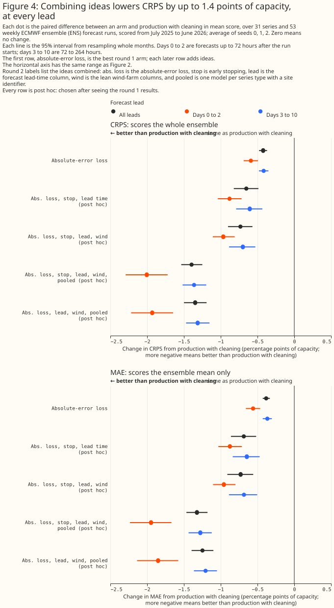
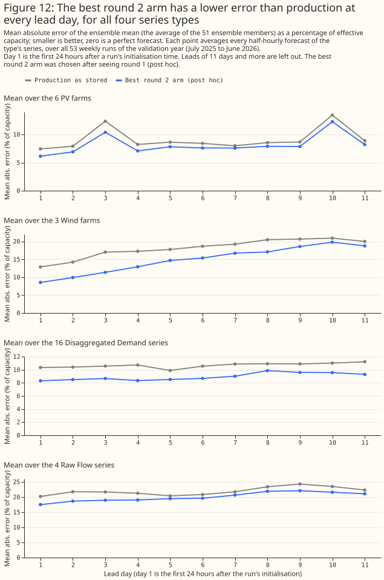

# Six cheap changes lowered the production XGBoost forecast's error at 31 NGED series, and rescaling its ensemble spread lowered its CRPS further

**Six changes to how the production XGBoost forecast is trained, taken together, lowered its CRPS
from 11.6% to 10.0% of capacity and its mean absolute error from 12.3% to 10.8% on the validation
year, at 31 series in NGED's trial area.** The six changes are the absolute-error objective, early
stopping, a forecast-lead-time column, leaner columns for wind farms, one XGBoost model per series
type with a site identifier, and dropping the first weeks of a new meter. Each change, tried on its
own, lowers the error with a month-resampled interval that excludes zero, although dropping a new
meter's first weeks changes only 2 series. Rescaling the spread of the 51 ensemble members by
factors learned from past outcomes lowers the CRPS by a further 1.3 to 1.9 points of capacity, but
the rescaled forecast still scores worse than the `manual_heuristic` baseline. Several ideas we
expected to help did not: removing power lags from solar and wind farms made them worse, and dropping
a series' first months, zeros, and spikes changed almost nothing. Everything on this page is
exploratory, and several ideas were chosen after the first results, so the page labels each result
"planned" or "post hoc". A second fitting seed, a third seed, and a backwards-in-time fold agree on
the direction of every headline result.

**Terms used on this page.**

- **Production forecast:** the point-valued XGBoost model in `conf/model/xgboost.yaml`, one XGBoost
  model per series, trained on the control member of ECMWF's 51-member ensemble (ENS) and run over
  every member. "Production" in a table means the study's refit of it. "Production with cleaning"
  adds the cleaning rule chosen in round 0.
- **Arm:** one copy of the production recipe with one named difference, such as a different
  objective. A combination arm has several differences.
- **Points:** percentage points of a series' effective capacity, its 99th percentile of absolute
  power. Differences are an arm's error minus a reference's error, so a negative difference means a
  lower error.
- **CRPS:** the fair continuous ranked probability score of the 51 members ([Ferro, 2014](https://doi.org/10.1002/qj.2270)), as
  `ml_core.metrics` computes it. MAE is the absolute error of the ensemble mean. Both are divided by
  the series' effective capacity before averaging.
- **Fold A:** the leaderboard fold. Training uses April 2024 to June 2025, and the 12 scored months
  run from July 2025 to June 2026. **Fold B:** the same 31 series, trained on July 2025 to June 2026
  and scored from April 2024 to June 2025.
- **Planned, post hoc:** a planned arm was in the plan approved before any fit. A post hoc arm or rule
  was added after earlier results, or after reading the training data, and its gain is biased upward
  by the choice.

> **How this page was made.** The research question came from a human. Everything else — the code
> behind every result, the analysis, the figures, and the text — was written by Claude, Anthropic's
> AI model (for this page, Claude Sonnet 5.5 and Claude Opus 5.5). Independent Claude reviewers
> checked the method, the numbers, and the prose adversarially. The study ran with one scientific
> review by Claude Opus 5.5 where the study skill asks for two, to save credits.

## Key findings

- **The production forecast scores worse than `manual_heuristic` on both metrics.** On the 53 sampled
  runs, the stored production forecast scores a CRPS of 11.8% of capacity and an MAE of 12.6%, against
  7.2% and 11.0% for `manual_heuristic`. The refit's 10% to 90% member band holds the outcome in 10.5% of
  half-hours on the 45 later runs, where an ideal band holds 80%. The narrow band is the largest single fault we found.
- **The best combination of six changes is 14% better on CRPS and 12.5% better on MAE than the
  refit of production, and 16% and 14% better than the stored production forecast.** Averaged over three fitting seeds, the combination scores a CRPS of 9.95%
  [9.41, 10.42] and an MAE of 10.77% [10.21, 11.28] on fold A, against 11.55% and 12.31% for the
  refit of production. The combination's MAE is now below `manual_heuristic`'s, though the intervals
  overlap. Its CRPS is not.
- **The absolute-error objective and early stopping are the two best single ideas that were
  planned.** The objective lowers CRPS by 0.42 points [−0.48, −0.37] and early stopping by 0.38
  points [−0.52, −0.24], against production with cleaning (fold A, three seeds).
- **Leaner columns for wind farms lower wind CRPS by 3.3 points, and the same cut hurts solar.** The
  wind gain was found after the first results (post hoc). Removing the power lags from solar and wind
  farms, which the maintainer expected to help, raised both errors.
- **One XGBoost model per series type, shown a site identifier, lowers CRPS by 0.82 points on fold A
  but its gain does not stack on fold B.** Without the identifier, the same pooling lowers CRPS by only
  0.26 points [−0.44, −0.06] (seed 0) and raises the error of raw-flow substations.
- **Rescaling the ensemble spread lowers CRPS by 1.9 points for production with cleaning and 1.3 to 1.4
  points for the best combination (post hoc).** Using only outcomes known at each run's start, the band's coverage rises
  from 10% to 49–60%. The rescaled forecast still scores worse than `manual_heuristic`.
- **Cleaning the training data matters for 2 of 31 series.** Dropping the 6 weeks after a new meter
  first reads live lowers CRPS by 0.30 points. Rules for zeros, spikes, solar dropouts, switching
  days, and commissioning ramps changed the CRPS by no more than 0.06 points, and none by a
  resolved amount in the right direction.

## Recommendations for the production forecast

**These are the changes to try first, in order of evidence and then effort.** "Effect" is the
paired difference in CRPS against production with cleaning on fold A (three seeds, 12 months), with
fold B (15 months) beside it. Each fold-B effect comes from one seed.

| Order | Change | Planned? | Effect on fold A, points of capacity | Effect on fold B | Effort |
|---|---|---|---|---|---|
| 1 | Train with `reg:absoluteerror` | planned | −0.42 [−0.48, −0.37], 12 of 12 months | −0.37 [−0.46, −0.28], 15 of 15 | One config line |
| 2 | Choose the tree count by early stopping on the last 6 training weeks, then refit | planned | −0.38 [−0.52, −0.24], 11 of 12 | −0.77 [−0.98, −0.55], 15 of 15 | Small change in the training loop |
| 3 | Show wind farms fewer columns (drop weekday, radiation, dew point, precipitation type, time of year) | post hoc | −0.32 [−0.38, −0.26], 12 of 12 (wind alone: −3.3) | −0.35 [−0.45, −0.25], 15 of 15 | One column list |
| 4 | Add the forecast lead time in hours as a column | planned | −0.05 [−0.08, −0.03], 10 of 12 | −0.08 [−0.11, −0.05], 15 of 15 | Small, and a small effect |
| 5 | Rescale each series' ensemble spread by a factor fitted on past outcomes | planned idea, post hoc form | −1.9 for production with cleaning, −1.3 to −1.4 for the best combination (CRPS only) | −1.9 and −1.3 | A post-processing step and a state file |
| 6 | Drop the 6 weeks after a meter first reads live from training | post hoc | −0.31 [−0.62, −0.06], 9 of 12 (2 series) | No effect by construction | A rule in the cleaning step |
| 7 | One booster per series type with a site identifier | post hoc | −0.82 [−0.96, −0.69], 12 of 12 | −0.51 [−0.81, −0.28], 15 of 15; adds nothing to the best combination | A new training layout |

**The five training and column changes together (objective, early stopping, lead time, wind columns, and pooling) lower CRPS by 1.40 points [−1.54, −1.25] against
production with cleaning, and by 1.60 points against the stored production configuration.** The
same combination without pooling lowers it by 0.73 points on fold A and by 1.23 points on fold B.
Fold B shows no gain from pooling on top of the other changes (−1.16 against −1.23), so the pooled
layout is the least certain of the seven.

**Production's `colsample_bytree` of 0.8 scored 0.10 points better than 1.0 on fold A and the same on
fold B.** Every contrast on this page uses 1.0, so that arms with different numbers of columns are
compared fairly. A production change should be tested at 0.8 before it ships, because the
combinations here were never fitted at 0.8.

## Introduction

**The production forecast is a first version, and the cheap ideas for improving it had not been
tried together.** [The XGBoost improvements page](../../roadmap/xgboost-improvements.md) lists them.
The maintainer's hunches were three: give solar and wind farms different columns from substations,
calibrate the probabilistic forecast, and pick a handful of other ideas. The study also tested
several ways of cleaning the training data and the architecture of the boosters in earlier studies
on this site.

**The question came from [issue #1150 (Study: quick wins for the production XGBoost
forecast)](https://github.com/openclimatefix/nged-substation-forecast/issues/1150), and the
constraints came with it.** The study changes no production code and uses only the production
system's data, which are ECMWF ENS weather forecasts and NGED power. It scores CRPS and MAE and
benchmarks every arm against production. The maintainer will re-implement the recommendations by
hand.

**This is a looser study than the study skill's default, and the page says what that means.**
The arms were tried in rounds. Round 0 compared ways of cleaning the training data. Round 1 tried
ideas one at a time. Round 2 combined the ideas that won. Round 3 repeated the key arms with two
more seeds and on a backwards-in-time fold. After each round, the next round's arms were chosen by
judgement. The plan named four planned contrasts: the chosen cleaning against no cleaning (P0), the round 2
combination against production (P1), the per-type physics columns for solar farms only (P2), and
spread calibration against the same forecast unrescaled (P3). Every other number is exploratory.
The tables mark each arm "planned" if the plan listed its idea and "post hoc" if it came later.

## Data and methods

**Fold A is the leaderboard fold, and every arm is scored on 53 ECMWF ENS runs started every 7 days
from 1 July 2025.** Each run forecasts out to about 15 days. Scores labelled all leads use every
lead to 351 hours, and the lead bands are days 0 to 2 (under 72 hours) and days 3 to 10 (72 to 263
hours). The 31 series are the 6 solar
farms, 3 wind farms, 16 disaggregated-demand substations, 4 raw-flow substations, 1 battery, and
1 biofuel generator in the production fold. The study did not submit to the leaderboard scorer, so
every score is the study's own, computed with `ml_core.metrics`'s fair CRPS. The stored production
forecast scores a CRPS of 6.33 MW on these runs, and the refit on the GPU scores 6.27 MW, 0.2%
below the CPU refit's 6.29 MW and 0.15% below the lowest stored retrain, which is slightly outside
the stored runs' range. The CPU refit is inside that range. Every arm here used the GPU.

**Every arm is the production recipe with one named difference.** Production fits one XGBoost
model per series, with 24 columns, 500 trees, learning rate 0.05, depth 6, row subsampling 0.8, and
squared error, on the control member's rows. All arms were fitted on the GPU. Round 0 arms differ
in which training half-hours are dropped. Round 1 arms differ in the columns shown, the objective,
the number of trees, or the training layout. Round 2 combines them with `arms.combine`, which
removes the union of the columns any part removes and adds the union of the columns any part adds.
The report prints every arm's columns, objective, and cleaning rule.

**Intervals resample whole validation months, with the same draw for every arm.** The 31 series
share their weather, so months are the units that vary independently. The page quotes the 95%
interval from 2,000 resamples, the number of months in which the arm beat its reference, and, in
the report, a t-interval over the monthly differences. A percentile interval from 12 months is too
narrow, so the months-better count matters.

**Three fitting seeds measure the noise of the fit, and it is small.** Across seeds the CRPS of any
arm varies by at most 0.04 points, against differences of 0.05 to 1.4 points. The seed changes row
subsampling only. Fold B was fitted with one seed for every arm, and two seeds for the two best
combinations.

**Fold B is a robustness check, not a second leaderboard.** It trains on the validation year and
scores the 15 months before the training window, with the same 31 series. Some demand meters did not
exist in the early months, so those months average over fewer series. The new-meter rule changes
nothing on fold B, and every cleaning contrast on fold B is zero by construction. Fold B shares
series and weather regimes with fold A, so agreement between them does not show that a result holds
at other series.

### Round 0: data cleaning

**A Claude Sonnet subagent explored the training window (April 2024 to June 2025) and reported
what looked wrong, and the plan had already named four rules.** The plan named the first-N-months,
isolated-zero, spike, and commissioning-ramp rules. The exploration added three more rules (new-meter
settling, solar and wind dropouts, and switching days), written after reading only the training
months. The findings were these. Two demand meters started in early 2025 and were noisy for about 6
weeks. Three demand series had switching steps of 30 to 37% that lasted days. One solar farm was
commissioned in stages over about 6 months. Five solar farms had single-series dropouts while their
peers produced. One demand series looked sign-reversed (MVA bounce), and one biofuel generator
changed from switching on and off to idling. Only the new-meter rule changed a score.
[Figure 5](#cleaning-the-training-data-changes-two-series-and-nothing-else) shows the rules tried.

## Results

### The production forecast scores worse than a manual heuristic, and six changes bring its MAE below the heuristic's

**Figure 1 ranks every arm on fold A, with the stored production forecast, `manual_heuristic`, and
climatology as reference lines.** The best round 2 arm scores a CRPS of 9.95% of capacity [9.41,
10.42], against 11.34% for production with cleaning. The best arm's MAE of 10.77% sits below
`manual_heuristic`'s 11.00%, but its CRPS does not approach the heuristic's 7.21%. Intervals for
absolute scores overlap because every arm swings with the weather from month to month. Figure 2 and
the later contrasts are paired, so they are sharper.

### Round 1: ideas on their own

**Two planned ideas help clearly, one helps a little, and four did not help.** The absolute-error
objective and early stopping each lowered CRPS by about 0.4 points. The lead-time column lowered it
by 0.05 points. Recency weights (half-life 120 days) and the holiday and ordinal-day columns for
demand series changed CRPS by +0.06 and +0.07 points with intervals that include zero. Removing the
power lags and weekday columns from solar and wind farms raised the error by 0.19 points, and
adding per-type physics columns to that left it 0.16 points above production with cleaning. A booster with `min_child_weight` 20, as
the earlier studies use, raised CRPS by 0.05 points. The numbers in this paragraph for recency
weights, the calendar columns, the lag removal, the physics columns, and `min_child_weight` are from
seed 0.

**The error falls most in wind farms, raw-flow substations, and solar farms, and the 16 demand
substations change least.** The objective and early stopping help wind and raw-flow most. The
pooled model with a site identifier lowers demand error most (−1.18 points) and does little for
solar and wind. The absolute-error objective also lowers demand error, by 0.15 points. Three wind
farms and four raw-flow series carry many of the gains, so a wind result rests on three farms.

**The result about lags differs from the same-hour-lag study, and the two studies do not conflict.**
That study found a same-hour lag did not change day-ahead MAE at 6 solar plants. This study removed
four lags (24, 48, 168, and 336 hours) and the weekday columns from solar and wind farms at all
leads, scored CRPS, and found solar CRPS 0.29 points worse [0.04, 0.54] and wind CRPS 1.38 points
worse [0.88, 1.90] (seed 0). The solar loss is concentrated in the first 3 days (+0.68 points).
Production's 24-hour lag is blanked at leads of 24 hours or more, so the loss at days 0 to 2 comes
mostly from the shorter leads, which that study did not cover.

### Round 2: combining the winners

**The ladder was chosen by judgement from the round 1 table, and each step helps on fold A. Every step except the pooled layout also helps on fold B.**
The absolute-error objective with early stopping lowers CRPS by 0.62 points. Adding the lead-time
column makes 0.65 points. Adding the wind-farm column cut makes 0.73 points. Adding the pooled
layout makes 1.40 points on fold A. The best arm without pooling reaches 1.23 points on fold B, where
pooling adds nothing. The lowering holds in both lead bands: 1.75 points at days 0 to 2 and 1.19 at
days 3 to 10 on fold B.

### Cleaning the training data changes two series and nothing else

**Only the new-meter rule changed a score, and only at 2 demand series.** The rule drops every
half-hour up to 6 weeks after a series first has 48 consecutive half-hours above 5% of its capacity.
It removes 4,747 training half-hours from 2 demand series, lowers the mean CRPS by 0.30 points
[−0.60, −0.07] (7 of 12 months), and leaves the other 29 series unchanged. The first-N-months
rules scored from −0.06 to +0.05 points with intervals that include zero. The first-6-months rule
removes a whole new series and could not be scored. The isolated-zero and spike rules removed solar
sunrise zeros and real battery dispatch, and slightly raised the error. The commissioning-ramp rule
removed 8,866 half-hours of one solar farm and raised the error by 0.02 points [0.01, 0.04]. We did
not test why. The rule for solar
dropouts, the rule for switching days, and the combination of all four scored −0.00, −0.06 and
−0.20 points with intervals that include zero.

**The rule's value is for series the system will meet in future.** Both series it helps began in early
2025, and production already trains on every half-hour from the first reading. A system that
onboards meters will meet more of them. We chose this rule as the cleaning for every later arm. It
was written after reading the training months (post hoc), and fold B cannot test it.

### Calibration: the ensemble spread is far too narrow

**The production ensemble's 10% to 90% band holds the outcome in about one half-hour in ten.** The
members differ only by the weather inputs, so their spread reflects the weather forecast's
uncertainty and not the XGBoost model's own error. We rescaled each series' members about their mean
by a factor from a fixed grid (0.6 to 12). Each run's factor is the one with the lowest CRPS for
that series on earlier runs, using only outcomes whose valid time precedes the run's initialisation
time. The first 8 weekly runs are dropped from both sides of the contrast. The mean, and so the MAE,
does not change.

**The rescaled forecast scores a CRPS 1.9 points lower for production with cleaning and 1.3 to 1.4
points lower for the best combination, with the same sign in all three seeds and on fold B.** On fold A,
CRPS falls from 11.60% to 9.71% for production with cleaning, and from 10.24% to 8.89% for the best
combination, on the 45 later runs. On fold B it falls from 11.95% to 10.00% and from 10.76% to 9.50%.
The 10% to 90% band holds 60% of outcomes for production and 49% for the best combination, still
under the 80% an ideal band holds. The rescaling is a stopgap. The largest factor in the grid (12) was chosen for about a third of the
series and runs of production, so a wider grid might lower the CRPS further. A residual-based predictive distribution is the fix we expect to work better.
**The rescaled forecast still scores worse than `manual_heuristic`.** On the same 45 later runs that baseline
scores 7.4%, against 8.9% for the rescaled best arm.

### Example forecasts

**Figures 7 to 12 show the forecasts themselves, for runs chosen by the actual power and not by the
forecast error.** Each series is the one ranked in the lower middle of its type by the CRPS of
production with cleaning. Each panel shows the ensemble mean of several arms against the measured power,
as a share of the series' capacity, for one run of the weekly sample. The solar and wind farms are
anonymous. The axes count days from the run's start and show no dates.

## What did not help

**These ideas were tried and are not recommended.** All numbers are fold A, seed 0, as CRPS
differences against production with cleaning.

- **Removing the power lags and weekday columns from solar and wind (planned):** +0.19 points
  [+0.14, +0.24]; the loss is largest at days 0 to 2.
- **Adding solar, wind, and heating physics columns to that (planned):** +0.16 points, which is
  0.03 points better than removing the lags alone.
- **Lean columns for solar farms (post hoc):** +0.29 points for solar [+0.12, +0.48].
- **Recency weights, half-life 120 days (planned):** +0.06 points [−0.04, +0.16].
- **Holiday and ordinal-day columns for demand (planned):** +0.07 points [−0.01, +0.14].
- **`min_child_weight` 20 (post hoc):** +0.05 points.
- **One booster per type without a site identifier (post hoc):** −0.26 points [−0.44, −0.06], a small
  gain that raises raw-flow error. A first version of this arm left the power lags in megawatts while
  scaling the target, and scored worse. The study discarded that version, and the page quotes the
  corrected one.
- **The first-N-months, isolated-zero, spike, commissioning-ramp, solar-dropout, and switching-day
  cleaning rules.**

## Ideas left for future research

**These are ideas the study did not test, or tested only in a limited form.**

- **A residual-based predictive distribution:** draw each member's value as the point forecast plus a
  sample of past residuals for the series, season, and lead. This should fix the band and be a
  proper calibration, unlike rescaling the weather ensemble's spread.
- **Training a point model on every member, or on the ensemble mean, so the model sees the spread.**
  The study did not fit an ensemble-mean arm.
- **Features from the ensemble itself:** member spread and quantiles.
- **Monotone constraints** on the weather inputs for solar and wind.
- **Pooling by type for solar and wind only,** since pooling helped wind and solar and hurt
  Raw Flow when it ran without a site identifier. Fold B did not confirm a gain on top of the other
  changes.
- **A blend with climatology at long leads,** which the lag study found gains 1.2 points at day 14.
- **Tuning depth, learning rate, and the number of trees,** which the study left at production's
  values.
- **The auto-research agent** planned in [issue #1038](https://github.com/openclimatefix/nged-substation-forecast/issues/1038)
  could take the cheap, repeatable arms here (each changes a configuration and is scored the same
  way) and search combinations without a human.

## Limitations

- **Neither fold is cut at ECMWF's ensemble upgrade of 12 November 2024,** so a change in the
  weather inputs sits inside both training windows.
- **The scope is 31 NGED series in the trial area, scored for one year and a backwards fold of 15
  months.** The 6 solar farms share a box 25 km across, and the 3 wind farms share their weather.
  A wind result rests on 3 farms.
- **The two folds are not independent.** Fold B uses the same series, and weather regimes recur.
- **Several ideas and every round 2 arm were chosen after the first results.** The gain of the
  winning arm on fold A is biased upward. Fold B repeats the direction, and the gains shrink only
  slightly: 1.16 to 1.23 points against 1.40.
- **The scores are not leaderboard scores.** The study did not submit to the scorer, and its 53-run
  sample is a subset of the leaderboard's runs.
- **Nothing was fitted at `colsample_bytree` 0.8 except the production arm.**
- **Calibration is evaluated for CRPS only,** on the later 45 of 53 runs, and the ensemble spread
  rescaling does not make the forecast a proper predictive distribution.
- **One demand series reads negative throughout and has a large error,** so the mean over series
  is sensitive to it.
- **The study did not check the MLflow configuration of the stored production run,** because none
  was registered.

## Data and code availability

**The scripts are in
[`studies/quick_wins/`](https://github.com/openclimatefix/nged-substation-forecast/tree/main/studies/quick_wins),
and the tests are in `packages/studies/tests/quick_wins/`.** Every table on this page is printed by
`report_summary.py` into `summary.md`. The input data are private. The commands that reproduce the
study are in the folder's README.

The production recipe's refit, the GPU fit time (about 40 seconds of training per arm and 40 seconds
of prediction and scoring), and the peak memory (about 7 GB, up to 8 GB) are in the study's logs.
