# Differentiable physics, part 1: which substations, rows, and dates the model can use

**The data lets the differentiable-physics series go ahead, with three changes.** Cut the leading
months at 13 of the 16 Primary substations, fix the lockdown window in advance, and count eligible
long-history MW sites at each tuning year's first day (5 at 2024-07-01, because D9 holds only 9.0
months then). Verdict: `helps`, exactly at the minimum of 5 eligible sites, so Phase A needs 4 of 5.
A sharper timestamp check, on the sunrise and sunset ramps of metered solar series, finds no
30-minute error on either side of the fix.

This experiment fits no model. It looks at the power records of 22 series (16 Primary substations,
four grid or bulk supply points, and two metered generators), at ERA5 temperature (the European
Centre for Medium-Range Weather Forecasts' fifth-generation reanalysis) and CAMS irradiance (the
Copernicus Atmosphere Monitoring Service), both estimates of past weather, and at 66
hand-filtered switching events. It decides which substations, rows, and dates the later parts can
use. A Primary substation is the transformer site that feeds a town or district. A MW Primary
reports net power in megawatts, and an MVA Primary reports apparent power in megavolt-amperes, so
only its dark rows (CAMS irradiance below 1 W/m²) show demand alone. A site-year is 17,532
half-hours. Power is shown as a percentage of each series' effective capacity.

## Figures

Figures 4, 12, and 13 carry the findings. Figures 1 and 2 show the raw data. The two
metered generators appear only in figure 9, as G-a and G-b, as aggregate statistics with no dates.

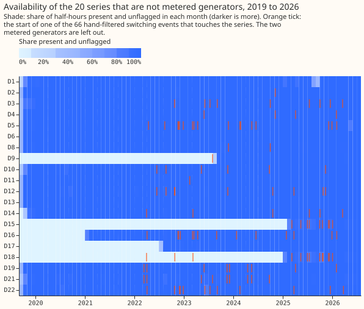

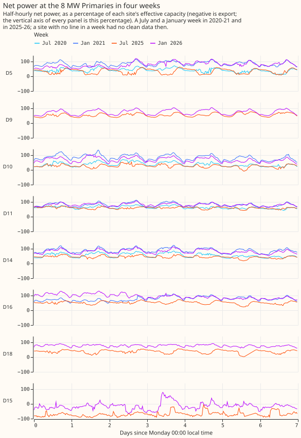

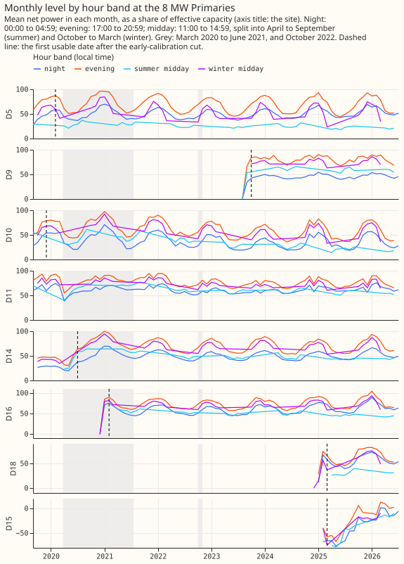

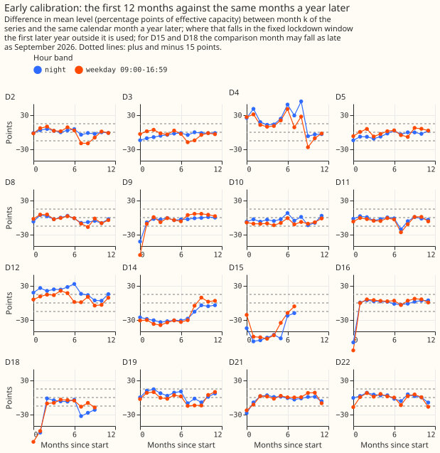

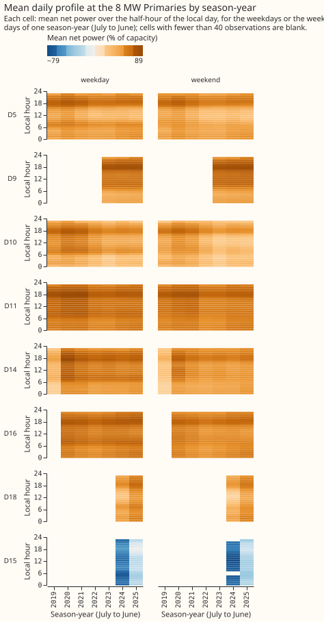

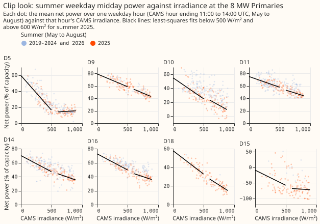

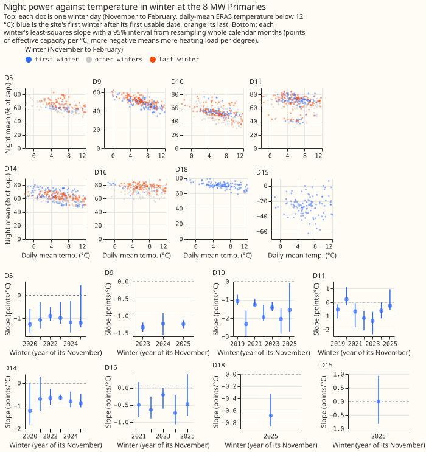

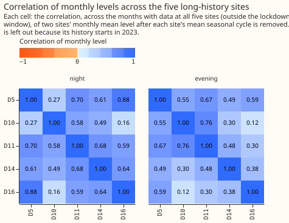

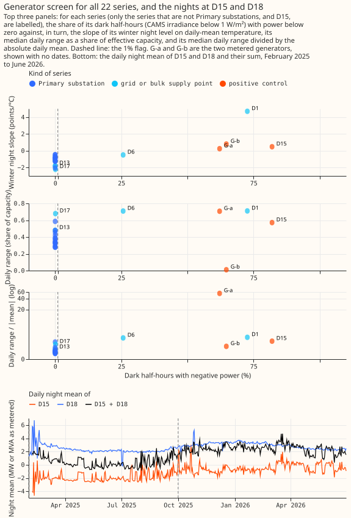

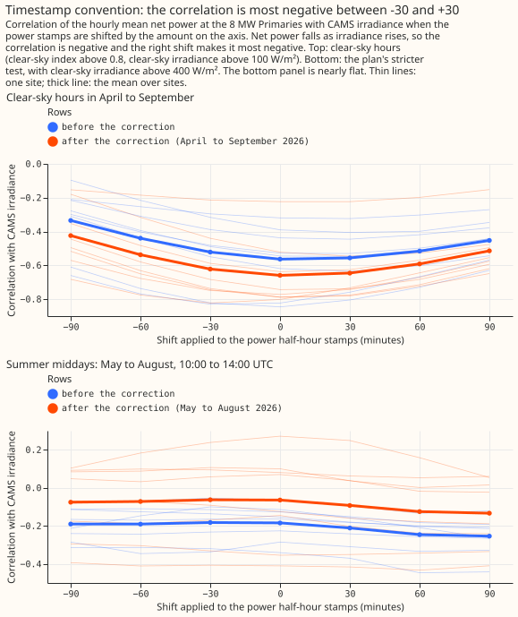

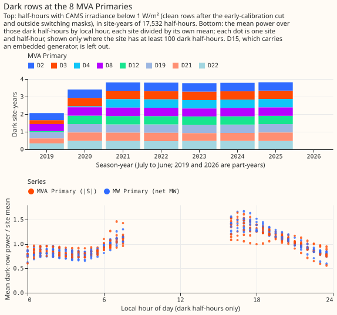

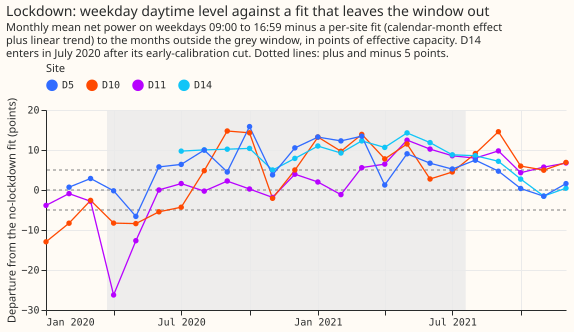

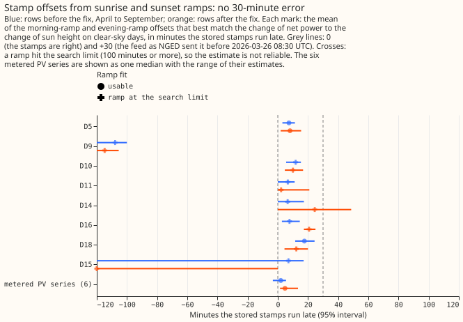

## Sites and dates

- **Roles** (`sites.parquet`): `mw_long` for D5, D9, D10, D11, D14, and D16; `mw_short` for D18;
  `generator_case` for D15; `mva_dark` for D2, D3, D4, D8, D12, D19, D21, and D22; `excluded` for
  D1, D6, D13, D17, G-a, and G-b.
- **First usable dates** come from the series design session's review of every series' start,
  which Part 1 may only move later: D4 2021-05-01, D14 2020-07-01, D12 2020-05-01, D5 2020-02-01,
  D3 2020-01-01, D10 and D21 2019-12-01, D22 2019-11-01, D19 2019-10-15, D16 2021-02-01, D9
  2023-10-01, D18 and D15 2025-03-01, and 2019-09-17 at D2, D8, and D11.
- **D12 keeps the rule's later date.** The review recommends no cut, and the 15-point rule cuts
  7.4 months (figure 4), so D12 starts 2020-05-01.
- **Months before a tuning year's first day** (2022-07-01, 2023-07-01, 2024-07-01, 2025-07-01):
  the six long-history sites hold 12 or more months before 2025-07-01 (D9 21.0). Five hold 12 or
  more before each of the other three days. D9 holds 9.0 months before 2024-07-01.
- **Dark site-years per MVA Primary:** 2.43 to 3.27 over all history, 2.34 to 2.68 with the
  lockdown window removed (20.1 in total), and 0.88 to 0.95 in 2023-07 to 2025-06, Part 3's
  training window. The share at 16:00 to 21:59 local time is 27.3%, 27.9%, and 27.2% in those
  three windows.
- **Row sets:** `dp_mw_v1` holds 508,341 half-hours and `dp_mva_dark_v1` holds 352,841 dark
  half-hours (`rows.parquet`; rows in the lockdown window or under a switching mask are flagged
  and left out of both).

## Decisions

- **Early-calibration rule.** The rule drops leading months while the night band (00:00 to 04:59)
  or the weekday daytime band (09:00 to 16:59) differs by more than 15 percentage points from the
  same month a year later. It cuts D14 9, D12 8, D15 8, D4 3, D18 2, and 1 month at D9, D16, D21,
  and D22 (figure 4).
- **Generator screen** (negative dark share above 1%, run after cuts and masks on MW series only).
  It flags D1 (73%), D6 (26%), D15 (82%), G-a (62%), and G-b (65%). It leaves the other 15
  Primaries unflagged, among them D18 (0% after its cut, 1.8% before it with 201 of 202 negative
  rows in January 2025), and the bulk supply points D13 (0%) and D17 (0.09%). The MVA Primaries go
  unscreened.
- **Timestamp.** The clear-sky-hours correlation with irradiance is most negative between 0 and
  +30 minutes (parabola vertex +10.6 minutes before the fix and +6.9 after), and the plan's
  summer-midday test is flat (about -0.18 and -0.06), so neither locates an offset; the follow-up
  below does.
- **Clip** (daytime power flattening above a ceiling): yes at D5 (4 of 7 summers) and D15 (2 of
  2), and no at the other six MW Primaries; D14 meets the rule in 1 of 6 summers.
- **Heating-slope drift** is not detectable. No long-history site has a last-minus-first winter
  difference whose 95% interval excludes zero (D9's runs from -0.06 to +0.26 points per °C). The
  test uses the interval of the difference, which is stricter than the plan's non-overlap test.
- **Lockdown window.** The series brief fixes it at 2020-03-23 to 2021-07-19. A window detected
  from the data would not work: in April 2020 D11 sits 26 percentage points below a no-lockdown
  fit and D10 7, but from August 2020 to September 2021 the four sites with 2019 history sit
  mostly 5 to 17 percentage points above it (figure 12). The fit leaves similar excursions in
  months it was fitted on, so the departures show a poor fit as much as drift.
- **Correlation of monthly levels** across D5, D10, D11, D14, and D16: the mean pairwise
  correlation is 0.56 for the night band (60 months) and 0.46 for the evening band (17:00 to
  20:59; 59 months), and the first principal component holds 66% and 58% of the variance (figure
  8).
- **Switching masks.** 28,543 half-hours on the full grid are masked on the 16 Primaries, 26,763
  of them in rows with data, the most at D5 (5,202) and the least at D2 (113). Each mask runs from
  24 hours before the onset to 24 hours after the end. The 66 events start in 2022-03, so no mask
  precedes then.

## Timestamp follow-up

- **Method.** On clear-sky days, the half-hour-to-half-hour change of net power while the sun is
  between -3 and 25 degrees above the horizon is matched to the change of a sun-height predictor
  shifted by a trial offset, from -120 to +120 minutes in 5-minute steps. The best offset comes
  from the smallest residual sum of squares, with a slope of the physically expected sign, and a
  95% interval comes from resampling whole days 1,000 times.
- **Orientation effect removed.** A fixed south-facing panel makes the morning ramp read late and
  the evening ramp early (the half-difference of the two is 40 to 70 minutes at the PV series). A
  stamp error moves both the same way, so the stamp offset is the mean of the morning and evening
  offsets.
- **Direction and amount of the ingest correction.** At the 6 metered PV series (aggregate only,
  no names, identifiers, or dates), the stored stamps before 2026-03-26 08:30 UTC run +0.9 minutes
  late (series from -0.2 to +2.9; intervals within -2.7 to +5.0). The feed as NGED sent it is 30
  minutes later than the stored stamps, so it reads about 31 minutes late, and the 30-minute
  correction is the right direction and size to within 3 minutes.
- **After the fix.** The PV series' median offset is +4.7 minutes (+1.5 to +13.3; intervals -5.3
  to +20.0) on April to 10 September 2026 (34 to 47 clear days each). The like-for-like April to
  September rows before the fix give +2.0 (-3.3 to +5.4), so the two sides do not differ.
- **MW Primaries.** Only D5 and D18 give a usable fit; at the other six a ramp hits the 100-minute
  search limit because demand ramps dominate. D5 gives +7.4 (3.1 to 11.3) minutes in April to
  September before the fix and +8.1 (1.9 to 15.5) after; D18 gives +17.6 (11.5 to 24.4) and +12.3
  (4.4 to 20.0). Both run 5 to 15 minutes above the PV series, which the demand ramps can explain,
  and neither is near 30.
- **Conclusion.** No 30-minute error is confirmed on either side. A residual of about 0 to +8
  minutes is possible and agrees with the correlation vertex, but the method cannot separate it
  from panel and horizon effects. It touches no Part 2 arm, because the CAMS and ERA5 joins work
  on the half-hour and hourly grid and are unchanged by a few minutes.
- **Limits.** The PV series lie in one 25 km by 23 km box, the after side holds under 50 clear
  days, and there is no known-answer check beyond the 30-minute sign test the correction supplies.

## Predictions

- **Held:** the six sites hold 12 months or more before 2025-07-01 and D18 fewer; about 27% of
  dark half-hours fall at 16:00 to 21:59; the screen flags D1, D6, D15, G-a, and G-b and none of
  the other 15 Primaries; heating-slope drift is not detectable; D14 and D15 are cut.
- **Failed:** the clear-sky-hours correlation peaks at zero per site at only 1 of 8 sites before
  the fix and 5 of 8 after (the ramp check below finds no offset beyond a few minutes); 13
  Primaries are cut, not 2; the MVA Primaries hold 2.43 to 3.27 dark site-years with the lockdown
  kept (24.3 in total), and 6 of 8 are below 3.2; D15's winter night slope is +0.48 points per °C,
  not within ±0.1; clip is at D5 and D15, not D5 only.
- **Superseded:** the lockdown prediction, now a fixed window.

## Data validation

- **Keys and values:** no duplicate `(series, time)` keys, no NaN power, no null irradiance or
  temperature to 2026-06-30, and no MVA value below zero.
- **Stuck runs of 12 or more identical half-hours, and zeros outside the `substation_zero` flag:**
  found only at the two metered generators.
- **Month-mean steps over 3 monthly standard deviations:** D11 (2020-04), D2, D4, D12, D18, D19,
  D21, and D6, a grid supply point whose monthly mean falls 218 MW in 2023-07.
- **Scarce days** (mean per long-history MW site): 3.8, 5.0, and 3.5 cold days (daily-mean
  temperature below 0 °C) in 2023-24, 2024-25, and 2025-26, and 12.0 in November 2022 to February
  2023. A full year holds 8 bank holidays, and the Christmas run (24 December to 1 January) holds
  9 days.

## Caveats

- ERA5 and CAMS estimates of past weather flatter the PV term (experiment 46).
- The switching masks and the early-calibration cuts are hindsight decisions: each cut compares
  months with a year later, and the masks come from labels written after the events.
- Four sites decide the lockdown figure, and D14 enters only from July 2020.
- The D9, D16, and D18 first-month cuts rest on very few readings.
- Every printed number is in `report.txt`.

## What the next experiment should answer

Part 2 should use the site list above and count eligible long-history sites at each tuning year's
first day, as the maintainer decided; this gives 5 eligible sites at 2024-07-01 (4 of 5 needed),
where counting at 2025-07-01 would give 6 (4 of 6). All 8 MVA Primaries clear the 0.5 dark site-year
entry rule in Part 3's window. The shared slow factor (design item D2) is worth keeping, given the
correlations above.

## Review triage

- **Accepted and fixed:** the switching mask now includes the onset half-hour and ends at
  `end_utc`; first usable dates follow the design session's review; `default_rows` leaves out the
  lockdown and masked rows (`in_pool` stays the pool membership); D15 and D17 no longer use data
  or cuts that conflict with the review; the generator tables and report no longer print dates,
  and figure 9 sets `aria=False`; Part 3's window is 2023-07 to 2025-06; the July 2026 half-hour
  no longer enters the monthly levels; the correlations and census use rows after the cuts (and,
  for the correlations, the masks); `rows.parquet` carries `early_cut`; `sites.parquet` carries
  the clip and generator flags; `decisions.json` carries the cut dates, screen flags, dark counts,
  and masks. - **Accepted as caveats:** the maintainer decided not to stop the series and to run
  the sharper timestamp check above, the summer-midday test is reported beside the clear-sky one,
  and the eligibility count is the maintainer's. - **Not changed:** the heating-drift test and the
  one-criterion generator screen differ from the plan, and both follow the series brief or are
  stricter.
